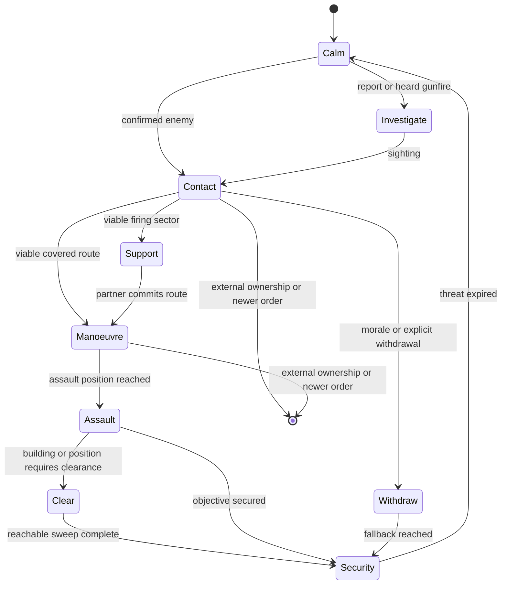

# CBE Cortex operations

> **Use this page when:** you need to understand or configure CBE's automatic
> group-level behaviour during contact, movement and recovery.

## Purpose and limits

Cortex is CBE's optional automatic-tactics layer. It augments native AI only
when an eligible non-player group has a useful combat opportunity. It is not a
replacement for authored mission orders, Zeus commands or another controller
that has claimed the same actors.

CBA is required and provides the configuration authority. ZEN is optional; native
Zeus orders work without it. Configure behaviour from **Options > Addon Options
> Combat Behaviour Enhancement (CBE)**, under **General**, **Infantry**, **Coordination**,
**Vehicles**, **Convoys**, **Aircraft**, and **Support and civilians**.

The CBA master setting **Enable Cortex automatic tactics** is on by default.
Each family also has its own gate. A setting marked **Live** is adopted by the
next owner-local update; a setting marked **Next operation** is guaranteed for
a new action without discarding a committed action halfway through.

## Ownership and interruption

One controller owns movement at a time. CBE creates a finite operation only
when it can own the affected action. The operation records an intent,
generation, owner locality, participants, route, physical progress and a
cancellation reason.

CBE immediately releases a conflicting operation when any of these occurs:

- a Zeus edit, move, waypoint, remote-control action or explicit native order;
- player control of the actor;
- a newer mission order;
- locality migration or an external controller marker;
- a lost target, impossible route, casualty collapse or safety failure.

Release removes only movement, postures, speed limits and state previously
owned by that operation. It does not restore an older formation, seat
assignment or waypoint over a newer external decision.

## Contact flow

A bounded owner-local engine danger FSM records immediate observations and
wakes the group's single shared decision job. A valid first event can start that
brain immediately instead of waiting for the periodic discovery sweep. The FSM
terminates after draining its short engine queue and does not add a per-unit
permanent movement loop or movement owner.

## Infantry actions

| Action | Expected behaviour | Completion or release |
| --- | --- | --- |
| Investigate | A suitable element checks an approximate reported or heard location while the group retains security. | Sighting, arrival, time limit, new order or loss of route. |
| Advance | Where numbers permit, a moving element makes short covered bounds while a partner covers. Fire remains native and may continue while moving. | Objective progress, contact change, no-progress recovery exhausted or handover. |
| Flank | Selects a distinct left/right corridor that progresses on the threat without crossing a friendly firing lane. | Side approach reached, target change, unsafe route or handover. |
| Assault | A manoeuvre element continues forward from its assault position while support holds only while its firing sector remains safe. A fresh known threat already too close for advance or flank enters this paired-element operation directly. | Position secured, target lost, casualty collapse, blocked route or handover. |
| Withdraw | A broken element selects a screened route away from the threat. Smoke is optional and never blocks movement. | Physical fallback, bounded incomplete result, newer order or handover. |
| Regroup | Separated survivors close only when they remain unreserved and the tactical situation allows it. | Cohesion, time limit, contact or handover. |

A grenade, smoke throw, straggler or individual recovery cannot freeze the rest
of an operation. CBE makes one local recovery attempt for a stalled actor;
then marks that actor unavailable and lets the capable element continue. It
never teleports, repairs, unflips or grants immunity as a recovery shortcut.

## Coordination and combined arms

Nearby friendly groups coordinate only when they share compatible intent,
threat knowledge and communication eligibility. The coordinator assigns
short-lived support and manoeuvre roles, offset rally areas and distinct
approach corridors. It rejects routes that cross a partner's firing lane.

A support opportunity adds to ordinary combat; it does not require a scheduled
assembly or override a valid authored order. Roles expire after no physical
progress, target change, casualty collapse, lost communication or external
handover. Vehicles and aircraft can support the same opportunity only when
their own capability and ownership checks pass.

## Buildings

Cortex building actions use a finite physical progression:

1. enumerate entrances, exits and reachable interior positions;
2. choose an entry with a viable approach and safe support sectors;
3. assign a limited entry element, interior lanes and exterior security;
4. record a room only after physical arrival in its position radius and floor;
5. retry a blocked position through another entrance, route or actor;
6. report exhausted positions as unreachable and finish `INCOMPLETE`, never as
   fabricated success.

**Clear** sweeps reachable interior positions then establishes security.
**Garrison** occupies defensible interior positions with exterior security. Walking is the default.
Mission scripts can explicitly request instant interior placement with
`[group soldier1, getPosATL house1, 40, createHashMapFromArray [["teleport",true]]] call CBE_fnc_CortexGarrison;`.
This option runs once on the group owner during a fresh order, using the same interior slot selection;
owner adoption and JIP do not replay it. Surplus actors still approach exterior security normally.
Players, remote-controlled/protected actors, movement reservations and native service tasks are excluded
from instant placement. `inPlace` and `teleport` cannot be combined. Instant placement is not evidence
of accessible interiors or physical CQB entry and must remain excluded from physical routing acceptance.
The executor option has offline checks only; fresh engine placement, repeat, casualty and migration
acceptance remains pending. The Garrison area module labels walking and instant placement distinctly; module controls are described below.
**Traverse** enters through one viable side and leaves through an actual exit
on the onward side. Casualties and stalls can rotate capable reserve actors into
the entry element without forcing a group merge.

## Vehicles and convoys

Convoy status broadcasts immediately when phase, task revision, spacing count or recovery count changes. Stable status refreshes at the first existing callback after ten seconds; vehicle control and local FSM completion keep their normal cadence.

General driving assistance is separate from registered convoy control. General
driving retains native waypoints and applies sparse speed/terrain observation
plus one bounded physical recovery. Convoys add an ordered vehicle column,
predecessor-trail spacing and contact/passenger policy.

Driving assistance requires a real authored waypoint. The implicit spawn waypoint does not admit it.
The recovery identity uses the shared full waypoint receipt: conditions, timeouts, synchronized
triggers/waypoints, script, attachment, house position, loiter parameters, speed, combat mode and
formation. Attached target motion retains object identity rather than resetting recovery on each
position update. A same-index edit resets recovery observation before another attempt. Every
speed or recovery write rechecks that the waypoint identity is still current. An initial refusal
clears an unapplied speed snapshot. This source guard has no fresh physical acceptance. Retests must
include condition/trigger edits during reverse recovery and a valid new route after the change.
Recovery refresh/reverse is limited to plain MOVE orders with no activation code, waypoint script,
timeout, attached target, waypoint synchronization or inactive trigger. This applies at every
distance, including far outside the native waiting envelope. Safety speed caps and native order
execution remain available; CBE does not evaluate authored code or bypass synchronization.
Distant scripted/timed/attached orders require physical retesting alongside ordinary recovery.

Only the vehicle currently carrying the group leader may refresh or reverse the shared native
route. Other group vehicles retain native formation movement and can still receive terrain speed
caps. Losing the leader role resets an existing recovery stage and its observation timer before
any reverse-speed cap is selected. Each command also checks current vehicle/group locality and the
actual driver/commander seat identities. This does not cancel an already-issued native movement
command by issuing a competing stop. Physical tests must cover formation waits, leader replacement
while recovering, seat changes during observation and subsequent valid leader recovery.

Ordinary driving now has a route-scoped owner-local operation FSM. Group decisions admit or
reuse it; the existing shared scheduler executes its cruise, deliberate-wait and recovery samples.
Epoch, current-brain identity and the authored route receipt fence callbacks. A newer route retires
old speed leases before fresh admission. Group release, disablement, Zeus/external takeover,
locality loss or loss of eligible vehicles ends the operation. Exhausted recovery retains a terminal
receipt for that exact order so discovery cannot restart the same attempts. A changed order or an
explicit group handback can admit fresh work.

A stationary native-ready vehicle within the completion radius plus 50 metres is treated
conservatively as waiting when its waypoint is HOLD, has an inactive synchronized trigger, a
positive timeout or a nontrivial condition. The condition is read as text and never executed by
CBE. The guard resets recovery observation while waiting; native waypoint processing still decides
when movement resumes. This envelope is a recovery guard, not proof of arrival, condition truth or
successful navigation. Terrain speed assistance remains separate from route recovery.

No new settings, dependencies or vehicle polling loops are added. The FSM queues one coalesced
sample every four seconds and yields to the existing tactical pause. It reports its semantic state
in `CBE_Driving_State`; this is observation, not physical acceptance. Predictive traffic, gate
execution, yielding and overtaking remain open work. Required physical retests include trigger,
condition and timeout waits near and far from the waypoint; same-order exhaustion; newer orders;
repeat use; disabled/re-enabled control; and owner migration. Audits are held, so these are unrun.

Ordinary recovery and tracked withdrawal now share a fresh rear-clearance observer. It samples
three positions across the real hull width at two body-relative heights, from the rear body edge.
Nearby actor footprints are projected into that corridor, so a long or angled vehicle can block a
reverse even when its centre sits outside it. More than 64 nearby actors refuses clearance rather
than dropping unexamined candidates. Each call returns the clearance reason, observation time and
ray count; it issues no movement or physics commands and retains no reusable clearance cache.

Ordinary recovery checks its eight-metre leg before the native command. Tracked withdrawal checks
its speed-dependent rear distance at each existing reverse step. The ordinary terrain/water guard
and tracked avenue/facing/deadline gates remain. Six sampled rays are not a complete navigation or
collision guarantee; native movement remains responsible for steering. No new settings or loops
are added. Physical wide-hull, angled-truck, pedestrian, wreck, low barrier, pitch/slope and dense
traffic cases remain unrun while audits are held. Convoy traffic prediction is separate open work.

Finite tactical movement acquisition now retires the ordinary driving FSM and its unchanged
speed leases before publishing the successor owner. Ordinary admission, queued execution and each
command reject an unexpired movement lease or a current tracked reverse. Late cleanup preserves
the successor's speed policy. Expired leases do not permanently exclude ordinary driving. This
handover has no new controls; withdrawal/standoff/jink/orientation and post-expiry resumption need
physical testing, including an acquisition while an ordinary callback is pending.

Convoys measure forward predecessor gaps to remain single-file; they do not use
formation wedge offsets. Target spacing uses a size-aware minimum/maximum band
with damped speed correction. A meaningful stop is classified as ordered,
contact, spacing, obstruction, immobile or external owner and is reported once
to Zeus. Player-made roadblocks remain valid stops.

Operating crews stay aboard. Cargo dismounts and remounts only while their
convoy task generation still owns them; a newer Zeus task wins immediately.

## Diagnostics

The diagnostic view exposes the active intent, owner, generation, phase,
participants, route, physical-progress age, recovery state, external owner,
scheduler latency, skipped work, replans and final cancellation reason. Use it
to diagnose a real action before changing a setting.

Static validation confirms interfaces, bounded contracts and configuration
parity. It does not prove pathfinding, combat, building entry, convoy recovery
or air combat. Those require the packaged, damage-enabled audit batches.

## Related documentation

- [Settings reference](SETTINGS-REFERENCE.md)
- [Capability registry](CAPABILITY-REGISTRY.md)
- [Addon lifecycle](ADDON-LIFECYCLE.md)
- [Modding and operations](MODDING-AND-OPERATIONS.md)

<!-- CBE-WIKI-NAV -->
---
[Wiki home](https://github.com/AdamWaldie/CombatBehaviourEnhancement/wiki/Home) · [Installation and setup](../README.md) · [Capability registry](CAPABILITY-REGISTRY.md)

### Passenger remount cooperation

With `CBE_AIPass_Vehicles_Enable` and `CBE_AIPass_VehicleRemount_Enable` enabled,
calm restoration retains an owned passenger boarding episode for up to 60 seconds.
Only passengers dismounted by CBE are eligible. A new assigned vehicle, Zeus control,
contact or a conflicting operation retires or suspends the old intent rather than
sending passengers back to their original transport.

The passenger group owner requests a stop from the original vehicle owner while an
eligible passenger remains within 100 metres. Each request lasts at most 30 seconds
and never exceeds the boarding deadline. The vehicle owner checks the public boarding
record, group ownership, side, original vehicle, live settings and current assignment.
It considers at most eight passenger records. Crew contact or an active vehicle movement
lease rejects a boarding stop. Actual boarding uses native assignment and get-in orders;
no passenger is moved directly into a seat.

A completed boarding, reassignment or expired request releases the stop. CBE restores
the prior forced speed only when the current forced speed still equals its own stop.
This uses existing group scheduler callbacks and adds no persistent worker. The record
is public for owner migration; a new owner validates live eligibility before commanding.
Stationary separate-group boarding and replacement-vehicle boarding have physical audit
evidence. Moving-vehicle boarding, interruption and migration of this handshake remain
queued for physical acceptance.

### Interior access recovery priority

A stalled interior access checkpoint uses its existing finite recovery before the controller searches alternate exterior entrances. This prevents entrance cycling from retaining the failed checkpoint while repeatedly resetting its local retry clock. Recovery can retire the checkpoint once and request the assigned room directly. Room retry counts, physical visit requirements, operation ownership and the hard deadline remain intact. No new settings or dependencies are introduced. Static gates passed for this change; fresh packaged normal and headless-client physical acceptance remains outstanding.

A failed partner alternative selection can be reconsidered when another actor physically visits an additional point. The public episode receipt retains the search count and coverage across ownership replay. Each partner receives at most three searches over at most 24 visited points per search, and one successful movement alternative. Unchanged coverage cannot trigger another search. This does not renew progress deadlines or recovery budgets. Fresh physical validation remains required.

### Exterior exit observation

Spare clearance participants receive a finite exit-approach observation assignment. The selector considers at most sixteen real exits and prefers exits with fewer current reserve assignments, then nearer exits. It validates exterior standing space, separation from other actors and destinations, entrance clearance, slope, dry ground and an unobstructed observation line. A supported exposed point is permitted when protective cover is unavailable, and that distinction is retained in the stage receipt. Each actor physically reaches its position before a single watch command is issued. Movement retains existing three-search and sixty-second approach limits, operation authority, native-task yielding and casualty promotion. The published stage journal retains the observation point and selected exit across replay. No new setting is introduced. This provides local exit observation only; complete isolation, changing sectors and larger supporting-squad coordination remain outstanding. Fresh normal/headless physical and runtime-performance validation is required. Audit launches remain paused at the user's request.

The twelve-person clearance audit now independently checks every living exterior participant for stage arrival, actual heading within 75 degrees of its watch point and an unobstructed eye-to-watch line during the original observation window. A rejected hold or assignment receipt cannot pass. These checks are prepared but have not run while audits are paused.

### Driving release and commander takeover

Standalone driving release now checks player, remote-control and specialist ownership of the effective commander as well as the driver. An old CBE forced-speed lease is discarded without restoring its captured cap when the commander has taken over, including a commander outside the driver's group. Waypoints, native routes and newer speed settings remain unchanged. This closes a source-level cleanup gap. Physical takeover and locality validation remain pending while audits are paused.

When an exterior observer replaces an unavailable clearing worker, promotion retires its matching clearance-generation/owner-epoch exit watch before interior movement. Native tasks and newer authority still gate the command. The historical stage receipt remains diagnostic and no longer reserves a destination once the actor joins the clearing team. Physical casualty-promotion acceptance remains pending.

Locality replay accepts both legacy and extended exterior-stage records. An approaching actor must retain its exact native endpoint; a stopped actor must physically remain at its stage. Exit watching installs once per local owner epoch after physical and authority checks, without a new movement request. Promotion clears that local installation record. Separate headless physical replay remains unvalidated.

### Unconfirmed support reservation

A PENDING/UNCERTAIN shot retains its original mission deadline. At expiry, the scheduling brain ends with UNCERTAINTY_PARKED while the unresolved native-command registry/token remains reserved. No shot is retried and the battery is not declared available. A qualified firing event or owner rejection wakes the exact mission for finite settlement only. A repeat-safe server EntityDeleted handler removes the matching deleted battery record without scanning other missions, and subsystem stop removes the handler. This changes no support settings. Delayed event, deletion, repeated callback and normal/headless physical acceptance remain required; audits are paused. Native-command cancellation is not claimed.

Observer artillery requests preserve the dispatch result: a synchronous server rejection takes the short retry cooldown. A headless owner can confirm forwarding only, not server acceptance or physical firing. This correction still requires live rejection/retry validation.

Clearance cancellation retires the matching exterior observation generation and owner epoch. It clears watching only for a free stopped actor under unchanged CBE authority; replacement tasks and external control receive no watch command. Live cancellation and handover validation remains pending.

Automatic clearance settlement also retires matching exterior watch metadata, including incomplete outcomes. Historical arrival records remain evidence rather than live assignments; newer generation/epoch watch records survive. Physical repeated-use validation is pending.

Mounted danger responses apply the same captive, surrender and handcuff exclusions as sustained vehicle targeting before requesting targeted suppression, orientation or mortar support. Targetless impact safety remains separate. Physical surrender-transition validation is pending.

Mounted danger suppression aims at the effective commander's native believed contact position rather than reading the enemy's exact aim position after lost sight. Missing estimates reject suppression; existing ownership, protected-target and friendly-fire gates remain. Physical occluded-contact validation is pending.

Fixed-wing ingress pass detection uses ASL displacement with world velocity, preserving a shared vertical origin across terrain cells. This corrects the forward/behind geometry test; physical terrain approach validation remains pending.

Combined-arms reservation expiry preserves a matching terminal manoeuvre/refusal result instead of replacing it with EXPIRED. Active dispatched/applied roles still expire and release their role records. Physical result persistence remains pending.

Combined-arms discovery deduplicates candidate groups through a request-local keyed set while preserving discovery order and dispatch-time admission checks. It removes repeated linear membership scans; total discovery/ranking work still needs budgeting and measured runtime acceptance.

Combined-arms ranking retains the asset found during discovery and uses a unique rank tie-breaker. Dispatch rechecks live asset and commander/driver group ownership instead of repeating the full crew scan. Invalidated assets are refused; candidate population and runtime budget remain unvalidated.

Combined-arms primary server and owner admission both reject captive, surrendering and handcuffed targets before reservation or action. Air fallback expiry preserves matching terminal results while active dispatch/application still expires. Live target-state transition and fallback-result validation remain pending.

CQB casualty replacement selects the nearest currently eligible reserve to the surviving buddy, or to the building when no buddy is available. It preserves original survivor movement, participation evidence and finite deadlines; selection adds no geometry probes. Physical reinforcement flow remains pending.

Garrison arrival and failed-route termination restore the previous approach speed only while CBE's applied cap remains unchanged and movement authority is retained. Failed destinations no longer retain the approach cap; newer forced-speed values survive. Physical inaccessible-position handback remains pending.

Clearance exterior geometry uses the shared read-only BuildingExteriorCandidate helper. It preserves footprint, exit clearance, standing support, observation and separation thresholds. Operation-owned selection, retries, movement, arrival and watch leases remain separate. Garrison surplus integration and physical validation are pending.

Combined-arms primary server admission, owner application and air fallback reject work while the local Smart AI Pass is inactive or paused. Delayed contact delivery cannot reserve or dispatch new support during pause/stop. Physical pause-transition validation is pending.

Reinforcement discovery and coordinated-assault server admission require the pass to be running as well as enabled and unpaused. Delayed messages after stop cannot create or extend support reservations. Cleanup and acknowledgement handlers remain available to retire existing work. Live stop-transition validation is pending.

Clearance admission orders intact eligible buddy pairs before roster remainder, then applies the existing concurrency capacity. This read-only selection publishes no new pair receipt on refusal. Odd capacity can still leave a singleton; the eight-worker limit remains. Physical pair-continuity validation is pending.

Live air-contact intercept refresh uses a combat-effective local native knower's believed position and successive-sample motion instead of exact unseen target position/velocity. Witness changes reset motion; correction jumps are bounded. Missing estimates end the finite run honestly. Initial plan selection and full sensor/radar freshness remain separate outstanding work; physical crossing/lost-contact validation is pending.

Initial air-contact plan geometry and altitude use a local native knower's believed position. Initial motion is zero until live refresh has successive samples; no exact unseen velocity supplies the startup lead. Missing estimates refuse the plan. Surface plan perception and complete sensor freshness remain outstanding; physical interception is unvalidated.

## Settings and behaviour modules

CBA owns addon settings, feature switches and tuning. Zeus/ZEN modules issue scoped behaviour
orders to explicitly selected groups and destinations or areas. Dialog parameters describe the
requested task, such as its destination or radius; they do not duplicate CBA configuration.
The ordinary-driving enable/release/inspect modules were withdrawn because they crossed this
boundary. Ordinary driving remains automatic under the existing CBA gates and native waypoint
orders. The convoy module remains a convoy task entry point. Future building, support and optional
navigation-corridor modules must use their real production task executor and retain owner authority,
interruption and cleanup. No replacement behaviour module is claimed complete here.

## Garrison behaviour module

Native Zeus lists **Combat Behaviour Enhancement (CBE) > Garrison area**. Place it on an AI soldier in the intended
squad; it tasks that squad around the module position. Without ZEN it uses walking and a 50 m
radius. With optional ZEN it opens the same task dialog as the **Garrison area** custom module.
The ZEN dialog explicitly selects a squad, area radius (15–150 m, default 50) and placement
(walk by default or instant interior placement), and **Prefer higher positions** (default on).
Turning height preference off distributes positions randomly while retaining roofed-first priority.
Sorting happens once at admission; published assignments and vacancy refill retain that selection
through owner migration. The script option is `sortByHeight` (Boolean, default true).
Neither mode establishes physical accessibility. Its group list is capped at 128 initial groups;
placing it on a soldier includes that squad even outside the initial list. Dropping the ZEN
module on a building or empty ground uses that position as the area centre, not an automatically
selected squad. The native module requires a soldier attachment and refuses an absent target.

These are per-task parameters, not addon settings. CBA still owns feature enablement. Enabled
Cortex must be ready on the current owner; players, excluded squads and other controllers remain
subject to the existing executor gates. The server authenticates remote requesters as assigned
curators, takes reply identity from the network sender, validates named task parameters and routes
the order to the current owner. Remote requests cannot change addon configuration or artillery
role registrations through this path. At most 64 owner acknowledgements can be pending, each for
12 seconds. Reaching that limit refuses another request rather than queuing unbounded work.

The owner rejects repeated/older task serials and changed native waypoint receipts before
altering the squad's orders. Receipt comparison covers waypoint count/index, position, type,
description, speed, behaviour, combat mode, formation, completion radius, authored conditions/
statements, timeouts and synchronized trigger identities. Conditions/statements are read but never
evaluated or executed by the receipt. A separate Zeus receipt compares the hold token, waypoint
control flag and control kind before the task may clear an older hold. Newer control refuses the
delayed task. Natural trigger activation is not treated as a new authored order. A settings/feature refusal preserves existing order state.
A notification reports owner acceptance or refusal; acceptance is not physical occupation.
Task commands are not replayed to JIP; existing garrison assignments support owner adoption.
Instant placement only occurs on fresh admission. It does not replay on migration or discovery.

The selected task uses the existing interior assignments, exterior security, casualty/morale break,
stuck-route deadlines and transform invalidation. Existing release/new-task/Zeus handover paths
still apply; this module adds no per-frame controller or world scan. Source-level and offline
validation are available; native and ZEN dialog interaction, spoof rejection, duplicate/delayed
requests, terrain/placed/modded buildings, placement, real walking, casualties, repeated tasks,
release, JIP, HC migration and measured performance all remain pending live acceptance.

## Ordinary driving traffic following

The owner-local driving FSM now observes same-direction vehicles ahead before applying its
ordinary speed cap. It projects the other vehicle's eight hull corners into the current vehicle's
body frame, checks lateral and vertical overlap, and uses actual forward velocity and hull-to-hull
gap rather than centre distance alone. The desired gap combines six metres and 1.8 seconds of
predecessor travel; a continuous correction adjusts the cap instead of alternating between fixed
start/stop bands. A second cap estimates available closing distance after allowing four seconds
for cruise sampling. Nominal deceleration is 4 m/s² divided by a mass factor from 1 to 2.5;
heavier vehicles therefore approach a slower predecessor more cautiously. The quadratic distance
model limits speed relative to the predecessor's currently observed forward velocity. It does not
predict a predecessor's future braking. A short closing-distance reaction can request zero speed.
These are provisional policy assumptions, not measured braking guarantees for every vehicle class.
The four-second allowance does not bound actual scheduler latency, particularly under load.

The observer processes at most 64 candidates from a single speed-dependent query capped at
250 m; dense sets request a congestion hold. Engine query cost itself is not bounded by that
processing cap. It installs no handlers, physics helpers or movement controller. Terrain, saved
mission speed and traffic caps combine by taking the minimum. Registered convoys retain their
own controller and do not acquire this ordinary driving lease.

A CBE-owned traffic zero remains eligible for observation and can resume when the queue clears.
A sampled traffic constraint suppresses route-refresh/reverse recovery and refreshes the stall
observation; clearing traffic therefore starts a fresh progress interval. The FSM's TrafficFollowing
phase requests another coalesced callback in one second; normal cruise remains four seconds.
These are shared scheduler requests, not deadline guarantees under load. A reverse leg uses its
existing rear clearance path rather than a forward following constraint. Cleanup clears observations
and restores an unchanged owned cap using the existing ownership checks. Unmarked external writes
of exactly the same forced-speed value cannot be distinguished by value comparison alone.

Crossing/oncoming priority, overtaking, obstacle/gate geometry, deterministic jam arbitration,
measured vehicle-specific braking and registered-convoy integration remain incomplete. Congestion
never becomes permission to ignore traffic after a timer. Native pathfinding still owns steering.
The straight body corridor can constrain unrelated same-direction vehicles on curved roads; native
routing and future path-aware prediction need physical testing before this is accepted. Offline
checks cannot establish safe headway, smoother motion, recovery, repeat behaviour, HC migration or
the 5% median/10% p95 performance budget. All remain pending live acceptance while audits are held.

## Mixed-convoy low-speed pacing

Follower smoothing no longer switches off when a predecessor drops below 2 km/h. Inside the
spacing tolerance band, spare longitudinal room permits the existing gradual cap reduction even
through a brief tracked-vehicle speed dip. The result remains bounded by the raw predecessor-speed
closing-distance cap on the same callback. At the lower gap boundary a stationary predecessor
still produces zero; reversing predecessors, retained path limits, pedestrian safety and ordered
halts retain immediate priority. No minimum forward speed bypasses these limits and no new
controller, scan, or setting is introduced. This removes a source-level pacing discontinuity;
it does not establish smoother actual movement or safe braking. Mixed tracked/wheeled step-off,
brief/permanent stops, compressed spacing, restart, turns, reversing, convoy authority and measured
performance require fresh live acceptance when audits resume.

The prepared normal-owner vehicles audit includes a stopped tracked predecessor and ordinary truck follower. It requires physical approach, sustained separated hold, absence of queue-induced recovery, actual departure/resume, a repeated stop/resume and disabled observation cleanup. No controller callback, relocation or successful state is injected. This fixture has not been run; collision/damage/gap sampling is not a universal collision guarantee. HC migration, road curves, crossing and dense congestion need separate variants.

## Garrison vacancy refill

After the arrival job settles, the existing group scheduler can refill one vacant interior post.
Living assignments, including unconscious soldiers, retain their reservations. An available new
reinforcement without an assignment is preferred by distance; an exterior defender may move only
when another capable held defender covers the same building exit. Sole exit coverage is preserved.
Player/specialist actors, active movement reservations, native movement/service tasks and failed
routes are excluded. The task roster distinguishes newly joined reinforcements from original
actors released to a newer native task; completion of that task does not permit silently reclaiming
them. Refill also waits for local garrison adoption to complete. Selection processes at most 64 group members and 64 stored interior candidates.
Moved/deleted buildings cannot supply a slot. The casualty break fraction still prevents refill of
a broken group. Vacancy selection does not mean that the selected position is physically reachable.

The replacement walks through the existing garrison approach/arrival path even if the initial
order used instant placement. Reapplication creates a new owner-local generation and a 90-second
approach window only after the previous job settled. Failed actors retain their failures; pending
old routes cannot renew the deadline this way. Adoption marks progression pending before its
job runs. Full release clears refill/pending metadata. Existing held actors are reapplied through
the shared executor; possible movement churn, coverage geometry, actual casualty replacement,
failed/blocked destinations, repeat promotion, late casualties, Zeus handover, owner migration and
performance still require physical acceptance. This source implementation is not an accepted
reinforcement feature and does not claim reserves from other squads.

Garrison refill now requires both the promoted exterior actor and its remaining duplicate observer to be physically at their posts (within 2 m and 0.75 m vertically) with an actual local PATH hold. A published role/hold flag alone is insufficient. Reapplication preserves already arrived, locally held defenders without reenabling PATH or issuing another stop; a new owner still installs its own hold. Dynamic visibility/cover changes, casualty flow and actual movement stability remain unverified.

## Aircraft egress over uneven terrain

Air attack departure now compares world velocity against an ASL displacement from the retained
last target position. The previous comparison subtracted ATL heights from different terrain cells;
that can invert the direction test when a plane climbs over elevated ground. Retaining the target
position in ASL also keeps departure meaningful after its object disappears. The existing physical
travel thresholds, finite egress deadline, native flight controller and forward-weapon alignment
checks remain. No new scan, reveal, sensor capability or scripted turn is added. Surface and air
intercept departure on uneven terrain, target deletion, climbing/descending exits and real weapon
release remain pending physical acceptance. Broader native route receipts, detection reliability,
turning/energy limits and intercept geometry still need further review and live evidence.

## Aircraft authored-route replacement

Air attack admission and active callbacks now use the same authored-route receipt. It includes
position/type/name/description, completion radius, condition/activation text, timeouts, speed,
behaviour/combat/formation, waypoint script, object/vehicle attachment identities, synchronized
triggers/waypoints, house position and loiter parameters. The receipt reads text without executing
it. Natural current-waypoint progression is excluded. CBE's named temporary attack leg is also
excluded so its own phase changes do not look like an authored replacement. For an attached
waypoint, the object identity replaces its moving world position in the receipt.

A changed receipt uses the existing AUTHORED_ROUTE_CHANGED handback, which removes CBE's owned
leg without restoring an old route or issuing a competing resume order. This adds fixed metadata
reads per authored waypoint, proportional to route size, at the existing active callback cadence;
there is no new world scan or worker. Long-route cost and same-index/attachment changes need
live validation. This does not yet prove detection of every possible edit to CBE's own leg.

The existing DESTROY association uses waypointAttachVehicle experimentally. The engine documents
that command for GETIN transport association and cautions that other waypoint types may not work:
[waypointAttachVehicle documentation](https://community.bistudio.com/wiki/waypointAttachVehicle).
Native attack association, detection/radar, roll-in, true weapon release and finite egress remain
unverified across aircraft classes. A registered target or plan cannot pass those physical cases.

## Defend area behaviour module

Native Zeus and optional ZEN expose **Combat Behaviour Enhancement (CBE) > Defend area**. The native module requires
an attached AI soldier, identifying its squad and centre; without ZEN it requests a 60 m line facing
that soldier's current direction. With ZEN, or from the custom module, the task dialog explicitly
selects a squad, compass facing (0–360 degrees) and line width (15–150 m, default 60). The same
128-initial-group selector limit as garrison applies; an attached squad is included explicitly.
No nearby group is guessed. These controls issue a defence task, not addon configuration.

The server authenticates the requesting curator, validates/clamps width and normalizes facing,
then uses the existing current-owner preflight and acknowledgement. `width` is the named task key;
older trusted calls using `radius` for defence width retain a legacy named-key fallback.
CBA owns enablement. The existing defence executor allocates cover-aware line posts and a rear
reserve, handles commitment/break conditions, publishes owner-adoptable assignments and releases
on newer orders. Walking is used; this module does not advertise an unimplemented teleport option.
No extra controller or polling loop is introduced. Script equivalent:
`[group soldier1, getMarkerPos "ridge", 90, 60] call CBE_fnc_CortexDefend;`.

Native/optional dialog selection, actual width/facing, physical occupation and reserve commitment,
replacement of garrison, refusal with preservation of previous state, release, JIP/HC migration,
terrain coverage and measured performance remain pending live acceptance. Registration and owner
acceptance are not proof of a working defensive line. Audits remain held.

Defend now plans its complete line and reserve layout before releasing the prior task. It refuses non-finite inputs, groups over 64 admitted actors, wet/steep slots or positions less than 1 m apart, then rechecks group ownership/eligibility before cleanup and assignment writes. Open dry positions can remain valid when no cover is found; this does not claim ballistic protection or native path accessibility. Cover selection now receives the actual group so per-group feature exclusions apply. Invalid-layout preservation and terrain/cover/path behaviour remain pending physical acceptance.

Garrison admission plans candidates before releasing the previous task. Nonfinite task inputs, an empty valid position list or a planning budget above 64 buildings/512 reported positions/64 admitted actors refuse the replacement. Module radius remains 15–150 m; direct script radii remain positive finite values subject to the same planning budget. Duplicate positions within 1 m in three dimensions and water positions are excluded. The search runs once, with at most 512 roof queries; it does not establish native path accessibility or ballistic protection. Modded inaccessible destinations still require observed movement and bounded route failure, never instant success. Existing runtime cases and performance measurements remain pending.

Garrison casualty refill and initial arrival now share the same read-only occupation predicate. Promoting duplicate exterior observers requires both to be physically at their posts and able to observe the assigned exit through current VIEW geometry and terrain. Nearby soldiers behind obstructions no longer count as retained exit coverage. This retains the existing finite group scheduler and performs geometry only after matching exterior role/building/exit and held-post gates. Runtime casualty, obstruction, ownership and performance acceptance remain pending.

Initial clearance partner recovery no longer commits its provisional lead-room fallback into the shared support-target cache. That previously bypassed the distinct support-point planner later in the same callback. Initial support candidates must be 2.5–8 m from the lead anchor on the nearby floor band with clear geometry (at most 24 candidates checked); where no candidate exists, the existing shared-anchor fallback and finite recovery remain. This fixes an execution-order defect, not proof of coherent physical entry or route accessibility. Pair movement and constrained single-room models remain pending live acceptance.

Clearance entry handoff, initial partner floor selection, exit checkpoint selection and exit-access arrival now compare ASL elevation consistently with the room-visit collector. Heights relative to different terrain cells can disagree on a common floor or accidentally match different floors. Native doMove destinations remain ATL, and the existing 0.75/1.5 m tolerances are retained. Uneven-terrain buildings and paired physical entry/exit still require live verification.

Explicit fragmentation throws now check the selected magazine ammo at admission and again at queued release. Protected soldiers and the thrower must be outside `max(12, 4 * indirectHitRange)` metres of the requested impact point; malformed or negative radius data refuses the attempt. The existing 8–40 m throw envelope remains, so large blast radii may make a carried grenade unsuitable. This follows the engine indirect-damage envelope, not a complete projectile scatter, secondary explosion or scripted fragmentation model. Physical throw and friendly-safety acceptance remain pending. Engine reference: [Arma 3 Damage Description](https://community.bistudio.com/wiki/Arma_3_Damage_Description).

Artillery smoke classification now validates submunition trees before accepting a smoke leaf. Explosive indirect damage, mixed/invalid payload entries and unknown leaf simulations are rejected; an AI smoke-usage flag alone is insufficient. Each uncached profile permits four payload levels, at most 16 children per node and 64 config checks total; actual available rounds remain live queries. Carrier direct-hit damage is rejected while direct smoke leaf collision damage is not treated as HE. This does not prove observed smoke delivery or resolve earlier request-admission failures. Physical ammunition variants and performance remain pending.

Battery-group artillery-smoke enablement is now checked during candidate selection and explicit admission, server mission continuation and the current owner’s final firing boundary. Disabling smoke prevents later queued smoke commands without substituting HE. A native command already issued remains uncertain until its firing evidence resolves; disabling a feature does not cancel a shell in flight or justify retrying it. Live disable-between-dispatch-and-release, battery overrides and HC migration cases remain pending.

Smoke submunition parsing accepts a single class, a bounded class list or the engine’s alternating class/probability array. Weighted arrays require complete pairs, valid class strings, finite nonnegative weights and at least one positive weight. Every branch is classified, including zero-weight branches; a mixed HE tree is never accepted by dropping its entries. The 16-child/64-check/four-level limits remain. Weighted mod ammunition needs in-engine delivery verification. Format reference: [Bohemia weapon config guidelines](https://community.bistudio.com/wiki/Arma_3%3A_Weapon_Config_Guidelines).

Convoy closing-speed caps now use the same provisional mass-adjusted braking model as ordinary driving: 4 s reaction allowance and deceleration `4 / massFactor` m/s², with massFactor clamped to 1–2.5. The relative-speed solution is converted to km/h before applying the convoy cap. Predecessor speed comes from forward model-space velocity, so lateral motion does not count as column progress. Compression/reverse/path limits still override smoothing. These assumptions are not measured braking guarantees; mixed tracked/wheeled step-off, turns, emergency lead braking and performance remain unverified.

Air attack now records the full metadata of its own named waypoint after each authorized leg write and compares it before later writes. An edited or deleted leg ends the lease as `OWNED_ROUTE_CHANGED`; an edited leg retains its native contents and loses only the CBE name. Cleanup does not recall the previous route. Moving attached targets compare object identity rather than transient position. Actual Zeus edits, deletion, attachments, native engine transitions and HC migration remain pending physical acceptance.

Air cleanup repeats the owned-waypoint receipt check even when early Zeus/external cancellation occurs before normal route comparison. Changed leg contents are preserved regardless of the original cancellation reason, and old target cleanup/resume is suppressed. Deleted legs are not recreated. Live early-cancellation and edited-leg handover remain unverified.

## Clear building behaviour module

Optional ZEN lists **Combat Behaviour Enhancement (CBE) > Clear building**. Its dialog selects the exact AI squad and house; it searches up to 128 building candidates within 150 m and 128 initial groups, explicitly including an attached house or soldier’s squad. Labels show name, distance and reported positions. Reported positions are not accessibility or hostile-room safety evidence. Acceptance uses authenticated named CLEAR dispatch, owner preflight and the existing physical CQB executor. At least two capable soldiers must be on foot. No teleport, forced completion or global setting change is exposed. This is a ZEN task; no standalone native module is added without a suitable group/building selector. Dialog selection, owner acknowledgement, pair entry/sweep/exit, replacement/refusal, cleanup and repeat/HC/JIP remain physically unverified.

Clearance admission rejects absent/destroyed targets, malformed target coordinates and models reporting more than 512 positions before replacing existing work. Position geometry queries use finite 3D arrays with duplicate points under 0.5 m excluded; only target-owned roofed points enter clearance. Fresh executor refusal codes now reach the CLEAR owner acknowledgement instead of the generic passenger message. These checks do not infer path access, teleport actors or certify rooms safe. Invalid-target preservation and modded topology still need physical verification.

A new clearance may admit physically arrived, still-owned garrison post holders despite CBE’s PATH hold. MOVE permission, current owner application, active assignment, CBE hold marker, physical post validation and existing actor/task/ownership filters remain required. The garrison-to-clear release restores owned state without issuing JOIN; ordinary garrison release still recalls by default. This prevents a predecessor’s recall from being mistaken for a protected foreign task. Actual repeated garrison/clear transitions and HC handover remain unverified.

Building admission duplicate checks now use a shared private 3D spatial index in ASL coordinates. Each candidate checks 27 neighboring cells with exact Euclidean separation, preserving vertical floors and boundary cases; it does not approximate duplicates by cell identity. Each cell allows at most eight admitted points and the grid at most 512 cells. Existing 1 m garrison and 0.5 m clearance separations remain. This replaces growing prior-position scans, without adding world queries or public state. Engine overhead and the full performance budget remain unmeasured.

Convoy lead retries and early-final-waypoint recovery now inspect authored gate semantics. Conditions other than plain true, activation statements, waypoint scripts, timeouts and inactive synchronized triggers prevent recovery replay. No authored code is evaluated. Final-route recovery compares a full metadata receipt; changed same-index lead receipts reset retry progress and are rechecked before doMove. The receipt helper can read one engine waypoint index, avoiding full-route metadata reads for these checks. Gated routes, same-index edits and HC continuation remain physically unverified; per-convoy metadata overhead remains unmeasured.

Convoy recovery, restart and straight-leg follower extension now exclude implicit waypoint zero. Native deletion reindexes remaining waypoints; the aircraft cleanup comment now reflects that documented behaviour rather than claiming persistent index gaps. Lead restart no longer issues doFollow to the leader itself or to the vehicle’s movement operator; only a subordinate sharing the lead vehicle receives that recall. Real HALT/resume, operator/driver arrangements and route deletion remain pending physical verification. Engine reference: [currentWaypoint](https://community.bistudio.com/wiki/currentWaypoint), [deleteWaypoint](https://community.bistudio.com/wiki/deleteWaypoint).

Rear clearance projects all eight corners of each candidate actor hull into the reversing
vehicle frame, checking width, length and vertical overlap with 0.3 m padding. This replaces
the fixed centre-height approximation. Existing 64-candidate and six-ray limits remain;
slopes, stacked roads, tall vehicles and actual reverse execution require physical validation.

Ordinary driving and convoy leads now share a read-only road look-ahead: up to eight road
nodes or 70 m, with at most sixteen connections evaluated at a node and cycle detection.
Turns above 25/45/70 degrees cap speed at 35/25/18 km/h; junctions cap at 30 km/h;
grades above 0.12/0.2 cap at 25/18 km/h. Existing lower mission, terrain and traffic caps
remain authoritative. Dense connection sets cap at 15 km/h. Convoys retain their three-second
cache; ordinary vehicles use their existing sample cadence. No route, waypoint or world
object is changed. Heading-based branch selection does not prove which branch native AI
will take. Junction false constraints, bends, slopes, actual speed and overhead remain unverified.

Clearance resume now validates the episode deadline and unchanged native order before
releasing existing garrison, defence or autonomous tasks. A matching final common-admission
eligibility check also precedes handoff. The new clear records native order state after
its authorized cleanup, so removal of CBE waypoints is not mistaken for a later mission edit.
Late operation-start refusal retains its existing cancellation handling; this is not a
universal transaction guarantee. Expired/changed resumes and successful handoff need live retesting.

CQB and authenticated Zeus task admission now use the same full current-waypoint metadata
snapshot as driving: scripts, attachment identities, synchronized waypoints, house positions,
loiter settings and existing native fields all participate. The compact count/no-order sentinel
is retained. Attached target motion is not a replacement order; changing the attachment is.
This closes same-index edit gaps in delayed owner dispatch, clearance continuation and held
post-clear state. It reads current-node metadata only, without running authored code or adding
world scans. Same-index edits, moving attachments, JIP/HC and overhead remain physically unverified.

Natural building contact now identifies the house and checks its bounds/roof using the stored
native believed position, rather than reading the hostile's live transform after knowledge was
sampled. It accepts only finite three-coordinate beliefs with nonnegative finite age and keeps
the existing five-second freshness and three-contact geometry limits. This prevents unseen enemy
movement from selecting a different house through live position reads. Belief inside a roofed
house is not proof the enemy remains there. Threat-prioritized interior routing is still missing;
physical contact/entry, lost sight, false beliefs and HC continuity remain unverified.

Natural building contact passes its believed position and original server-clock observation time
into clearance. Finite, building-contained hints no older than five seconds may seed the first
point on the matching floor near that belief. Lower floors still precede upper floors; after the
one-time seed, nearest-neighbour progression continues. All room visits remain physical. The
snapshot/timestamp is retained in the durable order and progress updates; owner adoption cannot
refresh it, and stale hints revert to ordinary routing. No unseen target position is polled.
This is initial route prioritization, not dynamic enemy tracking or proven topology. Threat-floor flow, stale beliefs, inaccessible points, casualties and HC remain unverified.

Door opening retains the three-metre actor interaction range, floor check and live lock guard.
It now checks geometry from the actor's eye to the door trigger, at most four eligible doors
per call. No obstruction is accepted except a hit on that building within the final 0.5 m,
allowing the closed leaf itself to hide its trigger while rejecting earlier walls or objects.
The generation/actor takeover guard is checked again before opening. Modded trigger offsets,
closed leaves, adjacent rooms, locks and actual animation timing require physical retesting;
recognizing a door does not prove access, entry or successful clearance.

Door requests also honour the building-wide bis_disabled_Door flag as well as indexed locks,
rechecking both at the animation boundary. Clearance's initial access check uses the same
combined lock rule; a physically open recognized entry remains passable. No lock flag is
changed. Global/indexed lock combinations and open-but-locked entrances need live validation.

The four-query door-visibility budget rotates through recognized entries on later callbacks.
A local per-building cursor advances past each tested door, preventing earlier obstructed
entries from permanently hiding a usable later entry. It carries no movement authority and
needs no network/JIP replay. Empty door sets refuse before indexing; the 64-definition cap remains.
Dense multi-door approach and multiple-owner fairness remain physically unverified.

Exterior-post validation rejects nonfinite/non-numeric coordinate triples and malformed observer
lanes before geometry queries. Input work is capped at 64 exits, 128 reserved positions and 64
observer lanes, matching the bounded proposal path. Diagnostic refusals report inputs=false.
This protects CQB security, egress and garrison replanning from malformed data; it does not prove
post accessibility, full building isolation or stable physical positioning.

Clearance route setup snapshots absolute node heights once (up to 512 conversions plus one
belief conversion). Remaining-node floor searches reuse that local snapshot instead of repeating
terrain-frame conversions at every route step. Retired-index construction is also performed once.
The nearest-neighbour search itself remains quadratic and bounded by admission; no engine frame
or total addon overhead claim follows from this reduction. Physical profiling remains outstanding.

Ordinary following explicitly includes destroyed LandVehicle entities in its existing nearby
scan using the Arma 2.18 area query, and no longer discards their hulls on alive status. Empty
live vehicles were already included. Existing heading, projected hull/height, 64-candidate and
250 m limits remain. Destruction is not evidence of free space. This does not discover every
static/classless wreck or create a route around a blockage; angled obstacles, jam resolution,
physical braking and dense wreck scenes remain pending. No extra scan or controller is added.

Rear-clearance actor discovery also uses the dead-inclusive area query. Destroyed vehicle
entities participate in full-hull overlap before the independent geometry rays, so sparse
rays are not their only guard. Dead infantry do not count as live actor occupancy; solid
obstruction checks still apply. Both ordinary recovery and tracked withdrawal consume this
shared observer. Classless/static wrecks still depend on geometry; actual wrecked hulls,
slopes and reverse execution require physical validation. Existing 64-candidate limits remain.

Rear discovery splits live infantry from dead-inclusive vehicle entities into two local-envelope
queries, avoiding corpse density in the person occupancy budget. Combined hull processing remains
capped at 64; the extra query occurs at reverse admission, not through another polling loop.

Authenticated task dispatch now stamps a server-clock admission deadline matching its 12-second
acknowledgement window. The owner rejects missing, malformed, nonfinite or expired deadlines
before consuming task serials or changing Zeus/task control. A packet delayed beyond a reported
timeout cannot start the task later. This is admission expiry, not the lifetime of an accepted
operation. The internal door executor also refuses direct non-server network calls while retaining
local/server-dispatched actor, generation and proximity checks. Delayed delivery, HC migration and
real notification/control timing remain physically unverified.

Ordinary route recovery preserves native planning time: a new or newly progressing order gets at least 20 seconds without progress before the first refresh. That refresh gets 30 seconds before admission of the bounded six-second rear leg, and the final authored-route retry gets 60 seconds before exhaustion. Scheduler delay may extend observation; it does not shorten these windows. A full waypoint-identity change, follower-role change or actual route progress resets the relevant observation state. Traffic and intentional waits retain their existing recovery suppression. These are provisional finite windows, not proof that a native route must finish planning within them; long routes and repeated new-order replacement require physical retesting. No waypoint is recreated and no teleport, repair or velocity push is used.

During an actually issued six-second recovery rear leg, the same finite driving operation requests one-second safety samples. It rechecks the rear hull corridor for actors, wrecks and solid geometry, and its pedestrian check uses rear intent even while the vehicle is stationary. A new blockage requests zero through the existing speed lease and does not extend the reverse deadline. At expiry, observation switches to the forward retry corridor before the existing route-recovery admission checks. An initially rejected rear leg is not marked as issued. This adds at most the rear observer's two native queries, 64 hull candidates and six geometry rays per active sample; native braking, stopped reverse restart, new obstacles, deadline return and frame-time cost require live validation.

If combat or recovery enablement prevents the forward retry when an owned rear leg expires, its existing speed lease requests a hold rather than letting the rear command continue indefinitely. A subsequently admissible retry, new authored order or controller handover resolves that hold; it is not reported as completed movement.

CQB casualty promotion protects established exit observers. A reserve whose post is ARRIVED can join an assault pair only when another eligible local reserve holds the same exit, remains within 2 m/0.75 m of its post, has the current generation/owner watch lease, and passes a fresh terrain/VIEW observation check. Approaching observers and role labels do not supply replacement coverage. Uncommitted reserves remain eligible. Each callback examines at most sixteen reserve candidates and spends at most one additional promotion VIEW ray. Candidate order rotates across callbacks so one blocked confirmation cannot permanently starve later candidates. If no safe replacement is confirmed, the casualty slot waits within the existing finite episode deadline. Promoted actors are removed from the live reserve pool, so later slots cannot count them as continuing cover. This preserves existing coverage only; it does not establish isolation of every exit or cross-squad reinforcement. Casualty, occlusion, simultaneous-loss and HC flow remain physically unverified.

Natural building-contact admission retains its four-person strength requirement and now validates that minimum against the clearance executor's actual eligible roster. Unconscious, captive, hidden, simulation-disabled, reserved, externally controlled and native-task actors cannot satisfy it. New tasks exclude hidden or simulation-disabled actors. An existing matching task resume preserves its owned roster during dormancy; runtime command and visitation checks still reject dormant actors. CBE does not unhide or enable simulation on those actors. The preliminary count uses the common combat-effectiveness predicate, while the executor applies its full movement/task checks before any prior task is released. An insufficient roster reports `INSUFFICIENT_ELIGIBLE_ACTORS`. Failed executor admission uses the existing eight-second natural-contact retry cooldown, avoiding repeated geometry work while actors remain protected. Direct script options may request an integer `minimumActors` from 1 to 16. The default remains 1 for existing explicit calls and resumes, preserving their prior behaviour. This is an admission invariant, not evidence that a four-person group can physically clear every building or provide complete isolation. Casualty-reduced natural contacts, task-protected actors and subsequent valid admission need live testing.

During clearance egress, an individual MOVE whose destination differs from CBE's recorded request takes precedence even if the group waypoint is unchanged. That actor is excluded from arrival holds and exit retries, and the unfinished exit remains an incomplete result. Terminal cleanup preserves the newer destination. This handover requires physical testing with individual orders during egress.

After shared room coverage, an actor needing further physical interior participation prefers an unoccupied, unreserved visited destination before applying same-floor and distance preferences. A free point on another floor therefore outranks an occupied same-floor point. This reuses the existing eight-actor reservation snapshot and twenty-four-point candidate bound. If every candidate is occupied, the waiter does not issue another movement request or consume a failed-target attempt. One completed CBE-held worker may yield to a free, previously visited point on the same floor, 2–8 m away, provided no unfinished worker needs that point. Selection inspects at most eight participants and twenty-four points and spends at most one ray from the existing shared geometry budget per callback. Each worker can receive one such yield per original building/transform/deadline episode; a public receipt retains that budget through owner adoption. Actual movement and arrival remain required, exterior security actors are excluded, and no operation deadline is renewed. Cases with no suitable interior space still require staged exterior yielding; this path remains physically unverified.

Individual physical room visits now survive a matching owner resume. Receipts bind the actor to its group, building transform, original hard deadline and fresh-task token; each stored room index must still match the exact native position and shared cleared set. A fresh task resets the token, so earlier clearance cannot supply participation for a repeat. Adoption restores historical entry/visit evidence only, without movement or current-arrival credit. Publications are coalesced to once per changed actor per callback, with eight actors and 512 visited nodes per actor as hard bounds. Network cost and HC migration behaviour remain unmeasured; this does not establish clearance acceptance.

Clearance exit admission also checks individual replacement movement orders before issuing the first exit leg. A diverted soldier is excluded from exit movement and terminal holds; the interrupted consolidation remains a failure, not successful physical egress. This uses the existing bounded worker roster and needs an in-engine transition-boundary retest.

When a clearing lane exhausts its room queue, workers with the required individual physical visits hold their actual position once rather than returning to formation around the leader. Active native movement and unfinished partners remain eligible to progress. The hold participates in the bounded interior-yield mechanism; it is not an exterior security assignment or completed egress. No additional scan or timer is added. Cohesion and doorway flow still require live retesting.

A completed worker blocking the remaining follow-through can now yield outside when no nearby free visited interior point exists. Selection uses the same bounded exterior planner as final egress: up to four proposals at four entrances, preserving live security posts, viewing lanes and earlier exit destinations. One worker is considered per callback; each worker consumes at most one yield attempt in the original episode. This relieves congestion after shared room coverage and supplements doorway observation after arrival; it does not establish complete perimeter isolation.

Early exits retain their native movement request and a fixed 45-second server-clock deadline. The existing building callback observes physical arrival, opens eligible nearby doors and stops an owned failed leg at expiry; it adds no scheduler. Room assignment and final egress do not reissue these legs. Final egress reuses the distinct destinations and real arrival receipts. New individual orders or unavailable actors retire the early exit and retain a failure. A public episode-bound journal supports owner migration only for the matching native destination or a physical stopped arrival; migration does not issue movement or renew the deadline. Full door/stair flow, failed exit recovery, casualty interaction and HC performance require physical validation; no new live audit has run.

Early-exit recovery observes actual displacement, so a moving stair or corridor detour is retained even when straight-line distance increases. Eight seconds without a one-metre displacement permits the shared operation recovery attempt, if still available. Retry consumption is journalled across ownership changes; neither recovery nor renewed local motion observation extends the original 45-second exit deadline. Hidden, unavailable or newly tasked actors receive no recovery command. This remains unverified in-game.

Terminal clearance cleanup releases unchanged speed and stance leases for diverted soldiers while preserving their replacement movement. The post-clear hold records only soldiers this terminal step actually stopped; diverted, unavailable and service actors cannot acquire a later formation recall through that record. Early-exit journal rows are retained in terminal route evidence and removed from active replay state on finish or explicit release. Lifecycle, repeat-task and handover behaviour still need physical validation.

Physically arrived early-exit workers now observe the doorway selected by the exterior planner while teammates finish inside. Existing observers and early-exit assignments contribute to entrance load and reserved viewing lanes, so subsequent selections prefer less-covered exits and avoid obstructing those lines. Early-exit observation adds at most one rotating actual-eye visibility check per building callback, at most once per actor every two seconds, alongside the existing reserve-observer check; it gates watch installation; sustained obstruction retires only the matching watch. Owner adoption retains entry/watch intent but requires a fresh local visibility check. This supports doorway isolation; complete perimeter security and combat effectiveness remain unverified.

Ordinary driving and convoy safety now observe recognised gate/barrier collision geometry across the vehicle body width before applying their existing speed cap. Nine straight or at most twenty-seven turning GEOM rays across lower, middle and upper hull heights inspect at most four hits each over a nominal braking horizon capped at 600 m. The stationary-obstacle envelope retains six metres of room and four seconds of observation reaction, with a provisional mass-adjusted deceleration. A gate constraint uses the existing traffic-wait path, so stopped approach does not trigger a reverse or route refresh into the gate. The normal driving and convoy driving-assist feature gates control this observation; no additional settings, scheduler or speed writer is introduced.

Gate animation, destruction and elapsed time never grant passage: only the current ray result removes this particular constraint. Recognition uses gate/barrier class or model naming, including common legacy conventions. No recognised hit is not proof of a clear road; unknown models, terrain, other objects and curved approaches remain native navigation concerns. This is an approach-safety foundation. Canonical-source opening and lock validation are described below; directional passage arbitration remains unfinished; opt-in finite closure is described below and remains physically unverified. Nominal braking, long-ray cost, moved/damaged gates and normal/HC physical behaviour remain unverified while audits are held.

Recognised gates with canonical `Door_N_sound_source` definitions (N 1..8) can now receive an opening request when the vehicle is within twelve metres of observed gate geometry and travelling no faster than 8 km/h. The current owner sends a named request bound to its driver and commander, with at most one delivery retry after five seconds. Public pending state retains the original delivery deadline/count through ownership transfer; it grants no movement or opening authority. A context-matching server acknowledgement suppresses further requests. Server authority independently verifies the sender, driver/commander, feature, route or convoy revision, expiry, gate transform, current forward geometry and all recognised lock flags before using the globally effective animation command. Already-open or moving sources are not restarted. No action statements are evaluated.

Requests are finite: the server remembers one gate/transform attempt per vehicle's current route/revision, up to sixteen gates per route. A gate-wide twelve-second receipt coalesces simultaneous openings. The geometry cap remains authoritative throughout; a request, animation phase or timeout never permits driving through an obstruction. Failed opening attempts retain their original budget. A matching lock release or completed passage cycle can admit only its separately bounded retry. Initial source phases are retained; the default-off passage observer described below may restore only the leaves CBE opened. Unknown animation conventions, shared directional passage arbitration and full physical/network/performance acceptance remain unfinished. The native animation state is visible to JIP; requests themselves are never replayed.

Gate delivery acknowledgements bind the group, authored route, convoy revision, gate and transform. Failed, unsupported and locked outcomes are acknowledged too, so a stopped vehicle cannot generate permanent request traffic. Duplicate delivery returns the recorded result before geometry or configuration scans. A missing acknowledgement ends as a request timeout after two deliveries; an expired opening window remains a diagnostic refusal, never a passability receipt.

Convoy fixed follower paths now carry a revision/owner-epoch/driver/operator/native-command receipt created at the path write. Release retires a matching path with an explicit driver stop before native handback; `unitReady` is not used as proof that a scripted path ended. Retained successor vehicles, service actors and newer native destinations are preserved. Mounted crews are not recalled toward an on-foot leader. A stopped path can resume only a plain current MOVE through its effective commander; scripts, waits, attachments and synchronization remain native. Waypoints and disabled AI features are never reconstructed or enabled. Path receipts record ownership, not physical travel. Release, mounted commander swaps, driver changes, HC transfer and subsequent native route movement remain unverified in-game.

Road grade observation now uses the engine’s ASL road endpoints, including slope within a single road piece, instead of road-object origin heights. The shared ordinary-driving/convoy observer keeps bridge/deck elevation and falls back to a conservative cap when a recognised bridge lacks usable endpoint data. It performs at most nine metadata reads over the existing eight-transition road walk, with no new world scan or scheduler. Bridge width is not inferred from this metadata, and the result does not certify a crossing. Elevated-road behaviour, malformed mod roads and runtime overhead remain unverified.

### Navigation corridors (partial execution; physical acceptance pending)

Trusted server code can register an existing Logic with `[corridorLogic,[25,5,15]] call CBE_fnc_DrivingCorridorRegister` (half-length and half-width in metres, task speed in km/h); empty dimensions remove it. Registration is bounded to 32 areas, identical definitions retain their revision, and JIP receives passive definitions only. Remote registration requires an assigned curator and an explicit editable CBE corridor area. Native Zeus and optional ZEN expose the Navigation corridor behaviour task; addon enablement remains in CBA.

`[truck1,corridorLogic,corridorLogic getVariable ["CBE_DrivingCorridor_Task",[]],1] call CBE_fnc_DrivingCorridorGeometry` proposes an elevated path on the local vehicle owner. It checks hull width and solid support at up to 20 stations, with at most 231 rays. Missing support, excessive slopes and sampled body obstructions reject the proposal. It does not substitute terrain beneath an unsupported deck or claim water capability. Sampling is not continuous swept-volume proof. The ordinary driving FSM now consumes these proposals through finite CORRIDOR_APPROACH and CORRIDOR_CROSS states in its existing callback. Entry/exit extensions account for full hull length so the tail can clear the far plane. Oversized hulls needing more than 30 m extension refuse. Only the ordinary leader vehicle or registered convoy lead with enabled AI steering is eligible. A separate effective commander and driver must both remain local, in the owning group/vehicle, capable, task-free and outside player/remote/specialist control. The authored order must be a plain, ungated MOVE. Vehicle and destination must lie beyond opposite ends, the entry must be within 400 m, and the detour must fit a bounded distance allowance. A newer individual MOVE is preserved.

The approach gets 120 seconds. Actual entry proximity, elevation and heading authorize one fixed-path command; crossing gets half-length plus 45 seconds, bounded by the original episode deadline. The owner must observe entry past the near plane in order; lateral hull departure while crossing aborts. All eight hull corners must physically pass the far plane by five metres, with actual position near the exit at its elevation. Native readiness, a command acknowledgement or elapsed time cannot pass. Traffic/pedestrian/gate constraints keep their existing speed writer and suppress ordinary recovery during corridor work. One-second sampling uses the existing scheduler. Approach support is native-planned; the proposed crossing is sampled, not a continuous volume guarantee.

Public route/seat/command/area receipts permit owner adoption without replaying movement or extending deadlines. Changed area transforms/revisions, deletion, timeout and release retire work; native handback requires the exact owned command and unchanged route. Newer native/Zeus/external work is preserved. A bounded 32-context, 120-second cooldown prevents immediate repeated geometry probes or failed crossings. No new CBA control or dependency is added. Physical repeatability, physical commanded-vehicle validation, physical convoy composition, module interaction, wet routes, owner migration and live performance remain unfinished or unverified; audits remain held.

The convoy lead now uses the same finite corridor executor from its existing one-second callback. It validates the current convoy brain, registry revision, local job token, exact authoritative configuration, TRAVEL phase and current eligible lead before movement. Convoy driving assist is its feature gate; the infantry/ordinary-driving enable state does not substitute for that gate. Corridor intent has dedicated convoy FSM states, while followers retain actual predecessor trails and their existing spacing/path writers. Lead route watchdog retries and arrival settlement cannot compete with an active corridor; its task speed only lowers the existing lead speed writer.

HALT retires the corridor journal after the existing driver stop. Release skips retained successor vehicles and protects newer commands. A changed lead permits only exact-owned path retirement, without waking an authored route on the former lead. Explicit controller/revision transitions can retire an unchanged old command; owner adoption with unchanged configuration keeps original deadlines. No new per-vehicle scheduler is introduced. Admission expands the one support/body proposal to the widest, longest and tallest living registered hull (at most 20 vehicles), so a narrow lead cannot authorize an oversized follower. Followers do not receive independent corridor movement commands. Physical behaviour for different follower hulls, replaced leads, HALT/resume, congestion, reconfiguration, HC adoption and runtime cost still require physical validation. Authenticated Zeus task controls are implemented but their live interaction remains unverified.

#### Navigation corridor operator controls

Native Zeus **Navigation corridor** creates a persistent editable area from an empty-ground placement. Without ZEN it uses the module facing, 25 m half-length, 5 m half-width and 15 km/h task cap. With ZEN, and through the optional **Navigation corridor** module, labelled controls select create, update selected area or remove selected area, direction (0..360 degrees), half-length (5..45 m), half-width (2..20 m) and task speed (5..30 km/h). Place on the exact corridor area to edit/remove; another attached object refuses. There is no nearest-area fallback. The disposable frontend is distinct from the persistent area, avoiding recursive task creation. Move/rotate the area using normal Zeus editing; deleting it invalidates dependent work. No full map-wide enable switch is presented as a behaviour.

The server derives curator identity from the network sender, validates all named values and refuses stale/moved edit targets. Creation uses only the CBE corridor Logic class, with no live vehicle spawn or teleport. It grants the requesting curator edit access and transfers the area's dedicated Logic group to that curator owner. Each area uses an auto-deleting sideLogic group; local empty groups are also explicitly removed on deletion/failure. Logic creation follows the [engine createUnit contract](https://community.bohemia.net/wiki/createVehicle_array?useskin=darkvector). A per-curator monotonic sequence coalesces duplicate delivery; requests expire within 12 seconds, receipts are bounded to 64 current curators and areas to 32. A server log records requested class, dimensions, direction and registration result. An acknowledgement confirms registration only, not vehicle execution or physical passage. The local script API remains available to trusted server code; direct remote registration applies the same explicit curator/area checks. Passive definitions replay to JIP without spawning areas or replaying movement. Removal clears the definition before deletion.

Required live acceptance: native/ZEN creation, each slider's resulting geometry/cap, edits refused after movement while a dialog is open, duplicate requests without duplicate areas, repeat create/remove, curator movement, server/HC owner adoption, late curator/JIP visibility, failure notifications, physically elevated crossing, HALT/restart and cleanup. Those tests and measured performance remain pending while audits are held. Dry solid-support corridors are the current execution scope. Terrain support beneath a water surface and low submerged object support refuse WET_SUPPORT; an elevated object deck over water can remain eligible. This adds at most 60 bounded water-surface queries alongside the existing support samples. Wet routes remain unfinished. Separate commander execution is implemented but physically unverified, rather than accepted on the basis of compilation.

#### Whole-column corridor passage

Lead crossing and whole-column completion are distinct. A bounded public passage episode snapshots up to 20 registered vehicles, their seats, original area/route metadata and individual entry/exit receipts. The existing convoy callback observes at most eight hull corners per unfinished vehicle and uses the already sampled support points; it adds no rays, world scan, movement writer or scheduler. Original waypoint count/content and Zeus control receipts protect interruption, while ordinary forward waypoint progression can leave the tail episode active.

Every required vehicle must be observed passing the near plane in order, remaining within corridor width/elevation and physically clearing the far plane with its full hull. Only all individual receipts produce ALL_VEHICLES_PHYSICALLY_CROSSED. A vehicle lost before passage, changed seats, lateral departure, changed area/order or deadline expiry remains incomplete/cancelled. Lead execution failure ends an uncompleted passage too; its terminal identity prevents the same active lead episode recreating failed tail work every callback; an accepted path or lead success cannot substitute. Receipts survive owner adoption without resetting their original deadline. The admission deadline includes original column spacing and task/cruise speed allowance, capped at 1800 seconds; congestion does not renew it.

Followers retain predecessor trails. Their existing speed writer additionally observes a progressive nominal mass-based approach ceiling, then the task corridor cap, until their own physical exit. Arrival settlement cannot halt the column merely because its lead has arrived while the tail episode is active. A second lead corridor is not admitted during the same unfinished episode. HALT and release retire only matching passage work, preserving successor revisions and retained vehicles. Short destinations that do not leave room beyond the sampled exit for the original column gaps plus a native settlement allowance refuse DESTINATION_CLEARANCE rather than driving beyond the authored waypoint and turning back. More advanced constrained destination assembly remains unfinished.

Physical braking, mixed vehicle flow, long columns, successive areas, failed actors, manual route changes, HALT/resume, owner migration and callback/frame overhead remain unverified while audits are held. The nominal braking model and sampled geometry are not physical acceptance.

#### Separate commander and driver corridor ownership

Corridor admission now treats the effective commander and driver as separate movement actors when appropriate. Both must be local, capable, in the exact vehicle/group, have their existing MOVE/PATH features enabled and remain outside player, remote, specialist or native service tasks. Admission and every crossing command recheck these boundaries. The commander retains native approach movement; entry then stops only the owned commander/driver before the existing fixed path. No leader change, seat assignment, group-wide stop, AI-feature enabling/disabling or physics recovery is introduced.

Crossing records and compares both expected-destination receipts. A changed command on either seat, changed seat occupant, locality/ownership loss or task takeover retires the episode without replaying old movement. Matching handback stops only the owned actors, rejoins the driver to its same-vehicle commander and wakes the unchanged plain authored route. It does not recall a mounted crew toward an on-foot leader. Original finite deadlines and physical hull/entry/exit checks remain unchanged; command receipts establish ownership only.

The design retains the [engine fixed-path requirement](https://community.bohemia.net/wiki/setDriveOnPath) rather than assuming native planning can traverse a deliberately supplied navigation area. [Expected destinations](https://community.bohemia.net/wiki/expectedDestination) are local command metadata, not path-completion evidence. Actual commander/driver propagation, autonomous native overrides, repeated crossings, driver/commander replacement, individual MOVE interruption, HC migration, formation handback and runtime cost still need live acceptance; audits remain held.

#### Solid obstacle approach (routing remains incomplete)

Ordinary driving and every opted-in convoy vehicle now share one forward geometry observation for gates and other solid obstructions. The existing nine body-edge rays/four hits each are reused, not doubled. Current ASL geometry and transforms observe new/moved/rotated props and classless wrecks without a stale global mission-object grid. Live/dead land vehicles and pedestrians keep their dedicated hull observers. Nongate steep terrain faces, solid props, parked aircraft/boats and moving unknown objects can constrain approach. Gentle upward support is excluded from generic blocking so a sampled hill/deck is not automatically treated as a wall. Narrow/low/curved geometry and slopes still require physical tests.

Ambiguous barrier names require a canonical door source before being treated as an opening gate; concrete H-barriers are ordinary solid obstacles. Gate classification is cached for the current call only (at most 108 hit objects/eight canonical-source lookups per ambiguous object). Gate opening retains its existing authenticated server path; arbitrary props receive no animation, fake damage or invisible simulated helper. The gate-only script API remains compatible through the shared observer adapter.

The existing speed writers combine the nominal mass-based braking ceiling with traffic, pedestrians, corridor tasks and spacing. Solid constraint states use the existing owner-local FSM/scheduler and suppress stuck refresh/reverse into the observed blockage. No hit is not proof that a route is clear. No minimum crawl or timer declares an occupied surface passable; fresh geometry determines whether that constraint remains. Disabling/releasing clears ordinary observation metadata without world mutations. Convoy assist remains its independent feature gate.

This is approach observation and intentional waiting, not obstacle-routing parity. Production detours/native path influence, safe passing/right-of-way, dense-scene performance, damaged or moving structures, curved approaches, placed-versus-terrain controls, HC migration and physical braking remain unfinished or unverified. Audits remain held. No invisible collision helper, teleport, repair-push, waypoint reconstruction or additional movement controller is introduced.

#### Physical bypass proposal and finite ordinary execution

`[truck1,_solidObservation,-1] call CBE_fnc_DrivingBypassPlan` preflights one left-side candidate; `1` selects the right. It accepts a fresh, stationary solid-object observation within 50 m while the vehicle is at most 8 km/h. Actual projected obstacle corners define the route; arbitrary terrain faces, moving objects, uncertain/oversized bounds and insufficient turning approach refuse. Vehicle or optional convoy dimensions expand a circumscribed hull clearance radius, capped at 12 m. This is deliberately conservative and does not prove steering feasibility.

Forward smoothstep ramps route before, beside, beyond and back onto the original forward line. They meet the straight sections with zero lateral slope and bound nominal tangent departure to 35 degrees; insufficient approach room refuses. Sampling accounts for diagonal travel to retain at most 5 m separation and 24 stations maximum. This replaces right-angle lateral steps, but is not a native turning-radius proof. One side is evaluated per call; there is no internal retry loop, new scheduler or world-object spawning. A shared support/body validator preserves absolute elevation, rejects water/steep or missing support, excessive cross/longitudinal slope, and lower/middle/upper body obstructions. It never ignores the source obstacle. Changed source/vehicle transforms invalidate the result.

The shared validator now also serves corridor admission. Corridor work remains bounded to 20 stations/231 rays; a bypass candidate is at most 24 stations/279 rays. The added middle body row addresses a gap where an intermediate beam could lie between the previous lower/upper samples. Discrete rays are still not continuous swept-volume proof. Native ray cost and admission spikes require physical performance measurement; these bounds do not establish the frame budget.

The proposal API remains read-only. Ordinary lead driving now consumes it through the finite executor below; convoy bypass composition is implemented below but physically unverified; safe passing/right-of-way remains pending. Audits are held; neither a valid proposal nor compilation is physical success.

#### Ordinary-lead bypass execution (physical acceptance pending)

The existing ordinary driving callback now admits BYPASS_PLAN/BYPASS_FOLLOW under the driving recovery feature gate. It selects at most two sides on separate callbacks and preserves one original 90-second server-clock deadline across owner adoption. Exact native route, current brain/epoch, both seat occupants/command receipts and the caller's fresh authority guard each command. The executor independently rejects attached, scripted, timed or synchronized waypoints, unregistered or non-lead vehicles, external driving ownership and busy tasks in either seat; it rechecks these before the fixed-path write. This closes reliance on a caller supplying the correct admission predicate before convoy reuse. Corridors and reverse recovery cannot run over an active bypass. Registered convoy leads now share this finite executor under their own registry/brain/configuration and convoy assist/recovery gates; followers never call it.

A successful physical proposal issues one fixed path after owned driver/commander stops, capped at 8 km/h through the existing speed writer. Ordered checkpoints require actual position/elevation; at most four advance per callback. The next actual path segment receives fresh bounded support/body validation (at most 15 rays). Only that healthy leg permits yielding the exact source object's forward cap; gates, traffic and pedestrians remain independent constraints. Changed geometry/commands, failed health or expiry retire the path through guarded same-order handback. A failed episode retains its result and a bounded 120-second object/route cooldown; moving the object cannot reset that cooldown immediately. PLAN owns no movement and cannot stop native actors.

Only all ordered visits plus actual full-hull clearance five metres beyond the obstacle plane complete PHYSICALLY_PASSED. Path acceptance, readiness and elapsed time cannot pass. Exit extensions leave tail room, and a destination behind the exit refuses rather than causing an overshoot/turnback. No helper object, teleport, feature reset, second scheduler or world scan is added. The internal authority predicate is synchronous local code only and is never serialized or remotely accepted.

Required live acceptance remains ordinary cars/trucks and separate commanders, left/right failures, tight turns, inaccessible supports, moving/new obstacles, mid-leg new orders, repeat cooldown, owner migration, path retirement and native-route continuation. Actual steering feasibility and callback/frame overhead are unverified while audits are held. Constrained backoff, articulated vehicles and passing negotiation remain unfinished.

#### Convoy bypass composition (physical acceptance pending)

The convoy lead uses BYPASS_PLAN/BYPASS_FOLLOW in the existing owner-local convoy FSM. Both convoy driving assist and route recovery must be enabled. Admission verifies the current registry revision, job token, exact configuration, TRAVEL phase and eligible lead. A single proposal expands to the widest, longest and tallest registered hull (maximum twenty vehicles); it does not repeat the complete proposal per follower. The authored destination must leave room beyond the bypass for the original column length plus native completion allowance. Corridor work and lead route recovery cannot compete with a bypass.

Followers retain their existing predecessor-trail movement. Only a matching static source observation can yield, and only after that follower's unchanged committed path/seat/command receipts, actual alignment and fresh hull-sized next-segment support/body check pass. Other geometry, gates, traffic, spacing and pedestrian constraints remain. This adds at most fifteen rays per affected follower per callback (285 for nineteen followers), in addition to existing observers; this bound is not proof of the frame-time budget. Native trail extensions are disabled during the episode to avoid extending a straight endpoint across a bypass bend.

A public whole-column episode tracks each vehicle through ordered physical checkpoints and full-hull exit. The lead completing its path cannot complete the column. The original deadline adds column-length allowance to the lead's ninety-second budget, capped at 1800 seconds; congestion and owner migration cannot renew it. BYPASS_TAIL retains existing speed ceilings and prevents premature arrival HALT. Lost vehicles, changed orders/obstacle transforms, external control and timeout retain incomplete/cancelled evidence. HALT, lead replacement and release retire only matching work; ordinary cleanup cannot claim a convoy bypass or erase a successor revision.

Required live cases include mixed tracked/wheeled step-off, large spacing, separate commanders, curved follower trails, mid-column blockage, obstacle movement/deletion, short destinations, HALT/resume, new individual orders, lead replacement, repeated episodes and HC migration. These paths are implemented but unaccepted while audits remain held. No physical reliability or performance-budget claim is made.

#### Individual convoy movement handover (physical acceptance pending)

Each follower's actual native/fixed-path write now publishes a bounded group/revision/seat/operator-destination receipt. If that same operator receives a new individual MOVE more than 0.25 m from the recorded destination (the existing release comparison tolerance), the current owner yields the entire convoy revision before crew or trail writes. Exact speed/unload leases can restore, while cleanup cannot stop or recall the replacement, reconstruct a route or restore formation over it. Unchanged exact-owned fixed paths on other vehicles are stopped without route recall so they cannot continue unattended at a restored cruise cap. A public revision-bound yield receipt prevents later ticks, crew upkeep and owner adoption from reclaiming the same convoy order. A fresh authoritative convoy revision can re-admit it.

This closes the ordinary trail writer overwriting a replacement order even when bypass clearance itself correctly rejected the changed receipt. It compares native command evidence, not user intent; engine destination propagation, separate-commander routing, simultaneous orders and HC migration need physical validation. It is not universal detection of unadvertised foreign fixed paths. No new timer, scan or setting is added; detection inspects at most the twenty registered vehicles per existing callback.

Bypass approach pacing now applies the existing nominal mass-adjusted braking/reaction model to each follower's actual distance from the first checkpoint, with its hull length and six metres of margin removed. Distant vehicles keep available approach speed instead of receiving an immediate whole-column 8 km/h crawl. Once a vehicle reaches its first ordered checkpoint, its ceiling remains 8 km/h until physical tail clearance. This only lowers the existing speed writer: spacing, predecessors, traffic, pedestrians and other limits can still stop it immediately. It adds no geometry query or scheduler. Actual mixed-column braking and cohesion remain unverified; nominal mass is not measured vehicle braking capability.

#### Predictive crossing approach (physical acceptance pending)

The shared ordinary/convoy traffic observer now projects moving right-hand crossing traffic into six-second hull-occupancy windows. It reuses the existing maximum sixty-four candidates, actual bounding boxes and vertical-overlap filter. Measured velocity supplies the other vehicle's course, including reverse travel; our current/requested forward speed supplies the approach estimate. Near-parallel courses are excluded from crossing prediction and retain existing following/occupied-lane checks. Overlapping windows include one second of margin. The cap delays arrival until the other hull's predicted exit and respects the nominal mass/reaction braking envelope; insufficient stopping room requests zero through the existing writer.

Arrival-window prediction reduces unnecessary yielding to vehicles whose paths are nearby but whose occupancy times do not overlap. It adds no world query, raycast, movement writer, timer or clearance lease. Right-hand yielding grants no permission through an occupied lane: the existing current-hull cap still applies to every heading, empty vehicle and wreck. No elapsed-time traffic immunity, forced back-up or synthetic collision helper is introduced. Prediction only covers candidates in the existing bounded query radius and assumes short-term linear motion. Turns, sudden acceleration/braking, differing future elevations, simultaneous arrivals, dense intersections and actual yielding/braking performance need physical validation; this is not passing negotiation or complete junction control.

#### Turning geometry observation (physical acceptance pending)

The shared gate/solid observer now reads current model-space yaw and forward velocity to predict a short turn, then continues along the resulting tangent. Curvature applies for at most 2.5 seconds of measured forward travel, with an eight-metre minimum and a seventy-degree cap. Below 1 m/s, unsupported yaw or less than three degrees of predicted bend, it retains straight sensing. Predicted rigid poses rotate both the front and lateral hull offsets, preserving three body heights in the current absolute pitch/elevation frame. Hit distance maps each segment fraction back to cumulative vehicle travel, so a longer outer body-edge arc cannot overstate available braking room.

Straight observations remain nine rays; a turning observation uses at most three segments per body ray, or twenty-seven rays/four hits each. Per-call classification can therefore inspect up to 108 hit objects and at most eight canonical gate-source lookups per ambiguous object. No history, state publication, world-object scan, timer or movement writer is added. The server gate recheck uses the same read-only observer. The native yaw command is available under the existing Arma 2.18 requirement; see [angularVelocityModelSpace](https://community.bistudio.com/wiki/angularVelocityModelSpace).

This is sampled, constant-yaw prediction, not a swept-volume clearance certificate or a steering route. It cannot know the next steering input, changing pitch/support, slip or an obstacle between sampled chords. Sparse updates, reversing, sharp turns, narrow lanes, elevated geometry, gate opening and dense-column frame cost require physical validation. No performance-budget acceptance is claimed.

Ordinary and convoy owner callbacks now supply a primary curvature estimate from actual traveled model-origin positions. One local receipt per controlled vehicle binds the route/configuration, owner epoch, vehicle, seats and machine. Ordinary callbacks rebuild the private measurement map from their current roster so departed vehicles retain no row. At least three metres of planar displacement or 1.5 seconds permits a new circle estimate; more than six seconds between samples resets it. Curves wider than 250 m count as straight. Standing, reversing, changed context and owner adoption start straight rather than replaying an old turn. Each convoy retains at most twenty such local rows in its existing state; no measurement is broadcast or scheduled separately. The independent server/script observer retains native-yaw fallback when no measured hint is supplied.

This addresses the sign/drift ambiguity of relying solely on angular rate, but sparse callback timing and actual sign still need physical testing. It deliberately does not retain curvature as permission to move from a stopped bend. Reliable stopped-on-bend admission needs current route/path evidence and remains unfinished; guessing the last turn or releasing a cap on a timer would not resolve it.

#### Fresh native-path bend evidence (physical acceptance pending)

Existing driving callbacks now install one local `PathCalculated` observer on the actual driver. It stores at most sixty-four ASL nodes and no network state, helper agent or forced path calculation. Exact controller/route/seat/owner identity replaces obsolete handlers; ordinary and convoy cleanup removes only matching mode/revision work. Fresh native segments can guide bend sensing even while stopped: they must be no more than five seconds old, retain both native destination receipts, pass within three metres/two metres vertically of the actual vehicle and provide a forward node 3-12 m away on the nearby floor. Otherwise traveled-position sensing remains the fallback. See the [engine event contract](https://community.bohemia.net/wiki/Arma_3%3A_Event_Handlers#PathCalculated).

This changes only the sampled observation direction. It cannot issue movement, lower a cap merely because a path was calculated, certify hull clearance or count physical progress. The observer still samples live gate/solid geometry. Missing vehicle-driver events, sparse/duplicate segments, stale native destination metadata and new owner adoption provide no path permission. Each callback checks at most sixty-three segments and three following-node candidates; event processing copies at most sixty-four nodes. Event frequency and vehicle-driver support, stopped-bend flow, ownership cleanup and the performance budget need physical validation. No reliable stopped-bend acceptance is claimed yet.

Native-path subscriptions now expire locally six seconds after the last eligible owner callback. The event handler checks expiry, its current feature gate and player/remote/specialist ownership in both driver and effective-commander seats before copying nodes. No timer is added: expiry is checked only when an event arrives. Explicit cleanup clears the subscription and retained path. The validated current convoy callback can retire an obsolete same-mode watch when assistance is disabled across a revision change; generic release callbacks still require their original revision, preserving successor handlers. Handler delivery and controller-stop/disabled/migration cleanup remain physically unverified.

#### Approaching rear traffic (physical acceptance pending)

The shared reverse observer now projects each candidate hull's relative velocity into the rear corridor over two seconds. Width, depth and height must overlap at the same time; separate-axis swept unions cannot falsely substitute for a simultaneous intersection. Current occupied hulls still refuse immediately. Approaching hulls report `REAR_APPROACHING`, feeding the existing ordinary-recovery stop and tracked-withdrawal fallback paths. No movement, collision changes, timers or extra queries are introduced.

The two existing actor queries now include a nominal 35 m/s two-second approach envelope, up to 250 m. An oversized envelope refuses rather than truncating the required rear area. At most sixty-four actors/eight hull corners each, three overlap intervals per actor and six existing geometry rays are evaluated; dense observations continue to refuse. The larger native query area can cost more and can increase conservative holds in dense scenes. Constant translation does not predict turns, acceleration or traffic faster than the approach envelope. Repeated reverse safety, slope/overpass separation, infantry crossings, mixed convoys and frame overhead remain physically unverified. This is a prerequisite for safe jam recovery, not implemented passing negotiation or permission to back through traffic.

#### Tracked reverse command ownership (physical acceptance pending)

Tracked withdrawal now pairs its existing finite nine-field reverse record with a generation-bound command receipt containing the original driver, effective commander, both native destinations and current authored-route metadata. Continuation and STOP/turn cleanup require that receipt to match. A replacement crew, native order or service/remote task retires the reverse as a handover (`RELEASED`); neither the immediate withdrawal caller nor the group step may turn that handover into a forward escape order. The receipt grants ownership evidence, never physical distance or successful withdrawal.

Owner migration can now stop an unchanged inherited BACK/turn command from its exact receipt before the existing forward escape is considered. A previous epoch alone no longer prevents retiring that owned command. New crew, destinations, route edits, external owners and service/dormant actors remain protected. Loss of operation/epoch/external authority also returns handover rather than navigation failure. A forward fallback remains possible only while the original withdrawal retains current authority, such as when the reverse-only feature is disabled. Legacy records without receipts permit metadata retirement only. Native command propagation, simultaneous seat/order changes, locality transfer and actual reverse/forward flow require physical validation. No generation deadline is extended and no new scheduler or geometry query is added; current-route metadata is read at command boundaries.

#### Ordinary recovery command journal (physical acceptance pending)

Route refresh, short reverse, blocked-rear observation and final retry now retain one public per-vehicle journal with original crew, both native destinations, authored route, cap baseline and stage clocks. The original refresh/reverse/final schedule is 30/6/60 seconds; owner adoption restores remaining stage time and exact cap ownership without replaying a command. It cannot issue a missed reverse after its original window has ended. Cap changes are published only when their value changes during recovery, not on every callback.

Changed seats or native destinations retire the old journal and yield that authored route. The same order cannot restart another recovery FSM until the route changes. Cleanup stops and returns only an exact-owned reverse to an unchanged plain MOVE; forward recovery commands retire metadata only. New orders, service/remote actors, successor journals and foreign caps remain protected. A matching public baseline also permits cap cleanup after migration when private state is absent. Deadline expiry and metadata are not physical success. Native destination propagation, actual reverse retirement, repeated interruption, owner transfer and network/frame overhead need live validation; audits remain held.

### Persistent traffic route retries (physical acceptance pending)

An ordinary leader blocked by a stationary ground vehicle can reissue its unchanged plain MOVE after twenty seconds of continuous eligible blockage. The existing driving FSM permits at most three attempts, twenty seconds apart, within an original eighty-second budget. Owner changes retain that budget; fifteen metres of actual progress toward the authored destination or a changed route establishes a new episode. Different seats or native destinations stop further retries. Interrupted blockage restarts only the dwell observation. Local observation receipts bind the current owner epoch, route, seats and blocking vehicle; a gap over six seconds or ownership change requires fresh dwell without renewing the public budget. Existing collision, pedestrian and geometry caps remain active. This does not implement cooperative passing, queue backoff or prove that native navigation can clear the blockage.

Shared corridor and bypass support checks reject vehicle and person surfaces, including parked vehicles and wrecks, as well as moving props. A flat obstacle roof cannot serve as a route deck. Terrain and static structures retain their existing support and slope checks. This remains sampled geometry and requires physical validation.

### Ordinary driver casualty handover (physical acceptance pending)

With ordinary driving and route recovery enabled, an owner-local leader vehicle following a plain MOVE may attempt one internal crew-seat replacement. A living incapacitated driver is retained. A dead non-player driver receives one native eject action; only observed vacancy without another living assigned driver permits one native MoveToDriver action from a capable mounted crew member, preferring cargo occupants. No forced seating, movement/repair shortcut or waypoint change is applied. The original twenty-five-second deadline and issued phases survive migration without action replay. Different route, seats, native order, assignment, player/Zeus/specialist control or service task ends further writes. Completion requires the candidate physically to occupy the driver seat; it does not prove restored navigation. Terminal receipts prevent repeated attempts against the same driver/order. Registered convoys remain outside this ordinary task.

The unrun `drivercrew` normal audit focus compares actual casualty replacement and thirty-five metres of resumed route movement against living-unconscious, locked-seat and incoming-assignment cases. Negative cases observe the same actors continuously for thirty-two seconds. They use normal discovery and never invoke the production seat executor or assign completion state. Headless-client transfer and modded-vehicle acceptance remain separate outstanding work. Audit runs remain held.

Ordinary driving diagnostics publish immediately on phase, generation or reason changes and otherwise at most once per ten seconds when the existing callback runs. Each new owner-local brain publishes its first sample; terminal cleanup still publishes immediately. The public packet retains its four fields. This reduces unchanged status publications without changing sensing cadence, movement decisions or deadlines; the runtime performance budget remains unverified.

Ordinary route recovery and persistent-traffic retries refuse a native individual MOVE whose current destination differs from the authored waypoint, and deliberate STOP commands. An unowned CBE does not grant new retry permission. Waypoint identity alone is not native command ownership. The exception is the exact current CBE reverse journal with unchanged route, seats and both native destination receipts, permitting its finite handback. Safety observation and caps remain available for newer direct orders. Actual engine destination propagation and takeover behavior still require physical testing.

The unrun ordinary traffic fixture now adds a newer individual MOVE during a renewed predecessor hold and observes it for thirty-two seconds without rewriting the group waypoint. It checks that the native destination remains intact, retry count does not increase and reverse recovery does not start. This is a prepared takeover check, not physical evidence.

### Close static blockage (physical acceptance pending)

A stable static body within eight metres of the forward hull can stop the vehicle before a bypass has enough approach room. Three seconds of fresh same-object/pose/route/owner observation permits the existing finite route recovery to proceed through that static cap. A gap over six seconds restarts only the observation. Independent vehicle, gate and pedestrian constraints still block admission; moving objects and active corridor/bypass work are excluded. Existing twenty-second planning grace, thirty-second retry, six-second rear window and original deadline remain. Rear movement still requires current body-width clearance and is monitored at the existing cadence. An exact expired rear command may return to the authored route while a forward cap remains active; this grants no collision permission. No extra query, ray, loop, physics push or waypoint reset is added. Native steering and actual recovery remain unverified.

Driver seat-only handover is executed by the local group and mounted crew owner even if the vehicle remains remote. Each native action still requires its actor to be local: a remote corpse is not ejected and the original deadline is not extended. This separation grants no speed/path/ownership-transfer permission; ordinary driving waits for vehicle locality. Actual split-locality action execution and subsequent engine ownership transfer remain unverified.

Native STOP vetoes movement commands in ordinary reverse cleanup, even when the recorded destination still matches. Bypass and corridor execution deliberately stop the crew before issuing a fixed path, so those releases cannot interpret STOP alone as a replacement order. They retain exact destination, seat, route and external-owner checks. Distinguishing a later identical STOP from that owned acquisition state remains unresolved; physical STOP propagation, fixed-path retirement and route-deletion handover remain unverified while audits are held.

Ordinary route recovery does not treat attack, fire, suppression, hide, expect, follow or unknown native commands as idle. Only an empty command, a MOVE matching the authored waypoint, or an unchanged recorded recovery destination can authorize the movement operator; the driver must also be idle, moving or waiting. A non-route command on either crew seat invalidates reverse adoption and prevents cleanup movement. Safety sensing is separate from recovery authority. These are command-admission checks, not proof of task execution or real engine handover; physical normal/HC testing remains pending.

Aircraft AA threat geometry uses the perceived position in each native `nearTargets` report, rather than reading the contact object's current position. Malformed or non-finite position triples are ignored. The existing sixteen-contact limit and capability classification remain; this change adds no scan, timer or knowledge reveal. It applies to AA route-side selection and threat presence, not every target or weapon eligibility query. Hidden-AA movement and physical attack-route acceptance remain untested while audits are held.

### CQB destination admission follow-up (15 October 2026)

Initial buddy destinations and subsequent lead claims prefer native room nodes without another admitted worker's current owned approach or physical occupancy. Selection examines at most eight admitted interior workers, uses the existing same-floor and clear-geometry checks, and retains the existing 24-candidate initial buddy geometry limit. Cached buddy destinations and paths already in progress are unchanged. No new setting, timer, persistent room reservation or movement controller is added.

This is a preference, not a collision-free routing guarantee. If all alternatives are occupied or lack a clear connection, the existing finite attempt remains available; occupancy does not remove pending rooms or renew the operation deadline. Dead, unavailable and handed-over movement requests cannot hold a reservation through their historical destination alone. Floor-aware physical room visits remain the completion authority. Normal/HC entry flow, dense doorway congestion, inaccessible model nodes and actual performance remain unverified while audits are held.

### Ordinary-driving stationary traffic dwell (15 October 2026)

Native-route traffic retries now require both the subject and limiting vehicle to remain within 1.5 metres of their dwell-start ASL positions. The local observation receipt retains those anchors across fresh samples; it does not slide them forward with a creeping queue. Motion, an observation gap over six seconds, changed peer, seats, route or owner restarts stationary dwell without renewing the public eighty-second episode or its three-attempt limit. Existing absolute-speed, collision-cap and authored-order gates remain. Legacy three-field local observation receipts restart dwell on first use. No setting, query, timer, waypoint replacement or new movement writer is added.

This bounds observed displacement, not continuous motion between samples. Stop/start queues, tracked step-off, towing/Zeus relocation and measured retry behaviour remain untested in-game while audits are held.

The normal-owner traffic audit now includes a separate fresh tracked/truck creep pair. It requires a live, unexhausted production retry episode and24seconds of observed predecessor speed between0.35and1km/h, follower speed below1km/h, and at least3metres of actual predecessor displacement. Missing motion fails the prerequisite; a speed request cannot pass. Retry attempts, sampled separation and damage are recorded without assigning production state or calling controllers. This case is prepared and unrun; it is not an HC or performance result.

### Rear solid geometry on tall vehicles (15 October 2026)

Rear clearance retains its0.45m/0.9m knee and bumper rows and adds actual hull middle/top rows. Three lateral rays per distinct row mean at most twelve geometry rays, replacing the earlier six-ray bound. Existing actor queries,64-actor/full-hull projection, two-second relative-motion prediction, owner checks and finite reverse command boundaries are unchanged. Ordinary recovery and tracked withdrawal share this observer; no setting, timer or movement writer is added.

These beams reduce the tall-hull blind spot but do not establish continuous swept-volume clearance. Thin obstacles between rows, attachments outside reported bounds, steep surfaces, actual reverse paths and runtime cost remain unverified. Audits remain held.

### Combined-arms contact position transport (15 October 2026)

Requester, authoritative allocator and asset owner now require exactly three finite numeric ATL components within+/-1e6metres. Malformed reports reject before consuming the request cooldown or reserving support assets. The server previously accepted two-coordinate reports which the owner rejected after reservation. No target-coordinate substitution, report-age refresh, new setting or query is added. Existing ten-second server freshness, hostility, communications, role eligibility and operation ownership checks remain. This is transport correctness; larger-scale allocation, contact updates and physical support effects remain incomplete and unverified.

### Combined-arms knowledge provenance (15 October 2026)

The existing bounded native-knowledge pass appends reporter confidence at contact index5, retaining its original first five fields. Combined-arms requests cap that confidence at2.5. The server validates it and appends an immutable versioned receipt `[1, observedAt, confidence]` at role index7. Both replacement pools retain the same receipt at journal index6, compare it against the rejected role, and copy it unchanged. Owner replay supports eight-field roles alongside legacy seven-field roles. No setting, timer or discovery query is added; confidence uses one owner-local group lookup per evaluated contact, at most eight.

Only receipts no older than ten seconds may grant native target knowledge, at the sender-bounded confidence rather than a fixed2.5. Fallback, delivery and owner migration never renew observation time. Legacy roles grant no new knowledge; direct fire requires the asset group's native contact. Existing four-argument server calls conservatively default confidence to1 while retaining the caller's observation time. Manoeuvre routing still uses the supplied believed position, and role expiry remains a separate35-second dispatch lease.

This does not make native `reveal` a historical-position API: the engine still owns the object knowledge it creates. Independent reacquisition, delayed fallback, current-owner belief propagation and actual firing remain physically unverified. Native remembered knowledge is not proof of current visual contact. Larger-scale effect allocation and continuous contact updates remain unfinished.

The knowledge summary now refuses nonlocal groups before reading or pruning their observation cache. Native `knowsAbout` is group-level even with a unit operand, so confidence is sampled once per evaluated contact rather than redundantly for up to eight members. Member-specific `targetKnowledge` sighting/threat times and error margins remain unchanged. This removes up to56 redundant confidence lookups per full eight-contact pass; it is an operation-count reduction, not a measured frame-time result. See [the command contract](https://community.bistudio.com/wiki/knowsAbout). Normal/HC belief propagation and the5%median/10%p95budget remain unverified.

### CQB exterior exit inventory (15 October 2026)

Exterior reserve selection now retains up to sixteen distinct, above-terrain native exits already discovered during clearance admission. Interior entry and egress routing keep their existing four-nearest-entry bound. Previously that truncation also removed farther exits from the reserve selector, even when those exits had no observer. New reserve proposals rank the complete bounded security list by attempted exit, current assignment count and distance; existing posts and active native paths are unchanged. Both covered and uncovered proposal validation use the security list to keep entrances clear. Legacy jobs without the new list retain their existing entries.

No discovery query, scheduler or geometry budget is added: reserve selection still permits one search per callback, three attempts per actor and fresh arrival/eye-ray checks. Extra exits mean up to sixteen rather than four arithmetic candidates. Native exit metadata, missing windows, scarce observers and blocked posts can still leave coverage incomplete; this is not a complete building-isolation or tactical acceptance claim. Normal/HC migration, modded multi-exit models and actual perimeter coverage remain unverified while audits are held.

### Convoy bypass constraint and self-near trails (15 October 2026)

A follower may relax only the bypass source obstacle's speed constraint after its unchanged committed trail has one same-floor capture cluster near its actual pose. The existing at-most-eleven-point check now rejects separate nearby clusters and points more than1.5m above/below the vehicle. Ambiguity retains the obstacle cap; it neither rewrites a fixed path nor grants a new route or physical progress receipt. Existing driver/commander destination receipts, forward alignment and fresh hull-sized segment geometry remain required. No extra query, ray, timer or movement writer is added.

This checks admission for obstacle-cap relaxation only. General trail cursor advancement at self-intersections, continuous route progress, close parallel legs and the native controller's exact current segment remain unverified. It is not completed convoy-loop or overtaking support. Normal/HC physical tests and runtime overhead remain open while audits are held.

### CQB reserve observation spread (15 October 2026)

New reserve posts rank untried and unassigned native exits first, then prefer the greatest minimum angular separation from existing planned exit observations before distance. This reduces the tendency to allocate several nearby doors on one face while ignoring another face. The reference centre is the current building bounds centre; no ring, arbitrary interior point or new movement controller is introduced. Current assignments are collected once per search, from at most eight early-exit and eight managed reserve actors, rather than rescanning historical stage records for each exit. Only an available actor's exact owned approach or physically retained arrival influences the ranking; historical/diverted posts do not count.

The ranking creates a plan, not proof of isolation. Actual geometry validation, finite three-attempt searches, movement arrival, current-eye visibility, casualty promotion and original operation deadlines remain authoritative. Existing posts are not recalled or replanned. Scarce observers, windows absent from native metadata, blocked terrain and incomplete coverage remain limitations. Physical distribution, threat response, normal/HC migration and performance remain unverified while audits are held.

CQB observation distribution also requires the existing simulation/visibility/task-readiness predicate and rejects quarantined/unavailable actors. A combat-effective but hidden or simulation-disabled worker cannot influence assignment counts or bearing spread through an old arrived receipt. This changes new-post allocation only; no dormant actor receives a command and no existing post is recalled. Actual hide/disable/reactivation and owner-migration cases remain unrun.

### Ordered convoy trail capture (15 October 2026)

Follower refreshes now inspect only the contiguous route prefix beginning at their retained cursor. A later nearby return leg cannot compete after an intervening point lies outside the capture corridor. A local pose/time sample permits capture near the observed movement segment between refreshes, bounded to three seconds and 100 metres; older samples use the current pose alone. Capture requires less than 18 metres horizontally and no more than 1.5 metres vertical separation from the interpolated sweep. Initial 30/50-metre-gap joining approaches only the next retained forward point, requiring relative terrain heights within 1.5 metres so ordinary uphill ground starts remain eligible. This initial test cannot distinguish separate decks with similar relative terrain heights. No future nearest-point search, query, timer or additional movement writer is added.

This removes the reproduced future-loop cursor jump; it does not prove continuous swept-path tracking, collision clearance or complete loop support. Tight route folds entirely inside the capture corridor remain ambiguous. Lost observations, evicted history and steep initial joining can refuse acquisition and reach existing bounded recovery rather than skip route sections. Mixed-speed convoys, crossings/overpasses, halt/resume and HC adoption need physical validation; audits remain held.

### Fair exterior reserve service (15 October 2026)

Exterior staging and due view checks now use the same rotating window of at most eight eligible reserves. Stable larger rosters receive service across successive existing callbacks instead of leaving every actor beyond the first eight unprocessed. Rosters of eight or fewer retain their existing order. One search and one view check per callback, three search attempts per actor, original deadlines, task eligibility and movement ownership remain unchanged. This fixes a scheduler starvation path; it does not make rejected posts safe or prove building isolation. Changing rosters, casualty replacement, large groups, physical exterior positioning and performance remain unverified while audits are held.

### Ordinary gate opening command intent (15 October 2026)

Ordinary gate requests and their final server mutation require the unchanged plain authored MOVE and both seat actors idle or moving to its destination. Native STOP, unowned CBE, FOLLOW/ATTACK and replacement MOVE destinations cannot authorize opening. Scripted, timed, attached or synchronized routes refuse. An unchanged finite ordinary bypass FOLLOW or corridor CROSS can retain its deliberately acquired STOP only with matching group, route, seats, controller, deadline and both native destination receipts. Corridor APPROACH retains its exact owned operator MOVE/arrival wait; a separate driver still needs idle/plain-route intent and STOP cannot authorize it. A later STOP identical to an acquired FOLLOW/CROSS receipt remains indistinguishable. Convoy requests retain their separate registry/crew contract.

The guard reads two bounded journals and current route metadata, with no timer, world query or movement writer. It does not grant gate clearance, cancel an opening already issued, add legacy-model support or prove external-controller handover. Native command propagation, separate commanders, queued replacement orders, normal/HC migration and actual gate behaviour remain physically unverified while audits are held.

### Prior drill reunion and CQB ownership (15 October 2026)

The completed-drill holder list now relinquishes actors claimed by an explicit building/defence/garrison or authored stationary order, a current generation/owner operation, or an unchanged generation/owner/native-order post-clear hold. Previously the reunion filter excluded only a replacement drill roster, leaving old bound holders eligible for doFollow during or after clearance. Transfer removes old metadata without issuing movement; the current executor retains its destinations and physical posts. Actors outside successor ownership keep the existing reunion behaviour.

This closes a source-level competing recall path, not proof of the reported wedge's complete cause. Changed orders, casualty succession, repeated clears, actor tasks, native formation response and normal/HC transfer remain physically unverified while audits are held. No extra world query, timer or movement writer is added; the existing callback reads current task and authored-order receipts.

### Replacement-worker destination occupancy (15 October 2026)

Room-destination preference now reads the current four pair rosters, at most two actors each, instead of the historical team list's first eight entries. Casualties remain in the historical list for cleanup/evidence and replacements are appended, so the old prefix omitted replacement workers' current issued or physically occupied points. Actor availability, exact movement ownership, visibility/simulation and same-floor checks remain. Active paths and room queues are unchanged; the preference adds no world query, ray, timer or movement command.

This closes a destination-allocation omission after casualties. It does not prove doorway flow, corpse avoidance, successful replacement entry or collision-free movement. Single/whole-pair casualties, repeated replacement, normal/HC migration and physical clearing remain unverified while audits are held.

#### Bypass checkpoint observations

The ordinary and convoy-lead bypass executor counts the next ordered checkpoints against the current pose or a movement segment observed within three seconds and twelve metres on the same owner and epoch. This prevents a delayed callback from missing a checkpoint already passed. It advances at most four checkpoints per callback, retains the two-metre ASL floor tolerance, and stops at the first uncaptured checkpoint. Older observations and owner changes use the current pose only. This adds no geometry queries or movement writer; observed segments do not prove collision-free travel or native steering feasibility. Original deadlines, fresh segment validation and physical tail clearance remain required. Delayed-callback, turning, bridge and owner-transfer behaviour remains untested in engine while audits are held.

The convoy-tail bypass observer uses the same short ordered movement-segment principle with its existing 3.5 m checkpoint tolerance. Each vehicle retains independent checkpoint and full-hull tail-clearance requirements. At most twenty owner-local pose records are rebuilt per callback and keyed to the passage identity, machine and convoy job token; nothing is broadcast for pose-only updates. Migration, a new passage or stale/long observations discard inferred travel. This does not change follower steering, safety caps or the passage deadline, and physical acceptance remains pending.

#### Unacknowledged crossing traffic

Normal crossing approach still yields to traffic on the right. When predicted occupancy windows overlap and a crossing vehicle from either side is within the existing nominal stopping-room envelope, the same observer can request zero speed. CBE has no agreement that a vehicle approaching from the left will yield, so priority does not remove this imminent-collision constraint. Existing height, measured-course, six-second horizon and occupied-hull checks remain. No additional query, ray, timer or movement writer is added. Nominal braking and callback timing are not physically guaranteed; left/right crossing, player traffic, simultaneous stops, bridge separation and runtime cost still need in-engine acceptance. This is not traffic negotiation.

#### Consistent convoy lead spacing

Lead catch-up pacing now reuses the gap already computed for convoy stretch. Aligned pairs within the existing near-column envelope use longitudinal separation, so lateral drift by itself does not reserve cruise speed as though a follower had fallen behind. Turning or distant pairs retain the existing distance metric. Genuine rearward gaps, follower lateral recapture, closing-distance caps, reversing predecessors and independent obstacle/pedestrian constraints are unchanged. The existing pair loop stores at most twenty scalar gap values; no additional query, timer or movement writer is introduced. Mixed tracked/wheeled flow, turns, lateral recovery and performance still require physical acceptance.

#### Scheduler wake-up cache

The scheduler now preserves keyed wake requests raised during another callback after the target job has already been skipped in that tick. It clears the old idle cache before traversal and merges newly raised due times at the end. Previously, the final cache write could hide that wake until the original future deadline. Existing queue rotation, one-pass traversal, soft callback budget and finite operation deadlines remain; a wake does not cause another execution in the same tick. This adds no world query, scheduler, queue traversal or network publication. Cross-job wake timing and runtime cost still need owner-local in-engine acceptance.

Lifecycle reconciliation applies the same effective due time: the earlier of a retained row deadline and its keyed wakeAt. This prevents an unrelated convoy, settings or aircraft lifecycle change from replacing an already-raised wake with the old row deadline. Both active and pending queues use their existing traversal; subsystem filtering and callback ownership remain unchanged. Runtime wake timing and performance acceptance remain pending.

Aircraft scheduler retirement includes jobs queued during the current callback as well as retained jobs. A newly queued landing/deceleration successor therefore keeps its owner-local runtime active for the next tick. With neither queue containing that job family, existing runtime retirement still applies. This uses the existing lifecycle traversal, with no new handler, world query or movement command; scanning cost includes the pending queue. Callback-created successor execution, locality transfer and frame-time overhead remain physically unverified while audits are held.

Shared rear clearance retains its straight corridor and adds a measured reverse-turn veto. At reverse speed above 0.25 m/s and at least three degrees of projected yaw, current yaw/velocity predict at most two seconds or the requested rear distance. Actor tests conservatively expand over the full hull and front-corner swing; up to 48 additional corner GEOM chords supplement the 12 rear rays. More than 70 degrees refuses rather than truncating the turn. No new query, worker or movement writer is added. This is an additional safety observation, not a native route prediction or clearance certificate: future steering, thin inter-sample geometry, slope changes, physical stopping and runtime cost remain unverified. It does not implement negotiated yielding or overtaking.

The prepared normal-owner `REAR-TURN-LEFT/RIGHT` sensor diagnostics use excluded tracked crews with native BACK/turn inputs. Each requires at least three backward samples, one metre actual travel, three degrees observed heading change, two measured yaw/heading-sign comparisons and two observations executing more than21 but no more than69rays, separating turning chords from the nine support and twelve straight rear rays. They run separately from production withdrawal and straight convoy reverse; HC batches omit them. No CBE brain/result is assigned. These cases remain unrun and do not establish obstacle rejection, physical stopping or performance acceptance.

Explicit clearance release recalls formation only for idle/STOP actors or a current MOVE whose destination matches that clearance's recorded movement target within0.25m. FOLLOW, ATTACK, CBE, fire/suppression, JOIN and unknown native commands cannot authorize doFollow. Existing current-owner, external-control, task/reservation and restore=false guards remain; unchanged settings still release independently. This closes an overwrite boundary, not proof that every exterior cluster is caused by release. Identical later STOP commands remain indistinguishable; physical replacement-task propagation, repeat clearance and separate HC handover remain unverified.

The same native-task ownership rule now gates automatic clearance settlement and both egress admission/continuation. Actors on FOLLOW, ATTACK, CBE or other non-owned tasks are marked diverted and removed from exit movement; their unfinished exit retains failure rather than becoming success. Idle/STOP and exact owned MOVE remain eligible. No successor task is stopped or recalled at terminal cleanup. This adds no query, timer or movement controller. Identical later STOP and all physical task propagation/flow remain unverified.

Exterior egress/early-yield selection examines every retained entrance (up to four), instead of permanently omitting the fourth ranked entrance after three rejected proposals. Smaller entrance sets retain three attempts. At eight admitted workers the per-transition proposal ceiling rises from24to32 native searches, with existing geometry/occupancy validation and unchanged deadlines. No extra recurring worker or movement writer is added. A fourth-exit-only physical fixture and measured cost remain unverified; a proposal never proves native path access or actual departure.

Anti-armour selection and movement/fire boundaries now reject actor-specific external/remote control, hidden or unsimulated actors and native service tasks. Opportunistic backblast relocation additionally requires idle or MOVE; FOLLOW/CBE/STOP and other non-route tasks cannot authorize displacement. Existing backblast, drill, clearance, holding, reservation and group-owner checks remain. No extra scan/timer/controller is added. This does not identify ownership of a replacement MOVE, implement individual indoor engagement or prove physical launcher behaviour; those remain open.

Anti-armour relocation no longer accepts arbitrary individual MOVE destinations. Current MOVE must address the plain authored group waypoint within3m; scripted, conditional, timed, attached and synchronized routes refuse. Idle actors without an authored route remain eligible, while an authored non-MOVE/gated route prevents relocation. The full native-order receipt and actor/command checks repeat after cover selection before doMove. Safe stationary engagement remains separate. Identical replacement destinations remain indistinguishable; route/task propagation and physical launcher outcomes are unverified.

New clearance room-visit receipts now require the actual observer inside the target building bounds under its owned roof, not only proximity to a configured node. The actor-to-node segment rejects any GEOM hit, including another building or prop. Per-callback actor/pose caching shares the existing16geometry-query budget with room segments; no new timer or discovery scan. This strengthens navigation evidence, not hostile-room safety. Porches/complex models, limited-budget visit latency and physical repeatability remain unverified.

Egress arrival is retained only while the actor remains within1m horizontally and1.5m vertically of its assigned exterior post. Displacement invalidates current settlement; existing exit/retry handling and original45s deadline apply. Historical arrival alone cannot finish the group after an actor leaves its post. No new query, timer or movement writer is added. Collision displacement, stairs, early-exit observers and physical retry/handback remain unverified.

Early-exit observer arrival/recovery uses the same idle/STOP-or-owned-MOVE gate as final egress. Other native tasks mark the record DIVERTED and retain egress failure before any stop/recovery request; newer tasks receive no return movement. Existing deadlines, search/retry limits and observation budgets remain. Natural combat command propagation and explicit task takeover still require physical comparison; this does not establish complete isolation or flow.

Initial buddy entry still prefers connected native nodes at least2.5m from the lead's first node, but can now try distinct nodes1.2..2.5m away in compact interiors before reusing the lead node. Existing free/busy occupancy priority, same-floor range,8m maximum,24candidate limit and GEOM connection checks remain. No synthetic room offsets or new query budget is added. Node spacing is not body/path clearance proof: close actor avoidance, entry flow, modded interiors and performance remain physically unverified.

Final clearance egress now plans at most one pending actor per shared callback, retaining up to four entrance proposals. Previously eight actors could request 32 native searches in the transition callback. Already assigned actors continue arrival and stall observation while others await planning. All planning consumes the original 45-second exit budget; expiry with pending actors is incomplete. Version-2 egress journals append pending native-leg receipts and entrance-use counts; legacy ten-field journals remain readable. Adoption does not issue movement or renew deadlines. Replacement native tasks retire pending actors, and failed searches no longer create a synthetic current-position exit. Normal audit observations accumulate later assignments instead of freezing the first subset. This reduces the final-planning burst structurally; actual flow, migration and loaded overhead remain unverified while audits are paused.

The separate HC egress fixture now requires an actual inside-house pending-worker boundary before transfer. It retains the complete assigned/pending roster, checks pending native-leg receipts and the original deadline, collects later assignments and requires every expected worker to physically reach its exit. Missing the pending boundary or losing an actor cannot pass through an empty or partial target list. The observer issues no movement or completion commands. This fixture is prepared but unrun while audits are paused.

Natural building-contact selection is shared through `[_group,_knowledge,100] call CBE_fnc_BuildingContactSelect`. It returns an observation only: `[building, hostile, [believedATL, serverTimestamp]]`, or `[]`. The current-owner selector examines at most three fresh hostile infantry beliefs within the supplied finite range (capped at 1000 m), uses strict horizontal building bounds and requires the nearest overhead geometry hit to belong to that building. A neighbour/prop surface cannot be skipped to find a more distant target roof. No hostile live transform, movement command or new scheduler is used. The whole-clearance executor retains its four-eligible-actor requirement. Individual indoor engagement remains unimplemented; this shared selector supplies no actor executor, physical access proof or room-safety receipt. Placed/modded building geometry and physical behaviour remain unverified.

Returning a group to calm no longer erases live independent actor-movement reservations. Generic search/hold recall requires an absent or structurally valid expired reservation; an unrecognised/malformed record also refuses recall. Feature-specific cleanup retains its own tag/actor checks. This keeps a contact-state transition from discarding cover, launcher or other finite-task authority and issuing a competing follow order. No expiry is renewed, no movement controller or geometry query is added, and locality/full-stop cleanup retains its existing separate paths. This is a source correction, with physical transition and handover behaviour still unverified. Individual indoor engagement remains unfinished.

On a changed native order after clearance, an exact-owned old leader STOP is no longer released only for MOVE waypoints. Plain MOVE retains the existing positional handback; other native waypoint types use `doFollow leader _group` to release the old formation exclusion while leaving task semantics to the engine. Bohemia documents this formation reset as valid for leaders too ([doFollow](https://community.bistudio.com/wiki/doFollow)). Existing generation/epoch, current command/destination, native order change, actor availability and external-owner guards remain. No waypoint is created or rewritten, no join/reset shortcut is used, and the natural-continuation opt-in remains separate. Native HOLD/SAD/other task handovers and player command-menu behaviour need physical tests; the documentation is not runtime acceptance. Identical replacement STOP commands remain indistinguishable.

Delayed grenade-evasion regroup compares the authored waypoint receipt captured before the escape order, as well as the actor lease, generation, owner epoch and exact three-dimensional escape destination. A replacement waypoint prevents the old callback from issuing follow even before native AI updates its destination. Legacy queued records without a receipt only retire their matching marker. The existing maximum of sixteen actors and one six-second regroup job per grenade is unchanged. Identical replacement orders remain indistinguishable; physical interruption and migration acceptance are pending.

Indoor contact observation resolves the building from the nearest overhead geometry owner before checking its bounds and native positions. This avoids choosing an adjacent house by centre distance. A foreign overhead object, missing positions or an outside belief still refuses admission; the same three-contact/query budget applies. This is observation only and does not prove navigability or clearance. Dense adjoining houses and modded geometry require physical retesting.

Individual indoor executor work is staged: the native-node planner ranks at most 512 positions on the believed floor, excludes reserved destinations within 1.5 metres, and validates at most three candidates against their nearest overhead surface. It reads no hostile transform and grants no movement or access authority. The planner and actor executor are registered for focused script fixtures; natural admission is now wired as a CONTACT fallback after whole-group clearance refuses. It remains physically unverified. This earns no behaviour acceptance credit.

### Staged individual indoor investigation

`CBE_fnc_IndoorActorOperation` provides a finite actor task independently of whole-group CLEAR. Its bounded automatic dispatcher runs after natural whole-group clearance refuses, before open-ground tactical selection; it has no Zeus module. It is an implementation under review, not an accepted behaviour. The danger reflex remains movement-free.

For a focused owner-local fixture, use `["START", soldier1, createHashMapFromArray [["building", house1], ["belief", [[100,100,2], serverTime]]]] call CBE_fnc_IndoorActorOperation`. The belief argument contains an ATL position and its original server timestamp; automatic callers must obtain it from native knowledge rather than a hidden hostile transform. START returns a boolean. `["FINISH", soldier1, createHashMap] call CBE_fnc_IndoorActorOperation` cancels the actor's current journal on its owner.

Admission requires a local, simulated, visible, combat-effective on-foot AI with MOVE/PATH, a weapon, suppression below 0.5, permissive native combat mode, no pending treatment or native fleeing, no external owner, no Zeus hold, no actor reservation and no overlapping or group-wide common operation. An already-running, explicitly disjoint infantry roster may coexist under the scoped rules below. Existing building-combat and assault feature gates apply; no new CBA setting is added. At most two investigators are admitted through a two-actor registry. Automatic selection uses the rotating bounded sample described below; explicit START is not restricted to a roster prefix. Membership reordering does not hide existing investigators or their destinations. Native context is classified separately: idle actors and non-busy ordinary MOVE-route actors may receive a leg; ATTACK/FIRE must refer to the supplied native-known contact. HOLD and other waypoint types, conditions/statements, scripts, timeouts, attachments and synchronization are protected. Arbitrary individual MOVE destinations refuse. PLANNING refuses. An unrelated assigned target or actual engagement target also refuses. [getAttackTarget](https://community.bistudio.com/wiki/getAttackTarget) supplies actual engagement identity; [assignedTarget](https://community.bistudio.com/wiki/assignedTarget) is a conflicting assignment veto. A clear believed firing line within twenty metres leaves native combat untouched; it is not a hit/safety assertion.

Individual indoor dispatch rotates its sixteen-member sample through the full stable group roster. Contact and unknown-body investigation share the same local cursor. Two live investigators freeze selection, so full occupancy cannot keep skipping roster windows before admission becomes possible. START no longer rejects an otherwise eligible actor merely because it appears after the first sixteen group members; all native task, owner, witness, building, lease and two-investigator checks remain. Small groups retain their former ordering. Body-clue attempts use their eight-second cadence even when no sampled actor is eligible. Original clue/task expiry is unchanged: a very large group may not be fully sampled before one finite clue expires. There is no global actor scan, extra worker or JIP replay. Physical larger-group fairness and performance remain unverified.

The owner-local FSM queues one coalesced shared-scheduler callback at a time. A machine-local serial identifies each job, including actors without network IDs. Selection ranks at most 512 native nodes and checks at most three candidates. An unchanged native same-contact approach into the house is observation-only, including while BUSY: no doMove, setDestination or movement cleanup is issued. Native idle-to-combat transitions toward that same contact do not fabricate a new target. Otherwise selection issues one doMove and preserves that leg without repeated resets. If an observed native path is BUSY, not FIRE, and has made no one-metre progress for twelve seconds, one alternative native node may be selected. The old destination is excluded within 1.5 metres, and all command/target/route proofs are checked again. Only that escalation changes the public issued flag and grants exact-leg cleanup rights. The original deadline is retained; a later stall terminates. No blind repeated retry is used. Recognised unlocked doors use the existing three-metre, same-floor interaction and visibility checks, with actor generation, deadline, transform, native route and destination proof. No door unlocking or teleport recovery is used. Within arrival distance, two bounded geometry observations check the actor's roof owner and the segment to the node; bounds and floor height must also agree. A two-second observation yields VISITED, which makes no assertion about enemy elimination or room safety.

The original deadline is at most 45 seconds and never later than thirty seconds after the supplied belief timestamp. Twelve seconds without one metre of actor movement ends NO_PROGRESS, except for the single measured native-path escalation described above. Native command/destination changes, authored waypoint replacement, a new common operation, building movement/destruction, disabled features, Zeus or specialist ownership cancel the task. Repeated attempts have a twenty-second actor cooldown. Natural script dispatch, contact reassessment and coexistence with unrelated squad operations still require integration before automatic activation. The constructor optionally accepts `["contact", enemy1]` only for a native-known hostile infantry contact; it reads no exact enemy transform.

Marker, brain and journal arrays are copied independently, so changing a marker in place cannot rewrite its saved ownership proof. A nine-field public cancellation journal retains generation, owner epoch, original group, common operation generation, original server deadline, native route receipt, target, exact actor lease and whether movement was issued. Locality change cancels rather than adopting or replaying the investigation. Locality cleanup also retires the exact old machine-local brain pointer when the public journal has already gone, so returning ownership does not block a later investigation. The new owner may return only the unchanged, exact journal-owned MOVE leg to native formation. Only the internal TRANSFER cleanup permits an absent machine-local lease; a different live reservation always prevents follow. Ordinary cleanup requires the exact actor lease as well as the journal. For a still-owned leader leg on an unchanged ordinary MOVE waypoint, release resumes that native waypoint destination; it creates or changes no waypoint. An observation-only native leg is never recalled. Full stop and group release inspect all current members for that scoped cleanup, so membership reordering cannot hide an actor beyond its original admission slice. Inactive actors do not enter the indoor cleanup function. Changed tasks and successor journals are preserved. No task is replayed for JIP. The public result records the generation, terminal reason, server time and target only.

Physical entry, repeated encounters, independent actors, casualty effects, door timing, STOP/FOLLOW/CBE interruption, migrated journals, inaccessible modded nodes and measured callback/frame overhead are unverified. Automatic admission is wired, but the natural-dispatch, combat and mixed-role physical variants remain unrun. The unrun normal `indooractors` focus now covers independent entry, separated destinations, same-actor repeat, refusal guards and native MOVE replacement; The separate unrun `indooractorshc` focus covers real-provider cancellation, native movement on each HC, server return and a new physical investigation. Combat and inaccessible/moved-building actor variants remain missing. All feature families remain partial.

Routine tactical fallback uses a group-wide waypoint and now refuses while any live or malformed actor reservation exists. This prevents it from overwriting an independent grenade, launcher or indoor leg. Other native fire/support and independently scoped manoeuvre paths remain available. The earlier close-armour withdrawal retains its urgent survival priority. This is an ownership repair, not proof that every squad role composes correctly; common-operation claim integration and physical mixed-role tests remain required.

The staged individual executor may start beside an already-running ADVANCE, FLANK or ASSAULT only when its explicit, current-owner participant roster excludes that actor, the actor is absent from drill/support holders, and no CBE group waypoint owns formation travel. Missing, empty, oversized or stale rosters refuse concurrency. Whole-group clearance, garrison, defence and withdrawal remain exclusive. A replacement operation may be acknowledged only while its live current-owner roster proves it is disjoint. The actor brain and matching public journal then acknowledge that operation generation together, without changing destination, lease, belief time or deadline. An intervening operation that has already ended cannot be proven disjoint and retires the job. Overlapping and group-wide replacements still preempt immediately. This is a conservative initial concurrency boundary, not automatic dispatch or demonstrated combined-role acceptance. Door requests and cleanup use the same actor-availability boundary.

Natural fallback dispatch selects one roof-owned building from at most three fresh native infantry beliefs every eight seconds. It considers the first sixteen group members, requires actor-native knowledge, honours the building-combat range and restricts actor admission to at most forty metres from the belief, prefers nonleaders and admits no more than two actors. START still owns final actor admission and the group's two-investigator limit. Existing scoped operations retain their own roster: dispatch does not set the squad ordered flag. New natural whole-group clearance waits while a live individual job exists; explicit clearance can still replace it. This does not add movement to the engine danger reflex, manufacture target knowledge, or mark a building cleared.

Contact search/consolidation and routine boarding now regard malformed or nonfinite actor reservations as occupied, rather than treating a malformed marker as permission to follow or remount. Only an empty marker or a fully typed, finite, expired three-field reservation is free. This matches calm cleanup and preserves the authority of independent indoor, equipment and recovery work; it does not fabricate a successful handover or repair an unknown controller's record.

Convoy predecessor-path curvature caps now refresh when only two retained points remain, so a previously passed bend cannot indefinitely retain its older speed cap while waiting for a third point. Grade checks include the first retained segment, including two-point uphill/downhill tails. This uses the existing bounded predecessor trail and adds no world scan. Spacing, reversing-predecessor, pedestrian, obstacle and traffic limits still independently reduce speed. Mixed tracked/wheeled physical pacing remains unverified; this repair is not evidence that stop/start or spacing acceptance has passed.

Native-steered convoy recovery now retains the pre-extension trail/bend destination separately from the longer straight-leg driving destination. Recovery still requires that retained point to exist in the current predecessor trail and retains the same ownership and finite-attempt checks. This avoids rejecting a recovery solely because its valid normal-driving look-ahead lies beyond recorded samples; it does not invent an observed trail or authorize teleporting, reversing, passing, or success. Legacy records retain the stricter recorded-point fallback. The stopped-native recovery and mixed-convoy outcomes remain physically unverified.

A native convoy recovery command now refreshes the same revision/seat/destination movement receipt as a normal path commit. Otherwise CBE's next native-order check could misclassify its own recovery command as an external diversion and yield the convoy. Recovery also refuses a recorded endpoint behind the follower's captured trail cursor. These are ownership/progress repairs; no new recovery attempt, timeout extension, physical repositioning or external-order exception is added. Live recovery, driver changes and true external MOVE replacement remain required retests.

Advance, flank and assault roster admission use the shared read-only `CBE_fnc_CortexActorMoveReserved` predicate. It refuses nonlocal actors and treats malformed, nonfinite or unknown leases as reserved. Empty markers and fully valid expired leases remain eligible. This closes a different entry point from post-contact cleanup: a new manoeuvre may not steal an actor merely because its marker has an unfamiliar shape. The helper grants no authority, clears no marker and issues no movement. Emergency reactions retain their separate documented priority rules.

An issued individual indoor leg that ends with measured NO_PROGRESS now records a temporary failed-node observation for that actor. At most four entries survive for sixty seconds; owner-epoch or building-transform changes invalidate them. The planner avoids nearby matching nodes during that interval and can try other native positions. Other soldiers retain independent opportunities. Cancellation, migration, deadline expiry during progress and successful visits do not create failures. Exhausting candidate positions is a finite failure, never proof of clearance or a permanent inaccessible-building label. Actual inaccessible/modded-building and temporary-congestion behaviour remain unverified.

Natural building-contact selection accepts both House and Building inheritance, rather than requiring House alone. A modded structural class still needs native building positions, the nearest roof surface must belong to that exact object, and the belief must lie within its bounds. This broadens classification without treating an advertised position as traversable: executor position limits, geometry checks, finite progress failure and temporary actor-local failed-node memory still apply. Direct-Building mod classes and inaccessible interiors remain required physical variants.

Individual indoor START establishes owner-local discovery/adoption for a fresh eligible group before publishing its actor journal, following the common operation-start lifecycle. It then rechecks eligibility, a positive owner epoch and the original belief age. This prevents the next periodic discovery pass from treating a just-started script task as inherited work. Adoption does not renew belief time, bypass feature gates or replay old actor work. Fresh-group and later locality/Zeus physical tests remain outstanding.

A validated explicit new CLEAR can replace an exact current indoor investigation lease during roster preflight. This exception requires matching actor brain, journal generation, group, owner epoch and movement lease; it does not free unknown or unrelated reservations. Preflight changes no actor state. The existing group release retires the old jobs only after target, positions and minimum roster are validated. Natural preserve-brain clearance and owner-resume paths do not use this override. Explicit replacement after automatic admission and refused-order preservation remain required physical tests.

The existing explicit Release task also retires current individual indoor jobs through their exact journal-aware FINISH path. It inspects current members rather than only the first sixteen or a task label, combines the result with CLEAR/Garrison/Defend release, and performs no generic group reset. Newer native movement, external controllers and successor actor journals remain protected by executor cleanup. The normal actor cooldown applies; future autonomous contact decisions remain governed by CBA settings. Live Release during approach/observation and subsequent repeated encounters remain unverified.

Garrison and Defend movement/settlement checks now use the same actor-reservation predicate as manoeuvre admission. Optional instant Garrison placement also uses it before teleporting. A malformed tag, nonfinite coordinate or expiry, nonlocal actor or live lease never grants placement/hold authority merely because a third field looks expired. Valid expired leases and free actors retain the existing task modes. This preserves the operator-selected Garrison teleport option without turning it into an ownership bypass; task preflight, owner, command and external-controller guards remain independent. Live ownership and repeated-use tests remain pending.

### Explicit passing prototype: not accepted behaviour

Trusted owner-local scripts can prepare a proposal with DrivingPassPrepare, request the
authenticated owner agreement with DrivingPassAgreementRequest, and call DrivingPassBegin
only while that preparation and agreement are current. Begin requires the existing ordinary
driving brain. It queues that brain; it does not create another scheduler or speed writer.
There is no automatic slow-vehicle admission yet.

DrivingPassStep executes OUT, DROP_BACK, RETURN_SCAN and RETURN in the existing callback.
It measures hull separation before preparing the return, resamples return geometry, retains
independent collision caps and the original deadline, and records blocked aborts as failures.
DrivingPassFinish retires the exact generation, command and broker token. These source paths
have offline coverage, but no physical passing acceptance.

Inherited fixed-path retirement is now prototyped. Each issued leg publishes a bounded identity
receipt containing its issuer, group/epoch/generation/token, both seats and command receipts,
authored route and original expiry. It contains no path or executable work. The new owner can
retire an exact unchanged native leg and return to the unchanged authored waypoint; it cannot
resume the old pass. Group adoption, the ordinary callback and the existing sixteen-vehicle
discovery chunk cover split group/vehicle locality without another scheduler or world scan.
Live work, successor pass/controller work, newer native destinations, changed routes, actor
reservations, Zeus and external driving authority prevent movement cleanup. A mismatch retires
metadata only and is reported separately from a native handback; neither result proves travel.
Changed seats or a deleted original group discard stale metadata without movement; remote
former occupants cannot retain a permanent veto. Unknown receipts are preserved and cannot
authorize new pass consent.

This source repair still needs real HC transfer testing, including delayed command replication,
transfers back to a previous owner, split locality, newer MOVE/STOP and controller takeover.
An identical-destination native STOP may be indistinguishable from the formation STOP used
for fixed-path execution. Newer STOP preservation requires physical negative testing and, if
needed, an explicit interruption mechanism. Consent, a green build or a public status label
does not resolve that ambiguity. Audits remain paused.

#### Native STOP observation

Each explicit pass now installs one owner-local, token/epoch/generation-bound group
CommandChanged listener. It records STOP only; it never commands AI, starts another worker
or grants movement authority. The fixed-path setup uses an exact temporary write fence so
its own synchronous STOP event is ignored. Finish, operation retirement and locality changes
remove only the matching listener; an expired or nonlocal event also removes itself.

An observed external STOP marks the current work interrupted and publishes a small matching
interruption receipt. The normal callback ends the pass without issuing a stop or route recall.
Successor-owner cleanup honours that same receipt. Command cleanup rechecks interruption
inside its unscheduled command boundary, rather than caching permission before that boundary.

Bohemia documents CommandChanged as a group event with a STOP command value. This does
not establish that repeated identical STOPs always emit it, that group events identify the
affected crew member, or that own events are always synchronous. Those are explicit live test
cases. Automatic passing is now connected through the default-off experimental admission path described below; this observer is not universal interruption proof.
No movement is issued from the event handler, including on engine versions with historical
command-handler crashes.

References: [Bohemia group event handlers](https://community.bistudio.com/wiki/Arma_3:_Event_Handlers#CommandChanged),
[fixed-path requirements](https://community.bistudio.com/wiki/setDriveOnPath),
[official command-handler crash fix](https://dev.arma3.com/post/spotrep-00120).

### Delayed CQB reserve admission

Clearance now retains a bounded original-command roster for up to sixty-four admitted actors.
The roster is bound to the building episode's existing unique visit context and survives a
true owner resume without taking a new command baseline. Before first staging or casualty
promotion, an unstaged actor's non-idle command must match that original admission or CBE's
exact issued movement. A changed MOVE, FOLLOW target, CBE or service task is preserved.
New idle members can still become reserves through the normal capability/authority checks.

For an original FOLLOW, the formation-leader object and native planning metadata identify
continuity; its changing destination position alone does not invalidate formation movement.
An identical reissued command remains indistinguishable and is not claimed as detected. Missing
or mismatched resume records do not authorize a fresh non-idle command. Staged reserves retain
the existing exact movement-receipt checks. Selection rechecks eligibility before removing a
casualty replacement from the reserve pool. Established exit coverage still needs a physically
settled alternate observer and the bounded fresh VIEW confirmation before promotion.

The roster is captured once, read through a local map, and retired on terminal cleanup or
explicit Release. It adds no world query, worker, room visit, or renewed deadline. This closes
an admission gap; physical replacement, exterior isolation and repeated MP flow remain untested.
Required variants include a new individual MOVE/FOLLOW before the first staging callback,
a moving original formation leader, a newly joined idle reinforcement, owner transfer before
staging, and simultaneous casualties with only one exit observer.

The reserve roster remains dynamic, while pair membership and established exit observation
retain explicit ownership. It does not add ammunition, route all members to one point, or
equate timeout/proximity with successful clearance. Native formation semantics are documented
by [Bohemia doFollow](https://community.bistudio.com/wiki/doFollow) and
[formLeader](https://community.bistudio.com/wiki/formLeader).

### Casualty replacement entry continuity

A lane may retain its interior progress after reinforcement only when an original buddy is
still capable, available and assigned to interior work. Historical entry by a dead,
incapacitated, recovery-unavailable or early-exited soldier cannot supply that continuity.
Without an eligible entered survivor, the lane restarts entry through its original route.
A healthy original buddy still approaching from outside keeps approach priority.

This change retains real historical visits and shared room coverage without granting them to
the replacement. It does not reset room retry budgets or the original hard deadline, issue a
new movement command during roster repair, or recall a healthy interior survivor outside.
Physical cases still required: two casualties with one reserve, incapacitation of an entered
buddy, a recovery-unavailable entrant, and an early-exited observer whose remaining partner
perishes. None has been run during the audit hold.

### Pair progress identity after casualties

The active room worker filters unavailable and early-exited actors from its immediate pair.
Its saved mover slot and motion baselines now map through actor identity to the original lane
roster. A slot-one survivor retains its own previous position even when it becomes the only
active member. Saving the worker cannot compress that actor into slot zero and later give a
replacement the wrong mover identity or baseline.

If the previous mover is unavailable, an active member receives a fresh target observation
baseline; existing room retry counts and operation deadlines remain unchanged. No travel or
room visit is inferred from changing roster shape. Healthy paired movement, loss of either
slot, temporary unavailability, replacement and return to a full pair remain physical test
cases. This repair has no new scheduler, world scan or movement command.

### Single-survivor entry regression

A lane's entered flag is now retired when none of its currently active members has physical
entry history. This includes a casualty without any reserve replacement: roster promotion is
not required to invalidate a dead entrant's lane continuity. The surviving exterior member
restarts the original entry path. Shared room visits, consumed retries and the original hard
deadline remain unchanged. No position or room visit is assigned to the survivor by repair.

The normal clearance batch now contains separate two-soldier cases for losing slot zero and
slot one. Native clearance starts normally; independent room observations establish the
prerequisite while the original job is still active before deliberate casualty injection.
The survivor must remain under that active generation and physically travel at
least three metres and reach a covered point it had not visited before the loss. The same
episode, original hard deadline and absence of reserve replacements are checked separately.
The slot-zero case requires catching the first entrant while its partner is still outside;
a missed prerequisite remains failed/unexercised, never proof of the exterior-survivor path.

These are prepared fixtures only. They are excluded from the HC batch, issue no replacement
movement or lease, and inject no successful result. Temporary incapacitation, provider-driven
HC migration and larger mixed casualty cases retain their separate physical requirements.
No audit has been launched during the hold.

### Facing when replacing exterior cover

A settled alternate observer now counts for CQB/Garrison casualty promotion only while its
actual body heading lies within seventy-five degrees of its assigned watch point, matching
the existing independent audit observation limit. The existing physical post, same-exit,
floor, capability, reservation, native-task and fresh VIEW checks still apply. A guard looking
away cannot release the other observer merely because the doorway remains geometrically visible.

The heading check precedes the existing geometry query; CQB retains its one promotion VIEW
ray per callback and can consider another facing observer without spending that ray on a
rejected heading. This is a coarse body-sector test, not proof of eye/weapon aim or detection.
It issues no turn, forced direction or watch command. Initial post arrival does not require
facing: its normal watch order is installed after arrival, avoiding an arrival/watch dependency.
Turning under contact, delayed watch orientation and casualty promotion with an observer looking
away remain physical test cases. Audits are paused; these source guards are not accepted isolation.

### Shared operation progress and recovery ownership

The common operation observer and native recovery executor now use the same strict actor
reservation predicate as task admission. Only an empty marker or a fully typed, finite, expired
lease is free. Malformed/non-finite leases remain owned: their actors cannot renew aggregate
operation progress or receive a recovery move merely because an expiry comparison failed.
The observer retires only its own recovery observation and retains the generation's spent
attempt count. It does not erase another feature's lease or quarantine a capable actor.

Hidden, simulation-disabled or MOVE/PATH-disabled actors likewise leave aggregate progress
and recovery observation temporarily. This prevents a paused actor from being recorded as a
failed native path. Reactivation establishes a current position baseline through the normal
participant update; it supplies no travel, new attempt or renewed operation deadline.

Recovery validates finite destination coordinates and rechecks locality, membership, capability,
movement flags, external authority, strict reservations, native service tasks, current operation
generation/epoch and the live retry budget inside one unscheduled journal/move boundary. A
yielding callback consumes no new attempt. A successful commitment issues one native move; it
does not enable AI features, teleport, manufacture arrival or add a second path instruction.

These source repairs apply to existing operation-backed behaviours, including CQB and manoeuvre
recovery. Physical lease handovers, suspend/reactivate during recovery, competing callbacks,
new Zeus tasks and actual frame-time cost remain unverified while audits are paused.

### Recovery after incapacitation or roster departure

The operation observer now retires an active recovery observation when its actor is no longer
in the currently eligible participant set. This includes observed incapacitation, captivity,
departure from the group, locality loss and external control. Previously such actors were
filtered out before recovery handling; an old observation could survive and time out as an
apparent failed path when the actor returned.

Only observation bookkeeping is removed. The original participant declaration, consumed retry
count, legitimate unavailable history and operation deadline remain unchanged. An eligible
returning actor gets its current physical position as the normal progress baseline; treatment,
teleportation by another owner or group reassignment does not supply operation travel. The
repair issues no actor command and does not claim to observe transitions that happen entirely
between callbacks. A new explicit operation remains the path to a new generation budget.

Pruning uses a callback-local map of eligible participant IDs only when recovery observations
exist. It adds no world scan or recurring worker. Physical incapacitate/treat/return, captivity,
group departure/return and owner migration during an active recovery remain unverified.

### Operation progress stays in its committed movement domain

The common operation record captures each participant's platform at commitment. An infantry
participant on foot cannot supply progress after boarding a transport; a crew participant can
supply progress in its originally committed vehicle but not by switching to another one.
An observed platform change excludes the actor from progress and retires its old recovery observation
through the normal ineligible-participant path. Returning to the recorded platform establishes
a current-position baseline without crediting the intervening ride or renewing attempts.

Explicit casualty recruitment, tactical role rebalance and validated clearance egress admission
update the participant/platform roster together. Existing participants keep their recorded
platform; new CQB and tactical replacements are enrolled as foot actors. Role rebalance also
uses the shared strict finite-reservation predicate, preserving malformed or live leases.

An operation with no declared participants retains its original foot/vehicle progress domain
for leader-based observation. It permits leader replacement in that same domain, rather than
locking the original leader actor. A new unrelated vehicle supplies no progress. Legacy records
without platform metadata may observe foot movement only; partial or malformed new metadata
does not silently establish a mounted platform. A new operation is explicit new commitment. Platform changes that happen entirely between
observer callbacks are not detected by this mechanism.

These checks do not dismount, move, transfer ownership or block normal transport behaviour.
They add per-participant map lookups and commitment metadata, not world scans, workers or a new
controller. Live boarding/dismounting during CQB/manoeuvre, original vehicle-crew travel, vehicle
switches, leader casualties, reinforcement and owner migration remain required tests. The
5% median / 10% p95 overhead requirement remains unmeasured; audits are paused.

Clearance cancellation also requires the actor to remain on foot before issuing formation recall. Boarding a vehicle retires the old clearance movement authority; settings cleanup and metadata retirement continue without a follow command to mounted crew or passengers. This boundary has offline regression coverage; vehicle boarding during clearance still requires a physical retest.

Exterior clearance proposals retain the finite three/four-attempt budget. Repeated proposals for the same exit now search first outward, then 35 degrees to either side, rather than repeating one blocked search centre. Exit visibility, standing space, reserved posts and observation lanes still decide acceptance; a proposal proves neither path access nor arrival. Physical single-exit clutter and reserve-spacing retests remain outstanding.

Convoy diagnosis can opt into owner-local capture with group setVariable ['CBE_Convoy_CaptureControl',true,false]. Read controlSamples from CBE_Convoy_LocalState on that owner only. Each follower netId maps to [serverTime, revision, index, predecessor netId, [raw gap, projected gap, target, lower, upper, lateral], [own forward km/h, predecessor forward km/h, prior cap], named stage caps in km/h, ordered actual [PACE/TRAIL, km/h] writes, wrote flag]. Negative retainedPath means no retained cap; absent passage/bypass caps use the existing large sentinel. No actual write is recorded unless its authority check passed. The latest travelling callback replaces the map (at most nineteen followers); inspect timestamps because suspended/held callbacks do not provide new travelling samples. Capture is not broadcast or adopted after migration and adds no scans, logger or controller. Disable the local flag to retire the map on the next travelling callback. This is diagnostic evidence, not physical acceptance.

Finite driver replacement retains the candidate and leader native commands alongside their destinations and assignments. An explicit STOP prevents admission/action; a later different command cancels the seat episode even if expectedDestination is unchanged. Receipts refresh only after the controller's own seat-switch action. Legacy journals missing the command receipts retire without issuing another action. Repeated identical native commands cannot be distinguished by these observations; physical STOP/attack interruption and normal seat-switch progression remain unverified while audits are held.
The pending candidate seat switch may report ACTION asynchronously; that transition is accepted only for the already-issued SWITCHING phase and the selected candidate (including a candidate who is leader). STOP is never accepted by this exception. An unrelated identical ACTION during that small window remains observationally ambiguous.

The normal driver-crew fixture now includes an explicit STOP comparison before production admission, checking that the replacement stays out of the driver seat and retains STOP throughout observation. This fixture is prepared, not run; it does not establish interruption during an in-flight seat action.

Door definition discovery for the wholly-locked clearance check is now metadata-only: it cannot animate doors or consume the opening cooldown, even when its probe actor happens to stand near an exit. Real opening requests still use the three-metre, same-floor, live-lock and visibility checks; immediately before animation they also require a local on-foot visible simulated actor with MOVE/PATH enabled and no STOP command. Physical door timing and interruption remain unverified.

Convoy native-route recovery excludes object-attached, vehicle-attached and peer-synchronized MOVE waypoints, retaining their native following/rendezvous semantics. Ordinary recovery compares an individual MOVE destination to its authored waypoint in three dimensions, so a newer bridge/deck destination at the same horizontal coordinates does not authorize recovery to the old elevation. These ownership guards do not modify the waypoints or disable ordinary safety caps. Attached-target, synchronized-group and stacked-road physical tests remain outstanding.

Ordinary-driving recovery exhaustion no longer finishes the whole group safety FSM. Durable recovery stage four suppresses additional native-route/reverse retries while the existing traffic, terrain, obstacle and infantry caps continue at the same cadence for eligible vehicles. Ownership adoption retains the spent stage and original hard deadline. Temporary traffic holds, native waits and follower role changes do not renew it; measured forward progress toward the authored route or a genuinely changed route can retire it. The FSM exposes RECOVERY_EXHAUSTED when no more specific active task owns its phase. Finite bypass/corridor tasks keep their separate bounded journals. Blocker removal, multi-vehicle groups, progress reset and owner migration still require physical validation.

Ordinary driving now yields to unknown/malformed tactical movement leases and reverse journals instead of treating malformed state as free. A typed owner/finite expiry is required before a group lease can expire; reverse records require their full typed finite schema. Gate opening reuses this read-only boundary on the trusted server at admission and immediately before animation, including for remote HC groups. This adds no scans, timers or movement commands. Physical malformed-state preservation, normal expiry and HC gate interaction remain unverified.

Delayed walking-garrison retries now require idle/STOP or their exact owned MOVE; ATTACK, FIRE, CBE and FOLLOW no longer authorize a retry. CLEAR door requests validate the active owner-local brain, target transform, roster, route and owned MOVE receipt. Garrison door requests validate the actor assignment building/transform and generation/epoch movement receipt. Both yield to another actor movement reservation. Metadata-only discovery and the separate indoor actor lease contract remain available. Stale door calls, same-generation reassignment and native-task interruption require physical retesting.

Discovery no longer reacquires observed movement leases or erases malformed ones. It retires only a complete typed finite expired lease through the recorded owner. The shared acquisition/release API refuses unknown existing lease shapes and nonfinite acquisition deadlines, and rechecks the captured lease after retiring ordinary driving before publishing a new owner. This preserves finite operation timing across discovery sweeps. These are shared movement-ownership repairs, not new compatibility integrations. Live timing, explicit repair and ownership migration remain physically unverified.

Garrison setup distinguishes freshly assigned actors from owner/discovery reapplication. Explicit orders name their selected actors; casualty refill names only its replacement. Discovery may resume an exact native MOVE bound to the unchanged full assignment, an idle actor, or an actually arrived CBE PATH hold; another native task is preserved. The five-field public move receipt now includes the assignment, and delayed retries, door checks and group diversion use that same identity. Release still recognises old four-field receipts for cleanup. Reapplication does not issue the initial formation STOP to existing actors, and reserved actors no longer consume initial slots. Refill excludes native combat/wait/follow tasks. Real migration, membership changes, repeated refill and command interruption remain unrun.

An actor already physically at its assigned post receives a generation/assignment receipt without a MOVE. This covers explicit in-place and instant-placement holds during subsequent adoption; the receipt itself remains metadata and cannot count as a path visit or clearance success.

Explicit garrison planning captures the current native route, owner epoch, task generations and selected actors' command/destination state before reading candidates. Changed context, boarding, lost capability or a new actor reservation refuses the plan before existing-task cleanup or assignment publication. Native planning-mode and force-replan flags are excluded from this comparison. The capture adds no world scans and remains bounded to the admitted sixty-four actors. This is a pre-commit check, not proof of atomicity throughout all later setup commands; runtime command races and false refusal under changing native behaviour remain physical retest items.

An existing FOLLOW with a known unchanged formation leader may move its destination during garrison planning; the leader identity binds that context. A changed leader or command still invalidates it. This does not distinguish a repeated identical FOLLOW to the same leader.

Owner acknowledgements distinguish garrison planning context changes, missing positions and invalid/over-budget plans. Failure receipts bind the current request serial so an earlier refusal is not reused as this request's explanation. Failed behaviour-task rollback restores prior Zeus flags only while its own temporary control token, owner epoch, request serial and native route remain unchanged. Changed task generations also block rollback, including a newer direct script task without a module serial. A capability-only refusal may restore unchanged prior Zeus flags. Native and optional Zeus module feedback, simultaneous newer control and owner migration still require in-engine validation.

### Defence planning and newer orders

Defence layout planning now excludes actors with a movement reservation and captures the native route, ownership epoch, task generations and each allocated actor's command and destination before cover queries. Immediately before releasing prior tasks, it refuses a plan if that context has changed. A following actor may track the same moving leader; a different leader refuses the plan. Refusal preserves the existing task. This adds bounded reads over at most 64 actors, with no new scheduler or world scan. Existing defence controls and geometry limits are unchanged. This is an offline authority safeguard; physical approach, interruption during planning, casualty flow and headless-client migration still require in-engine validation.

Defence reserve reinforcement selects settled, combat-effective local soldiers with idle/STOP commands and no movement reservation, player, remote or specialist control. It validates the full proposed layout against surviving line posts and other proposed slots before publishing any replacement. Wet, steep or overlapping layouts leave the reserve uncommitted for a later decision tick. Busy actors retain their tasks; this does not yet establish physical casualty reinforcement or native-order handover acceptance. Planning remains bounded to 64 selected reserve actors.

Known authority limit: a repeated native STOP has no unique engine command token, so an externally repeated STOP on an already settled CBE defender cannot be distinguished by this admission predicate alone. Delayed defence arrival and locality adoption now have the source receipt checks described below; dedicated physical interruption and migration tests are still required.

Defence arrival workers now keep a local issued-movement receipt bound to the actor route generation and exact assignment. After a MOVE is issued, only an idle command or that same destination permits arrival/watch/retry writes. Before any MOVE, the original command/destination must remain unchanged; FOLLOW tracks the same leader. A changed command retires the matching defence assignment without movement or formation restoration. An externally repeated identical MOVE remains indistinguishable. STOP after an issued MOVE is treated as interruption. Full-application adoption uses the additional receipt checks described below; physical migration remains unverified. No new scheduler, scans or public movement receipt is added. Dedicated physical interruption and migration tests remain outstanding.

### Defence owner adoption

A fresh explicit defence supplies its admitted actor list; reserve commitment supplies only its selected reserve. Discovery supplies no fresh actors. New owners may adopt non-idle actors only through a typed six-field public MOVE/HOLD receipt binding group, generation, owner epoch, destination, exact assignment and command kind. Unmatched native commands lose only their CBE assignment, with no replacement movement. Actual CBE arrival publishes HOLD; MOVE requires the recorded destination. Jobs also retire when their captured owner epoch or authored native route changes. Receipts and route identity are cleared on release. Actor lists are bounded to 64; non-server remote execution of this internal executor is refused; server-forwarded task calls remain valid.

Existing running defences without the new route receipt are released in replacement-order mode rather than assumed safe to adopt. Identical native commands remain ambiguous, and migrated receipt delivery order, STOP behaviour, WATCH restoration, casualty reinforcement and real HC/server round trips require physical validation. This adds per-command public metadata rather than a recurring network publisher. It is source implementation with offline checks, not accepted handover behaviour.

Defence release now clears watch or recalls formation only while a typed MOVE/HOLD receipt still matches the group, exact assignment and current native command. A different MOVE destination, unmatched STOP or other new command receives metadata cleanup only. Missing legacy receipts do not grant movement restoration. Reserve commitment likewise requires a matching HOLD receipt and physical proximity within 3 m, so a stale holding flag cannot by itself enrol a displaced soldier. Repeated identical commands remain indistinguishable. These guards add bounded reads without new scans or scheduler jobs; release/repeat/HC physical acceptance is outstanding.

An admitted replacement defence, garrison or clearance now releases the preceding defence with `[_group,false,false] call CBE_fnc_CortexDefendRelease`. The third BOOL, **recall owned holds** (default true), suppresses predecessor formation recall when false and restore formation is also false. Ordinary release retains owned-command recall. This prevents cleanup from inserting JOIN/FOLLOW between preflight and the new task; it does not authorise overriding a new external service command. Remote server forwarding preserves this option. Repeated task transitions remain a required physical retest.

### Parked vehicle and wreck bypass input

The existing solid-obstacle observer now also supplies stationary, engine-off land-vehicle hulls with no living crew to the finite bypass planner. The independent traffic hull cap remains active; this does not grant permission to drive through a parked car. Planning still requires the existing fresh geometry, plain authored MOVE, actual owner/driver/commander consent, approach room, bounded two-side plan and physical checkpoint/tail completion. No new setting, movement writer, helper object or scheduler is added.

A shared read-only predicate rejects movement above 0.5 km/h, living crew, engine activity and attached/towed objects. It is checked while classifying the observation, before and after proposal geometry, on active bypass steps and again before issuing the fixed path. A vehicle becoming occupied invalidates the work even before its transform changes. Geometry classification is cached only within one observation and capped at 16 land hulls, with at most 64 crew inspected per object; further hulls retain traffic-only handling. Existing ray, proposal, deadline and cooldown bounds remain. Engine-off does not prove permanent availability, so ordinary collision and pedestrian constraints are retained. Parked/wreck, crew-entry, engine-start, towing, mixed convoy and HC cases remain physically unverified; no performance-budget acceptance is claimed.

The prepared normal-only `parkedbypass` focus uses three fresh disposable scenarios: an empty parked MRAP, a destroyed hull and native boarding after production bypass work begins. Pass cases require actual travel, lateral displacement, full-hull clearance, no additional damage and the production physical-passage result together. The occupied case requires actual boarding and cancellation of the matching active work. It never calls the bypass planner/executor or assigns a result/path. The test also runs in normal vehicles/full batches; it is excluded from HC batches and does not establish HC acceptance. Each case has a 150-second observation bound. These cases are prepared and unrun while audits are paused.

### Alternate-route native order identity

Bypass and corridor admission now compare all three coordinates of native PositionAGL destinations, refusing malformed/nonfinite targets or a separation above 3 m. Ordinary gate intent uses the same full-distance comparison. A same-horizontal-position order at another elevation is not consent to the authored route.

Bypass work records both driver and operator native command types at admission and after its own fixed-path acquisition. Active steps, ordinary alternate gate intent and handback require those types as well as the existing destination receipts. A changed command type retires work without native route recall; legacy work without task receipts grants no recall. Repeated identical commands, native asynchronous command propagation and real STOP/Zeus/HC interruption remain physical test requirements. No new scheduler, scan, event handler or movement writer is introduced.

### Passing handback and consent

The explicit road-pass prototype now requires the unchanged authored route before cleanup may issue STOP or native-route handback. A changed route retires work and its consent metadata without inserting a formation-follow fallback; a same-vehicle subordinate is recalled only when the original route remains owned. Active consent must retain the exact original context and finite expiry, with no deadline renewal. These guards protect handback. Automatic admission is described below and remains experimental; physical steering, command propagation, negotiation, interruption, HC round trips and performance acceptance are outstanding.

Pass cleanup also rechecks Zeus hold, convoy takeover, external driving ownership, actor specialist/remote-control markers, actual seats and current simulation before restoring commands. These preserve existing ownership exclusions; they are not new compatibility adapters or proof of controller handover.

### Experimental automatic road-pass admission

CBA **Experimental automatic road passing** (`CBE_AIPass_DrivingAssist_Passing_Enable`, default **off**) connects sustained ordinary-road traffic observation to the existing finite pass prototype. It is not accepted production behaviour. A slow moving predecessor must remain the observed traffic peer for eight seconds, with current crew/order identity, road presence and at least 10 km/h proposed speed advantage. Combat/stealth, player or external ownership and existing alternate movement owners refuse admission. Convoys do not use it.

One preparation per owner advances at 0.1-second intervals on the existing shared scheduler, sampling at most one bounded geometry slice or traffic query per step. The original two-second proposal deadline never renews; owner/route/crew changes cancel. Failure or admission places the same context on a 60-second cooldown. Real server-brokered owner consent is required before DrivingPassBegin can hand work to the existing ordinary driving FSM. Cancellation retracts matching requests/consent, and passing-owner replies must still match the current private request serial/context. No speed write, collision exemption, physics helper or permanent scheduler is added. Disabling the option cancels preparation; an already admitted pass retains its finite safety/handback contract.

Automatic moving-road passing, actual proposal completion within the deadline, late RPC cancellation, native command propagation, new orders, ordinary/HC variants and the 5% median/10% p95 frame budget remain unverified. Default-off is deliberate until those tests pass. Head-on jam negotiation remains a separate missing behaviour; this option does not claim to resolve it.

Automatic passing refuses same-group peers in observation, proposal, preparation and owner consent. Its proposed speed is bounded by the existing safety cap, 65% of configured maximum speed or recent observed cruise capability, and at most 30 km/h above the predecessor. LIMITED groups use only unobstructed cruise speed actually observed within the last 30 seconds in the current brain/owner epoch, authored route and speed mode. The record stores the latest qualifying observed speed, not an indefinitely refreshed peak. With no qualifying observation they do not start. This retains authored speed intent; it is not proof that the vehicle can accelerate or finish the pass within the estimate.

Automatic qualification consumes the current limiting observation after gate, solid and pedestrian constraints, so a closer independent blocker prevents qualification through an otherwise-followed vehicle. It does not discard those constraints to create passing demand.

Qualification now proposes extra following headway to preserve physical pull-out room while observing a slow predecessor. It uses current projected separation, hull lengths/widths, lateral offset and measured predecessor forward velocity; the existing writer applies only the lower cap alongside all independent constraints. Preparation retains this proposal for its original two-second lifetime, rechecking current command context on each ordinary observation. Refusal/cooldown, changed context or completed admission removes the extra constraint. There is no additional speed writer or reverse command. Actual gap flow, braking and successful pull-out still require physical validation.

While extra headway makes the ordinary traffic cap non-limiting, qualification may retain its prior peer for at most six seconds between observations. This requires the exact current owner/brain/crew/order context, live forward aligned hulls within 60 m and no different limiting object. A new gate, pedestrian, vehicle or solid constraint preempts retention. This avoids qualification oscillating simply because its own headway succeeded; it is not a cached road-clearance lease.

The prepared **roadpassing** focus requires **Altis**, a **normal** batch and the addon loaded. Staging rejects VR, native baseline and headless variants rather than silently substituting them. Its bounded road-metadata search finds a 650 m non-junction, non-bridge low-grade route. Two fresh same-side groups use native MOVE waypoints and an authored 12 km/h predecessor cap; the passer receives no test-side speed or path command. One case requires natural production OUT/RETURN, lateral excursion, actual full-hull separation, returned lane and no damage. A second replaces the native waypoint during OUT and requires preservation plus at least 100 m of real travel to the new target. The test calls no passing admission/planner/executor helper. It is prepared and unrun; it is not HC or performance acceptance. Audits remain paused.

Passing return and clear-abort checks project all eight corners of each current hull onto the predecessor heading. Centre separation alone does not permit a merge: the complete projected hull must clear by six metres ahead or three metres behind. This bounded geometry check is not proof of native steering or continuous collision clearance; live validation remains outstanding.

Experimental passing traffic discovery covers the proposed travel plus a nominal 35 m/s approaching course over the proposal duration, with a 60 m margin (maximum query radius 1,250 m). Dense results still refuse above 64 actors. This replaces the narrower 17 m/s envelope; faster modded traffic outside the query remains a limitation, and the larger query needs measured performance validation. Fresh collision caps and abort rules remain mandatory.

Passing forecasts measured traffic motion against each hull-expanded route segment. Longitudinal, lateral and vertical occupancy must overlap in time; merely approaching on a distant parallel road no longer creates a conflict. Current corridor occupancy still refuses independently. The forecast conservatively reserves the corridor for the whole proposal duration, so differing arrival times can still cause refusal. Constant-course prediction cannot anticipate turns, acceleration or traffic outside discovery; physical and performance acceptance remain outstanding.

Ground combined-arms manoeuvres retain the exact dispatched opportunity. A destroyed asset, an immobilised asset still outside its firing area, exhausted movement, or arrival without an eligible gunner, suitable loaded ammunition, known contact or clear firing lane releases its owned move and asks the authenticated server to try the existing bounded replacement pool. The original contact receipt and expiry remain unchanged. Newer roles, ownership changes, target loss, expiry and administrative cancellation do not spend fallback slots. A firing order still does not establish shots or effect; live fallback, interruption and performance validation remain outstanding.

Combined-ground continuation, arrival targeting and result publication require the complete admitted opportunity, including target, role and original expiry. A same-token change retires the old job without publishing over the changed role. Cleanup remains bound to the original operation generation and owner epoch. Legacy jobs without an opportunity snapshot cannot continue firing and require fresh admission. Live same-token edits and ownership transitions remain unverified.

Direct and arrival ground-support fire also require the selected gunner to belong to the assigned asset group. Locality alone cannot authorise fire commands to a gunner reassigned to another group. Mixed-group crew handover remains a live validation requirement.

Ground manoeuvre admission checks the actual local group gunner and its loaded station ammunition against the target platform before avenue planning, movement leases or temporary waypoints. An unusable station rejects the exact reservation through the existing bounded fallback pool. Admission does not issue fire, grant knowledge or bypass ROE; arrival repeats its independent fire-permission and lane checks. Live depleted/incompatible ammunition and crew-change cases remain unverified.

The combined-arms owner executor keeps one local application receipt for the complete opportunity, owner and owner epoch. Once that identity is recorded, repeated delivery returns before reveal, fire or route acquisition. A missing public replay marker is restored with the original application timestamp. A different owner epoch re-enters normal admission using the unchanged contact and expiry. The public applied marker remains available for diagnostics and locality replay. Actual duplicate delivery and HC transfer still need live validation.

Combined-ground replay retains an exact opportunity/asset progress journal with the spent replan count, original server-time observation and measured position. Ownership changes cannot refund the one feature recovery attempt or restart its ten-second observation window. The old opportunity expiry remains authoritative. Owner replay now reuses the saved firing area only when the complete native order, vehicle and driver/commander identities still match. Malformed or legacy matching journals refuse replay. Physical HC adoption, native destination propagation, interruption and performance validation remain outstanding.

Combined-arms admission establishes the current owner epoch before recording duplicate-delivery identity. Ground replay can rebuild an owner-local job and temporary waypoint for its saved destination; it never replays the previous machine's callback or handle. A changed authored order or operating crew refuses that adoption through the bounded owner-refusal path. This is implemented source behaviour, not live handover acceptance.

The ground progress journal records ACTIVE, COMPLETE or FAILED. A new owner acknowledges a matching terminal opportunity without repeating fire or movement. Only an ACTIVE journal can resume; neither terminal replay nor journal adoption extends its expiry. Live transfers during approach, retry and completion remain unverified.

Ground role replay defers while assigned operating crew are still on another owner during locality convergence. It neither consumes fallback nor extends expiry. Periodic replay compares the local complete-opportunity receipt and owner epoch as well as the public marker, including ownership returning to a previous machine. Split-locality and returning-owner cases remain physically unverified.

The active ground callback checks the same driver and effective-commander identities before further movement or arrival fire. Changed seats or loss of both operating crew to another group retire the exact old role; server fallback can allocate another asset under the original contact and expiry. No command is sent to the replacement crew by that old callback. This boundary still needs physical validation.

Active combined-ground work also retains the exact temporary waypoint and its full metadata receipt. Current-node replacement, deletion, edited movement properties or a changed intent retire the job before further fire or recovery, without allocating fallback for that administrative change. Physical arrival permits normal engine advance to the unchanged original next node only while the owned waypoint still exists unchanged. Identical scripted advance versus engine completion, native timing and interruption remain live validation limits.

The normal combined-arms component audit now observes ground shots on the local gunner through FiredMan and records the native projectile origin/course, operator, ammunition and role token. Its shot predicate requires damaging ammunition directed within 15 degrees of the reported contact. A missing projectile or course cannot pass. This is directed-shot evidence only; hostile target effects, HC sampling and production effectiveness remain unaccepted. No shot, projectile or target state is injected.

Ground manoeuvres reassess platform firing capability, the actual eligible gunner and target-suitable loaded station ammunition every four seconds through their existing callback. A definite loss ends the owned role and reaches authenticated bounded fallback. Simulation-disabled/hidden platforms and temporarily remote or dormant assigned gunners defer without refreshing opportunity expiry. Admission and arrival independently check firing capability. No extra world scan or permanent controller is added; physical capability-loss, dormancy, HC and frame-cost validation remain outstanding.

Combined-ground fire admission and arrival also refuse protected native service tasks (including rearming, treatment and embarkation) and active or malformed actor movement reservations. The bounded en-route capability check releases an assignment when its gunner becomes reserved; it does not cancel that individual task. This authority safeguard has offline coverage only; live interruption and replacement remain unverified.

Infantry fire control uses the same strict actor-movement reservation predicate as movement admission: unknown or malformed reservations remain protected, while only fully typed finite expired leases become free. Reserved movers retain natural engine aiming and firing; the fire controller excludes them from injected target, fire and suppression orders. This also protects building-clearing and aid movers from being redirected by ordinary squad fire control. Live routing under concurrent contact remains unverified.

Routine vehicle targeting and danger suppression yield their scripted ground-fire domain to a live combined ground reservation, including its manoeuvre approach. The original expiry bounds this group-level reservation; rejection or server retirement makes routine targeting available again. Native engagement, defensive smoke and passenger safety are not disabled. Routine gunner orders now require current group ownership, combat effectiveness, visible simulated crew/platform, no remote or specialist control and no protected individual task/reservation. Ground fire also requires loaded target-suitable station ammunition, and sustained direct fire checks the shared friendly/civilian firing cone once per selected refresh. These are offline-validated safeguards; coordinated fire, interruption and performance still require live acceptance.

Routine vehicle gunnery considers up to eight already-known contacts in threat order and selects the first with suitable loaded ammunition and an observed safe firing lane. An incompatible armoured target or blocked high-priority contact does not prevent a later usable contact from being considered. Selection stops at the first usable candidate and starts no new contact discovery or controller. The existing eight-second successful-fire hold remains; worst-case station/lane checks are capped at eight per eligible evaluation. Actual engagement and query overhead remain physically unverified.

The normal convoy matrix now enables its existing owner-local control capture for CBE cases. Engine baselines leave it disabled. Timing output includes follower spacing/closing/path cap observations and the lead cap chain: road, stretch/turn, pacing, corridor, acceleration/arrival, bypass, traffic/geometry and infantry. The lead record retains source time, revision, owner/epoch, measured forward speed and an actual-write flag. Records retain only the current callback and add no sensing or speed writer. The next authorised run must correlate these observations with native destinations and actual speed before attributing the retained mixed-column stop/start failures. This diagnostic preparation does not resolve those failures.

General queue-cascade recovery remains unfinished. It needs native movement, authenticated owner consent, finite participant/expiry bounds and continuous physical clearance before enabling. Existing tracked combat withdrawal and road-pass consent cover separate tasks.

The shared driving/convoy traffic observer now includes approaching traffic in its discovery envelope: six seconds of own travel plus a nominal 35 m/s approaching course and a provisional 20 m hull margin. The six-second crossing calculation uses that same horizon. Discovery remains one native query, capped at 500 m and 64 returned hulls; an over-budget envelope refuses before querying. This closes the own-speed-only discovery blind spot for nominal fast crossing/oncoming traffic. Faster modded approaches, larger hulls, native query cost and physical stopping distances remain acceptance limits. No traffic-ignore window, movement writer or forced-physics recovery is added.

Native bend observation now walks up to six metres along the retained path from its closest observed segment and interpolates within a sparse segment. Dense nodes no longer fail solely because the next three points span less than three metres. The existing 64-node retention, fresh exact seat/destination context, disconnected-stretch rejection, same-floor bounds and forward 3..12 m limit remain. Two bounded node passes replace the previous node-count lookahead. This supplies only an observation hint; native movement and separate geometry constraints retain authority. Physical bends, stopped step-off and performance remain unverified.

The shared solid-geometry filter excludes only upward-facing support normals. Downward-facing underside hits now remain eligible obstructions for the sampled body rows, including overhead geometry. Gate classification and the separate vehicle/pedestrian observers retain their existing ownership. The ray count, sensing horizon and movement writers are unchanged. This corrects the support-versus-underside predicate; actual clearance under modded roofs, bridges, slopes and resulting braking still require physical validation.

Ordinary driving and convoy traffic observation now retain the measured longitudinal approach speed of an oncoming or reversing hull already overlapping the forward lane. The provisional cap accounts for that approach during the four-second reaction allowance and the vehicle's mass-adjusted nominal braking time; it may only reduce the existing cap. The observer adds no discovery query, ownership transfer or speed writer. This does not negotiate priority, move a peer, clear a queue or guarantee braking/collision safety. Native steering, peer acceleration, observation cadence and real vehicle braking still require physical validation.

Ordinary-driving FSM startup captures its route after owner adoption. Worker replacement validates that route, owner epoch, current worker, feature/movement/Zeus gates and the observed recovery-yield record before one unscheduled retirement/publication commit. A live duplicate reuses its worker; a terminal receipt for the same route cannot renew exhausted retries. Cleanup is followed by another authority check before a new worker or yield clear is published. Locality adoption itself remains a separate boundary, and physical migration/interruption and startup cleanup cost still require validation.

Reverse recovery handback requires the vehicle's current forced-speed value to match the recovery journal's last applied cap, as well as its existing seat, native-command, route and controller checks. A changed mission/controller cap revokes native stop/redirect authority; the old journal retires as metadata and the ordinary callback yields that route rather than reacquiring it. Exact deferred handback remains available while its cap is unchanged. A missing effective commander uses the driver identity consistently with journal capture. Same-value external edits remain ambiguous without an ownership declaration. No runtime cap-replacement or deferred-shutdown acceptance is claimed.

When vehicle locality arrives before its recorded group or crew, reverse cleanup retains the unchanged journal as `DEFERRED_LOCALITY` instead of erasing its command proof. Retention requires the same seats, route, speed cap, native destinations and task/controller state. It grants no command authority and renews no deadline. The existing callback retries once the owners line up; full local actor/vehicle/group checks still control any handback. New orders or ownership declarations invalidate retention. This does not provide a same-owner simulation-restoration observer while the whole subsystem is off, and actual HC timing remains unverified.

Experimental passing joins each OUT/RETURN leg from the vehicle's current position rather than replaying its preparation origin. Passed stations are discarded; the first remaining point must lie 6..35 m ahead within 20 degrees of current heading and two metres vertically. A connector sampled at <=5 m receives fresh support/body checks (at most eight stations/159 rays), followed by one bounded traffic observation over the joined path. Exact pose, crew/order context and the original consent deadline are checked before the native path write. Refusal ends the episode without granting a new expiry or ignoring a blocker. Return scan completion waits for a separate RETURN_READY callback before joining and issuing its leg, avoiding a full scan plus connector in one callback. These are sampled checks, not steering feasibility or continuous collision proof. Native entry/return, moving peers, refused connectors, interruption and the performance budget remain unaccepted while audits are paused. Automatic passing of stopped queues is still unavailable; its drop-back method depends on predecessor movement.

The experimental RETURN leg now observes its issued joined corridor on every existing callback, using the actual recorded travel envelope and the unchanged expiry. Changed peer crew/order context or heading ends the merge; new traffic, combat/stealth or fifteen seconds without a metre of target progress ends it with a failure reason and owned STOP. It does not assume that stopping proves lane clearance or automatically redirect through a blocker. Arrival is reported only after that callback's traffic check. Ordinary collision caps remain active. This closes a source asymmetry with OUT; actual merge braking, stationary aftermath, native-order resumption and runtime cost still require physical tests.

Measured hull clearance by itself no longer starts RETURN_SCAN. The vehicle also has to reach within eight metres horizontally and two metres vertically of its issued OUT endpoint, which overlaps the planned return corridor's first station. Early clearance keeps the current passing path and normal traffic monitoring active. This avoids stopping while the return corridor is still far ahead, then either refusing the join or cutting prematurely across the passing leg. It adds no sensing query, new path, priority or time allowance. Native endpoint approach and return timing remain unverified.

Bypass PLAN publishes its FOLLOW phase in the same short unscheduled section as the native stop/path commands. That section repeats current controller/route/crew admission, original episode/phase/deadline, both native destinations and the proposal's exact vehicle/obstacle transforms. Geometry remains outside the section. A stale proposal or superseded task cannot issue a path through a gap after its final check. This does not prove native command delivery or resolve same-value external edits; scheduled interleavings, migration and runtime cost still need physical acceptance.

Bypass release now evaluates controller revision, native-command ownership and cleanup inside one unscheduled section with result/cooldown publication and episode retirement. It requires the same live episode and local group/vehicle on entry, and repeats those checks after native commands before deleting metadata. Replacement work survives even if a synchronous native event installs it during cleanup. Exact task/route/reservation protections remain; native reentrant side effects, same-value commands and interruption/migration still need physical testing.

The prepared normal-only parkedbypass focus also replaces the authored waypoint after production FOLLOW has physically travelled at least eight metres from its issued path start. It requires the new waypoint to remain unchanged, bypass work to retire and the truck to travel at least100m to within15m of the replacement destination without damage. It observes for at least10s after replacement. No path/helper/result is injected. This case is prepared, not run; it does not establish Zeus UI delivery, HC migration or repeated interruption reliability.

The existing stationary-traffic route retry now uses an isolated journal and one unscheduled observation/retry/publication section. Current driving brain/owner epoch and a traffic sample no older than1.5s are required on entry; successor journal or owner/order changes prevent stale publication. The original three retries, twenty-second dwell/spacing and eighty-second episode remain. This reissues only the unchanged native route; it does not implement negotiated backing, rear-to-front cascade or traffic-ignore windows. Physical jam resolution and cost remain unverified.

The prepared normal vehicles focus includes six excluded native reverse controls: ordinary MOVE, a rearward fixed path and BACK, each on a wheeled truck and tracked APC. Each requires at least four consecutive negative-forward-velocity samples, four metres of measured rear travel toward the six-metre target, bounded heading/lateral deviation and no damage. BACK requires an already distinct native commander; the fixture never changes commander or injects physics. Unsupported/missing prerequisites fail visibly. These controls are prepared and unrun, are not CBE queue execution, and cannot establish broad native reverse capability or HC acceptance.

Queue discovery is an internal development path until a physical queue executor can consume its result. It can propose up to four distinct ordinary groups, with HOLD_CROSSING/YIELD_ROOT/REAR_ROOM roles and rear-first dependencies through one bounded120m/64vehicle observation. Ordinary driving does not run this query or request queue consent: unconsumed agreement would block passing for up to30seconds without making room. Ordinary traffic retries and existing passing remain available. Queue execution is still missing.

Explicit local development callers can submit a queue proposal to the distinct owner-consent broker. The server authenticates the initiator, canonical roster, dependencies and actual-owner replies within the original two-second handshake and30second expiry. Each participant owner compares crew orders, route, driving generation, pose and the captured native vehicle move/turn input. New independent driving, turning or fixed-path control refuses passing and queue admission even when crew destinations match. Agreement remains consent only; no production queue hold, READY, backing dependency or success is implemented. Physical behaviour and cost remain unverified.

### Deferred driving release after shutdown

When an exactly owned reverse cannot hand back because simulation, mobility or crew locality is temporarily unavailable, driving release retains its original receipt and speed baseline. A local receipt-only service retries the existing guarded release even after tactical scheduling stops. It never starts or extends a reverse manoeuvre, changes an authored waypoint or clears an actor reservation.

Only registered pending receipts are visited: at most four tickets per 0.25-second callback, with no world scan. Each ticket binds the original seats, group, route, native destinations, clocks, cap and baseline. Deleted vehicles, lost locality and changed receipts retire that local ticket. Duplicate registration does not add another ticket. The service ends when its registry is empty; an unchanged unavailable receipt can remain observed without renewing its movement deadline. More pending vehicles increase revisit latency. Runtime cost remains unmeasured.

This closes the same-owner shutdown observation gap in source. Bounded receipt adoption is described below; late delivery beyond its window remains unfinished, and this service alone does not establish HC transfer support. Physical disable/re-enable, unavailable-to-ready restoration, newer orders and repeated cleanup still require a later authorised audit. No new CBA setting or Zeus task is exposed.

Driving cleanup adoption also runs from native land-vehicle init and locality events while tactics is disabled. An already pending reverse receipt is registered for guarded cleanup. An occupied vehicle with no receipt gets at most five one-second lookup retries; each actual locality edge invalidates callbacks from its previous local epoch. Existing nonpending work is never converted into a release request. No cap or route is written by adoption itself. Receipts delivered beyond this window, empty-vehicle transitions and actual HC/JIP delivery ordering remain unresolved acceptance cases; no complete migration support is claimed.

Both split-locality and unavailable-mobility deferrals now register cleanup directly where the release is deferred, including direct calls from the driving worker. They do not depend on a later outer assist-release call. Locality lookup also observes an already present reverse receipt for its later pending flag, within the same original five-second window. It never changes a nonpending receipt into pending work. Beyond-window delivery still requires a durable notification design and remains unresolved.

### CQB partner alternate-entry handover

A stalled exterior partner may receive a bounded alternate point already physically visited by the clearing element. Candidate ranking remains separate from command authority. Before publishing the attempt or issuing that move, the owner now atomically rechecks the current building operation and actor, native command/destination/formation leader, building transform, original deadlines, Zeus interruption, unchanged prior attempt and at most one metre of proposal-time movement. A current individual STOP or unrelated MOVE does not authorize this fallback. Refused stale proposals issue no alternate movement or attempt receipt. This protects one fallback boundary; other CQB command paths still require review. It does not prove entry coherence, native accessibility, exterior isolation or casualty flow. Physical order replacement during ranking and repeat/HC behaviour remain unrun while audits are paused.

Corridor admission now snapshots both native crew commands and full destinations before its bounded geometry proposal. It rechecks those receipts, the current controller/route/seats and the exact live area definition/transform atomically with the first approach order and work publication. A successor corridor receipt prevents acquisition. This replaces an undefined local comparison that could interrupt admission. Physical ordinary/convoy corridor passage remains unaccepted.

The main CQB room/support handoff and timed room retry now place native movement, first-use stance/speed changes and arrival holds behind final atomic actor/operation checks. Scheduled support ranking and arrival-segment geometry stay outside that boundary. A current CBE leg or physically occupied CBE hold remains usable; an unstarted actor must retain its original admission task, including the same formation leader for FOLLOW. An unrelated individual task after startup refuses these writes. Room assignment/request and timed retry credit follow actual mover admission, so a refusal does not claim that a native request was issued. These changes do not replace pathfinding or prove tactical quality. Other entry/recovery/egress mutation paths, physical paired entry, inaccessible nodes, isolation, casualties, ownership transfers and runtime performance remain open acceptance work.

All four CQB calls into common recovery now use one building-specific atomic wrapper. It rechecks the exact current building operation, authored order, transform, actor/native-task ownership, Zeus interruption and original soft/hard deadlines together with the common retry and movement receipt. Refusal yields without asking common recovery to spend its one-attempt budget. The shared recovery helper also explicitly checks Zeus holds at preflight and its final command boundary for all operation callers. Other direct CQB movement paths remain separate review items. These guards do not prove native recovery success, entry flow or physical handover.

CQB exterior staging now includes every eligible uncommitted squad member, including the local command anchor when it is outside the entry team. Previously that actor was considered only when no other reserve existed, leaving a possible unstaged leader after roster changes or capacity-limited admission. Leadership does not bypass native-task, ownership, specialist, casualty, movement-reservation or post-coverage checks. The existing rotating eight-actor service window, one post search per callback and coverage-aware casualty promotion are unchanged. This provides a role-selection path, not proof that a viable isolation post is reached or every building face is covered. A capacity-limited clear with an exterior leader, interrupted orders, casualties and repeat/HC behaviour remains a physical acceptance item.

Exterior reserve initial holds, selected post movement, arrival holds, watch installation/removal and approach timeout stops now recheck current building/actor/native-task authority and original deadlines atomically with their writes. Post movement also binds the planning-time native task, existing staging receipt and actor pose. Visibility queries remain scheduled; a watch change requires the actor's eye to remain within 0.25 m of that callback's actual ray origin. A staged STOP is accepted only while the actor still occupies its recorded post on the same floor, rather than treating STOP anywhere as staging ownership. Initial admission retains its original native-task receipt. Search/service/ray budgets remain unchanged; physical post arrival, usable isolation, order interruption, casualty promotion, repeat/HC/JIP and runtime overhead remain unverified.

An expired exterior approach can now retire after its native command becomes idle, provided the current command is idle/MOVE and the exact issued destination, staging post, generation and owner epoch still agree. The current building/task/deadline checks remain mandatory. Timeout stops only that owned request and records REJECTED or EXHAUSTED; it never records arrival or renews the three-search budget. A STOP, FOLLOW, unrelated destination or changed receipt is preserved. This closes a source path that could leave an idle failed approach stuck in APPROACH. Its physical effect remains unverified.

Reserve eligibility also rechecks actual current group membership, including at each command commit. Migration-stage snapshots are built in scheduled code and recheck the current building operation atomically before public publication, preserving replacement jobs.

### CQB casualty promotion and retained exit cover

A settled exterior observer can reinforce an entry lane only while the same physically settled substitute still holds its exit. Candidate ranking retains a callback-local cover proof; promotion rechecks the candidate's native task/post receipt, the substitute's watch, native task, floor, heading and eye position, and the original casualty slot before changing roles. Cover proof expires after one second and adds no second visibility ray. If the casualty has recovered, the observer has moved or either task has changed, promotion waits within the original operation deadline.

The role change updates lane and common-operation participants/pairs together, retires matching exterior-watch/stage metadata and preserves spent recovery budgets. Existing travel continues until the entry movement transaction replaces it. An already owned exterior hold transfers locally to the entry role without another stop; durable restoration of that hold across ownership transfer remains unresolved. The final public stage journal follows promotion so removed posts are not retained as established cover. This is source behaviour, not proof of casualty flow, sustained isolation, HC/JIP delivery ordering or the performance budget.

Convoy final-endpoint retries recheck the captured controller, current registry/configuration, actual crew seats and unchanged native commands together with the exact authored plain-MOVE identity immediately before restoring that endpoint. New corridor/bypass work blocks the retry. Deleted or scripted waypoints are not recreated. A public journal binds endpoint retries to the convoy revision and exact authored route: at most six recalls within the original 120 seconds, with at least fifteen seconds between recalls across ownership changes. Exhaustion leaves the native route untouched and retains the spent receipt. Only a new task revision or changed authored route identity starts a new allowance. These initial scheduling limits and physical interruption/migration behaviour remain unvalidated.

Convoy endpoint and active-route recalls also require both actual crew seats to be available for native movement. STOP, service/combat commands, reserved actors, disabled movement/pathfinding and specialist/player control refuse a recall. A movement operator already following an individual MOVE must still target the authored route in three dimensions; the subordinate driver may retain its native intermediate path target. These admission checks do not prove native task execution or physical handover.

An actual registered driver or commander entering a service task or holding an actor movement reservation temporarily suspends local convoy execution before crew, formation, speed and follower-path writes. Exact-owned policy leases are released, with no formation recall over the task. Reserved actors are excluded from cleanup stops. The column may reacquire from its current route after the task ends; this is suspension, not a permanent cancelled task. Passenger-only tasks do not trigger this movement suspension. Physical task transitions and ownership migration remain unverified.

Native reverse diagnostics retain default wheeled/truck crews and add separately labelled distinct-effective-commander comparisons. The latter add a seated actor during initial fixture setup and verify actual commander identity before physical results can pass. This does not authorize production helper creation or prove a single-driver vehicle can reverse on command. Normal-owner cases remain unrun; HC coverage is separate.

During corridor crossing, the lead vehicle must remain within two metres vertically of the approved support profile while inside the area. The executor interpolates the stored ASL path at the vehicle’s longitudinal position before granting entry or completion credit. Missing profile coverage or another floor retires the crossing as CORRIDOR_FLOOR_DEPARTED. This adds no world query or ray and does not replace current collision/speed checks. Bridge decks, sloped ground, modded vehicle origin offsets and ownership migration still require physical validation; convoy follower passage remains a separate observation path.

Whole-column corridor observation uses the same interpolated support height for every unpassed vehicle, rather than the elevation of its nearest sampled station. This retains the existing two-metre tolerance, lateral containment, full-hull exit, original deadline and separate entry/pass evidence. It adds at most nineteen stored segment checks per unpassed vehicle and no world queries or rays. Sloped-deck passage and runtime cost remain physically unverified.

The native approach-to-crossing handover rechecks the current controller/work record, authored route, actual crew tasks, area transform, deadline and entry pose immediately before issuing the two owned actor stops and fixed path. Command records and CROSS state are published in that same transaction. A changed order or area receives no stale crossing command; physical interruption and native steering still require validation.

Corridor release reads its current episode, checks native/crew ownership, retires the owned command and removes that episode in one bounded transaction. A newer work record cannot arrive between those steps and be erased by old cleanup. Explicit STOP during APPROACH refuses route resumption; CROSS retains its own issued stop alongside unchanged destination receipts. An externally reissued identical CROSS stop remains indistinguishable without separate command ownership evidence. Physical handback and migration remain unverified.

Navigation-corridor server requests serialize validation, request sequencing, area budgets, creation/removal and registry publication. Trusted scheduled server scripts use the same transaction as remote task delivery, so overlapping calls cannot both consume the same registry revision or overwrite another accepted area. This does not add Eden task placement or shallow-water fording support; those remain separate source-intent gaps. Physical curator editing and JIP replay still require validation.

Pending driving handback can also be offered when an actual driver or effective commander boards or changes seats after locality has settled. One GetIn and one SeatSwitched handler per native land vehicle remain available while tactical scheduling is disabled. Passenger-only events cannot register recovery through the actual-seat guard. The existing finite receipt lookup and exact cleanup ticket are reused; no reverse command or movement deadline is replayed. Delivery beyond the lookup window without any subsequent native event remains unresolved. Physical late boarding, seat switching and subsystem-off handback still require validation.

Disabling counter-battery invalidates the server generation of delayed radar fixes and observer wakes. Re-enabling requires fresh emissions; old delayed callbacks cannot become valid again. Pending per-side response cooldowns carry their generation, so a cancelled response cannot retain its pending slot in the new session. Existing emission-rate and completed-fire cooldowns still apply. Already queued/issued native fire missions and delayed relocation have separate lifecycle checks; this change does not establish cancellation of those cases or remove projectiles already fired. Physical toggle and live-fire validation remain outstanding.

Accepted counter-battery missions retain their original cancellation generation through the server sequence and owner shot payload. Disabling counter-battery or stopping CBE advances the server generation and publishes it to owners. A cancelled mission cannot issue another shot after re-enable; unconfirmed native shots keep their quarantine/reservation instead of being assumed cancelled. Final owner-side fire admission atomically rechecks its observed generation, current feature/ROE, actual gunner and token after safety work. This cannot retract a projectile or a native command already issued, and network delivery ordering and delayed relocation still require physical validation.

Each artillery shot request now carries a monotonic per-mission serial. The owner retains one public last-issued receipt per battery and atomically records it with native issue. Repeated delivery of the same or an older serial does not fire again or reject the genuine pending shot; conflicting same-serial payloads also issue nothing. New rounds receive new serials. The receipt records a command attempt, not a fired round: server event confirmation and uncertainty quarantine remain required. Locality/receipt delivery ordering and repeated live-fire cases remain physically unverified.

Pending shoot-and-scoot requests retain a per-purpose generation and original deadline through retries and ownership adoption. Disabling support or counter-battery, or that purpose’s relocation switch, invalidates only its pending relocations; switching relocation off does not cancel firing. Master stop invalidates both purposes. Expired requests cannot start after a busy period ends. Planning is followed by an atomic current-session/lease/movement admission, and old cleanup cannot erase a successor session. Already-started relocation and network delivery ordering remain separate physical validation cases.

An active artillery relocation also retains its original purpose/session in the common operation. The existing group callback checks its live feature and generation even after the pending token has retired. Invalid sessions cancel only the matching operation and its owned waypoint; generation checks protect successor movement and bookkeeping. The pending request deadline is not reused as a new movement lifetime: the existing finite movement lease still governs the active leg. Physical stopping, authored-order handback and ownership changes remain unverified.

Support and danger fire missions now retain independent cancellation generations, and smoke retains its own mode generation. Closing a purpose’s live firing gate invalidates its old missions across off/on; closing smoke invalidates smoke missions without cancelling HE. Relocation switches remain independent of firing. Admission captures generations before planning, and server continuation plus owner shot payloads retain those original values. Already-issued native shots keep their uncertainty reservation. Network generation delivery and physical cancellation remain unverified.

Convoy startup and waiting-for-trail holds recheck the actual driver and movement operator in the same bounded command section as the stop. A service task, reservation, control takeover or changed operator refuses that hold without creating a path-owner or native-hold receipt. This adds no observer or world query. Physical interruption, mixed-column step-off and repeat acceptance remain outstanding.

Steering-capable convoy HALT records its actual driver/operator, post-stop native commands and authored waypoint metadata. An explicit later travel revision resumes that hold only under the same local receipt, unchanged seats/commands/plain MOVE route and current convoy brain/registry. Missing evidence, edited/gated routes or a new individual order refuse the special restart; they are not overwritten. This receipt is local, so migration is not proof of resumable ownership. Physical stop/restart and native command propagation remain unverified.

When a casualty cannot be replaced without abandoning sole exit observation, clearance can send a physically progressed, idle interior worker to relieve that observer. The worker must hold no unfinished room claim or active movement, remain visible/simulated/task-free, and retain owned native intent. Existing exterior planning keeps posts and observation lanes separated. The original observer stays; only actual relief arrival, current watch ownership and a fresh eye VIEW confirmation permit the ordinary reserve-promotion transaction.

Relief selection is limited to one attempt per callback, eight actors per original episode, and one attempt per worker and observer. Attempts and their original deadlines are published with the visit context; migration cannot replenish them. The existing exterior leg lasts at most 45 seconds and never exceeds either clearance deadline. Existing early-egress cleanup handles interruption/failure; no new scheduler, teleport, forced simulation or room-visit credit is added. A relief plan may make up to four bounded native exterior proposals, so its actual cost and casualty/arrival/HC flow still need physical and performance validation. If no progressed idle worker exists, coverage remains and the casualty waits.

The prepared normal-owner building comparison now includes a relief case using an ordinary twelve-person clearance. Natural readiness requires unique physically observed reserve posts and a progressed idle soldier currently inside; missing readiness fails rather than injecting roles or visits. After one casualty, independent position/facing/VIEW samples require overlap at the exit before the original observer physically departs and enters a room. The case is unrun and does not cover provider-HC migration.

Pending exit relief also retains the original casualty slot and observer stage/native intent. If the vacancy is filled, the original observer is retasked/departs, or the fixed relief deadline expires before arrival, the callback retires only the still-owned relief leg into a yieldable lane hold. A newer relief-soldier order follows the existing diverted path and is preserved. Retiring the last early-exit record publishes an empty current-context snapshot so a new owner cannot replay stale work. These interruption and migration effects remain physically unverified.

If the known original exit observer dies or becomes incapacitated before relief arrives, the same in-flight leg continues as replacement exit security. Its target, actual native exit and original deadline must still match; arrival and fresh VIEW checks remain mandatory. No new movement, role-completion or observation receipt is synthesized at that transition. A missing object lookup, hidden/simulation-disabled observers and newer orders do not use this casualty branch; missing replication is not casualty evidence. Actual loss-in-transit, repeated casualties and provider-HC adoption remain unrun.

The unrun normal-owner relief comparison includes a separate original-observer-loss variant. Its second casualty is injected only after independently measured relief travel and before exterior arrival. It requires three seconds of actual replacement post/facing/clear-eye observation and an unchanged original approach deadline. The case fails when natural readiness or travel is absent; no assignments, movement or success receipts are injected. This remains preparation for physical validation, not evidence of casualty adaptation.

Ordinary driving now requests one-second rather than four-second observation when the existing traffic scan sees a closing or non-following same-floor lane hull inside40m or nominal stopping room, or an overlapping crossing window requiring attention. This can apply before the peer lowers the current cap. The cadence hint is local, survives gate/obstacle cap-row replacement, and is removed with ordinary driving state. It changes neither speed authority, right of way, recovery admission nor the conservative four-second braking reaction. Stable same-speed following does not request this faster cadence. Convoys retain their existing one-second callback. No extra query is added per observation, but affected vehicles can perform observations more often; actual response latency, traffic flow and5%median/10%p95 overhead remain unmeasured.

Queue-role consent accepts at most one server-authorized BEGIN per initiating vehicle per30seconds through a private64-entry admission journal, bounding timer churn even for fresh serial/release cycles. Queue-role consent has one-shot retirement for its original handshake and agreement phases on the server and accepted owners. Cleanup no longer waits for another request, and server retirement still runs if an owner disconnects or tactical scheduling stops. Exact token/phase/deadline and local canonical receipt checks preserve newer agreements; duplicate VERIFY cannot downgrade AGREED or replenish timers. Local timeout may retire only old-machine private metadata after locality changes. These callbacks issue no movement, priority or cap commands and perform no world scan. Scheduler delay/clock ordering remain unverified; queue native HOLD/READY/reverse/dependency execution is still incomplete.

### Native ignored contacts and individual indoor work

Natural contact-driven indoor investigation refuses a target ignored by the actor group. If the mission applies `ignoreTarget` during an investigation, its next owner-local step retires through the existing guarded cleanup; the indoor door interaction independently refuses that contact. This does not cancel an explicit group clearance order or change native ignore flags. The check adds one native knowledge read at admission and each active step, plus the existing door validation path; physical cancellation, unignore/reacquisition and performance remain unverified while audits are paused.

Ground combined-arms support also refuses native group-ignored targets before report reveal or role application. An active ground manoeuvre checks the flag before capability, movement and arrival-fire processing, cancels its owned operation and requests authenticated retirement of the exact reservation. Existing bounded fallback may choose another group without renewing contact age or expiry; one group ignoring a target does not globally forbid it. This adds one owner-local leader knowledge read per admission/active step. Aircraft executors, already-issued native fire commands, physical interruption and runtime cost remain separate unverified work.

Aircraft planning refuses native group-ignored targets. Active attack processing aborts through owned cleanup with authored-route resumption when that flag appears; assigned-target fallback also excludes ignored contacts. The asynchronous Fired callback refuses CBE guidance repair toward an ignored target, while preserving native projectile flight. Combined-air admission refuses before report reveal and uses the existing finite fallback dispatcher. This does not retract released ordnance, prove native fire cancellation, or establish physical flight/handback quality; those checks and added native-query cost remain unverified.

Combined-air jobs now retain their original opportunity snapshot at creation. Duplicate support starts require that same snapshot; they cannot bind a different reservation to an existing run. Ignored-target cleanup requests retirement only after owned flight/operation cleanup and only while that original reservation remains current. Air refusal messages carry the complete snapshot, which the server authenticates and matches before clearing a role or advancing the finite fallback. This does not add retirement for every aircraft terminal reason; expiry and other cancellation paths still need end-to-end review. Physical replacement/handback and performance remain unverified.

Delayed original-role and air-fallback expiry callbacks now match their complete dispatched reservation before clearing it, preserving same-token edits or replacements. Air fallback additionally requires its target, position and expiry to match the rejected role before retirement. The 35-second opportunity reservation remains distinct from the aircraft finite flight lease; this change does not redefine accepted flight duration. Physical delayed-message/replacement and performance validation remain outstanding.

Ground fallback expiry uses the same full-role identity protection. Requester expiry separately matches its original opportunity and each fallback pool identity (contact, position, expiry, candidates and observation receipt). Cursor advancement remains eligible for normal cleanup; changed pools survive old timers. No extra scan or callback is introduced. All delayed-message and replacement behaviour still requires physical validation.

Driving gate opening recognises exact indexed `Door_N_sound_source`, `Gate_N_sound_source`, `Door_N_source` and `Gate_N_source` names for leaves1-8. One preferred source per index prevents double animation; sound sources take precedence over plain aliases. Parsing remains capped at64 definitions, followed by8 leaf selections. Existing BIS global/per-door locks, current vehicle/route authority, twelve-metre geometry and one-attempt policy remain in force. Unknown source names and action-script animation stay unsupported. Gate classification is unchanged, so ambiguous barrier classes still require the existing canonical-source detection. Actual custom-gate opening, interruption and performance remain unverified while audits are paused.

Barrier classification now recognises the same four indexed door/gate source conventions as opening and stops at its first match. Its callback-local metadata cache shares results across the same config class, with per-object fallback for classless models. Worst-case ambiguous barrier classification rises from8 to32 config existence checks per distinct class; no additional geometry ray is added. Opening selects aliases before reading phase, limiting initial phase reads to the8 selected leaves. Static barriers without a supported source remain physical obstacles. Native cost and actual barrier operation remain unmeasured.

If a gate was refused as locked and its BIS global/indexed locks subsequently clear, the same approach may request one unlock retry. The owner uses a separate bounded delivery context tied to the original LOCKED result timestamp; the server independently matches that refusal, verifies unlocked state and consumes one durable retry before fresh metadata/animation validation. Locks are checked again at mutation and physical geometry still governs passage. Each gate/route gets at most one such retry, preserving finite attempts across ownership migration; unsupported custom lock schemas remain outside this recognition. Dynamic unlock, network delivery and performance remain unverified.

Common clearance recovery now preserves a partner/egress actor's exact owned MOVE while native PLANNING/BUSY continues within30 seconds of its original request. Previously a partner could enter generic recovery after12 seconds even though the room mover had a longer planning allowance. The guard matches actor, current native destination and retained target/time; it returns yielded without a new move, spent recovery attempt or renewed progress/deadline. Ended, changed or older commands retain existing recovery behaviour. Timing is provisional; doorway/stairstep flow, interruption and runtime cost remain physically unverified.

Entry recovery and alternative-entry selection now share one request-observation rule: two seconds for native acknowledgement, then the existing owned PLANNING/BUSY allowance up to30 seconds from issue. This prevents an elapsed24-second alternative threshold from immediately replacing a move just issued by recovery later in the same callback. Only an actual issued move creates a receipt; observation adds no progress, retry or deadline credit. Physical timing and continuity remain unverified.

A yielded room-recovery result no longer resets the lane no-progress timestamp or sampled position baseline. Existing native work stays protected and the point is not marked unreachable while yielding; only an actually issued recovery leg receives a new retry-observation interval. Failed/unreachable point records remain distinct from physical clearance. This closes caller-side timing renewal that was outside the common recovery guard; physical native-task interruption and inaccessible-point cases remain unverified.

Timed pair-wide room retries now check each actor's exact issued destination and request-observation window independently. A stalled room mover cannot replay its partner's fresh entry move or an owned path still within the bounded native planning interval. Only an actual room-mover issue spends the existing shared retry credit; skipped actors receive no new request or timer. Physical pair continuity and runtime overhead remain unverified.

Ordinary driver replacement now selects among already-eligible mounted crew in explicit order: cargo, commander, other crew, then the primary gunner as last resort. This avoids relying on native crew-row ordering and preserves the main weapon seat when another replacement is available. An admitted attempt retains its candidate and original deadline; new arrivals do not cause seat-switch churn. Native vacancy, action, task, ownership and completion checks are unchanged. Selection uses the existing at-most20 crew rows and adds no discovery scan. Actual seat handover, restored movement, retained gunnery and performance remain unverified.

Rear actor-hull projection now represents all eight box corners with one transformed origin and three transformed edges. This halves native model/world transform pairs per actor from8 to4 while retaining tilted/scaled full-height extents and existing current/predicted occupancy tests. An outward0.05 model-metre pad guards ordinary subtraction rounding; this is not a universal engine-precision proof at extreme coordinates/scales. An independent eight-corner affine oracle covers asymmetric boxes and general transforms offline. Actor/query/ray limits and movement policy remain unchanged; native numerical behaviour and measured overhead still require physical validation.

Rear-clearance observations now lazily read the vehicle crew once in a normal unscheduled callback, instead of repeating the same native query for each nearby actor. Empty/self-only candidate sets need no crew read. Scheduled direct calls preserve the prior per-actor crew observation. The64-actor limit, dead-inclusive vehicle handling, hull/prediction and safety decisions are unchanged. This reduces a repeated-query bound, not measured callback or addon overhead; actual crew transitions and performance remain unverified.

Contact-report voice delivery and initial combined-arms/ground-replacement voice eligibility now use3D ASL separation. Horizontal overlap cannot make a distant overhead or stacked-surface group voice-reachable when either radio endpoint is unavailable. Existing radio response radius stays horizontal and still requires both radios; reported contact identity/age and finite delivery limits are unchanged. Server report discovery keeps its original spatial centre, and receiver delivery rechecks the actual3D separation. This is distance eligibility, not simulated acoustic occlusion or radio propagation. Physical altitude/jamming/delivery cases and overhead remain unverified.

Combined-arms owner admission rechecks live friendly communication before applying a new reservation: ground roles retain the configured report radius, aircraft retain their air response range, and voice fallback requires three-dimensional ASL reach or both current radio endpoints. A refused delivery retires only the exact reservation through authenticated fallback. An already-received task remains autonomous after later communication loss; duplicate acknowledgements do not repeat knowledge or movement. Delayed delivery, jamming and owner migration still require physical verification.

Retired clearing workers receive bounded hold service through a rotating sixteen-actor window, so repeated casualty replacements cannot permanently exclude actors beyond an initial roster prefix. Holds still require availability, the current operation and native-order authority; temporary dormancy does not erase ownership. This is service fairness, not proof of physical entry or isolation.

Traffic observation retains complete tilted/scaled hull bounds using four affine transform pairs per candidate rather than eight corner pairs. A0.05m outward model-space rounding pad preserves conservative occupancy. Existing sixty-four-candidate refusal, wreck detection, vertical/lane occupancy, crossing prediction and convoy predecessor checks remain. Transform command count is reduced; native precision, actual frame cost and throughput remain unverified.

Ordinary driving retirement immediately releases only queue consent whose captured driver and commander receipts match the retiring group, owner epoch and driving generation. The current vehicle owner clears the exact local receipt and requests authenticated server token retirement; successor consent and native commands remain untouched. Queue consent still does not implement physical HOLD/READY or dependency room-making. Those execution stages and native handover need further implementation and physical validation.

When an authored order replaces clearance, terminal operation-generation invalidation rechecks the current owner epoch, exact building brain and clearance generation, and absence of a successor operation after cleanup. Stale completion cannot invalidate a newer task through that shared counter. Moved-building cancellation still uses its original transform; this change does not prove repeat-clearance or handback behaviour in game.

Queue proposal and deferred owner/server validation require total finite linear velocity below1km/h. A vehicle sliding sideways or falling no longer qualifies merely because its forward-axis speed is near zero. This preserves the original threshold and grants no settled HOLD/READY, reverse capability or passage. Native queue movement and physical repeatability remain unimplemented/unverified.

Shared authored-order receipts include the waypoint forced-behaviour flag as well as its behaviour value. Changing enforcement with the same behaviour string now changes the identity consumed by driving, native-task and aircraft replacement guards. The flag is observed only; CBE does not set or restore it. Existing metadata field positions remain unchanged. Native reaction, task handback and locality migration still require physical validation.

Landing feature handover records the exact control revision and original pilot. Admission refuses mission-disabled MOVE/PATH/FSM or an unresolved pilot-feature receipt. The controller publishes its aircraft feature snapshot and original-pilot FSM receipt before disabling those features. The ground anchor updates only the PATH state it applies and never acquires a replacement pilot. A pilot change ends the owned approach/anchor.

`CBE_fnc_ImprovedHelicopterLandingRestoreLocal` accepts an optional fifth expected-revision argument (NUMBER, default -1 for the current administrative revision). Internal controllers pass their original revision. Missing snapshots or stale revisions refuse release. Another live flight controller defers feature restoration while matching landing control retires. Matching cleanup restores only recorded aircraft flags still equal to the applied state. Original-pilot FSM restoration uses the existing finite actor-local release/adoption path; unresolved provenance remains visible. A different current pilot receives neither FSM restoration nor flight commands. Same-value mission flag edits remain observationally indistinguishable. Another flight lease can defer restoration; full physical pilot-change, MP/locality and repeated-landing evidence is still pending.

Landing retirement separates control handback from deferred aircraft-feature cleanup. Its public release receipt binds the original snapshot to one sixty-second deadline. Another flight lease or player/Zeus/external control defers feature writes. One coalesced finite callback chain rechecks the exact receipt, retired revision and owner tracker epoch; locality adoption preserves the same deadline. It restores eligible MOVE/PATH flags only, and never replays land, height, velocity, gear or waypoint commands. Immediate native handback also refuses protected pilot tasks.

`CBE_ImprovedHelicopterLanding_FeatureReleaseResult` is [status, original revision, issuer, original deadline, result time] and reports PENDING, RELEASED or UNRESOLVED. Callers must match the revision, issuer and deadline before treating RELEASED as acknowledgement. Expiry retains provenance and blocks silently overwriting the pending snapshot with a new landing. A successful `CBE_fnc_ImprovedHelicopterLandingRestoreLocal` return means landing control was retired/release offered; it does not prove all feature restoration completed. Actual controller sequencing, long external tasks, repeated landing and locality changes remain physically unverified.

A prepared normal/server-owned landing handover diagnostic enters the real approach, acquires a separate successor lease through the flight API, checks deferred cleanup and an unchanged deadline, then requires exact feature acknowledgement and physical native redirection after release. It never injects feature snapshots, result flags, position or velocity. The synthetic successor establishes its own native flight policy; this is not an installed Workshop controller test. The case remains unrun while audits are paused.

Zeus waypoint movement uses the native `CuratorWaypointEdited` group/waypoint-ID payload, shared with placement. Deletion and double-click retain their waypoint-array payload. Moving a curator waypoint therefore forwards its exact index to the existing takeover snapshot and cancellation path. Plain selection remains observation. Runtime confirmation of moved-waypoint interruption and native route continuity remains pending while audits are paused.

Temporary group movement records its native waypoint policy as well as geometry. Changes to speed, behaviour, forced behaviour, combat mode, formation, statements, timeout, script, attachments, synchronization, house or loiter settings relinquish CBE ownership; cleanup removes only its internal description and retains the edited route. Statements are read, never executed. Existing geometric tolerances remain. Unscheduled movement calls share one policy observation; scheduled direct calls re-read before mutation. This adds fixed metadata reads for one selected waypoint plus native route-handle enumeration; runtime cost and handover continuity remain unverified. A legacy intent without the policy receipt is conservatively relinquished.

Group-route cleanup is restricted to the committed intent. A matching CBE waypoint label on another route no longer permits deletion. Intent capture, generation check, authored-policy comparison and removal execute together in a short unscheduled block, including when invoked by scheduled callers. No additional route sweep or recurring worker is installed. Unknown labelled waypoints are preserved rather than guessed to be owned.

Driving recovery and authored-wait admission now use finite total linear velocity below 1 km/h. Lateral sliding, falling and reverse motion therefore do not qualify as a stationary jam merely because forward speed is near zero. The same check covers own/rear-conflict dwell, static-obstacle dwell, obstacle phase and ordinary recovery admission, read afresh where used. Existing original deadlines, attempt limits and collision caps remain. This is instantaneous motion admission, not an angular/settled HOLD/READY receipt or proof of native reversing; queue execution remains incomplete.

Rear clearance now returns an optional supported AGL destination from one additional centre-target GEOM ray. Ordinary rear recovery uses that sampled surface height instead of a terrain-flattened destination and terrain normal. A steep/missing surface, submerged water target or water with only terrain support is refused; an actual supporting deck object can remain eligible. Default nine body-support samples, hull/traffic/turn clearance and native-order checks remain. Default observations use at most70 rays (straight/support22); longer corridors use denser bounded support sampling described below; no extra world discovery query is added. Discrete support samples are not continuous-path proof. Bridge/deck navigation and native reversing remain physically unverified.

A blocked exact reverse handback now stops automatic cleanup retries at its original hard deadline. It publishes `UNRESOLVED_DEADLINE` (or an invalid-deadline result), retaining the command journal, owned cap and baseline instead of claiming successful handback. The finite ticket is removed and cannot re-register while unresolved; fresh assistance yields to that receipt. A newer route, crew or native command can still retire stale metadata through existing ownership checks. There is no automatic deadline renewal or late command replay. An unchanged unresolved receipt currently requires newer intent or explicit administrative resolution; a recovery/reset workflow is not yet implemented. Physical shutdown/locality/deadline behaviour remains untested while audits are paused.

Ordinary rear recovery now records hit-point names, selections and damage values alongside aggregate damage. An active rear leg aborts when a component rises by more than0.01 above its original baseline, even if aggregate damage does not rise. Changed, malformed, missing or over128-point tables refuse the rear leg; admission rechecks the captured table before issuing movement. No damage handler, suppression or repair is added. These are original-baseline comparisons, so repair followed by damage still below that original value is not separately detected. Native table retrieval and per-sample costs need profiling; actual component-damage interruption remains untested while audits are paused.

Convoy arrival now requires every vehicle to remain below1km/h total linear speed and0.01rad/s angular speed throughout the existing five-second settlement window, after route completion and spacing checks. Sliding, rotating or non-finite motion samples reset that window. This changes arrival classification only; catch-up gains, compression braking, contact and safety caps remain. Mixed tracked/wheeled flow and runtime overhead still require engine evidence.

Ordinary driver replacement now requires finite total linear speed below1km/h and angular speed below0.01rad/s before either native seat action. This rejects sliding/turning as a stationary vacancy. Completion of an already-issued `SWITCHING` action is observed separately: the confirmed candidate may already be moving as driver, while group, route, crew, feature, reservation and external-control guards still apply. That observation issues no seat or movement command and cannot admit a new action. Native seat completion and stop-threshold behaviour remain physically unverified.

Routine passenger boarding/unloading now requires finite total linear speed below1km/h and angular speed below0.01rad/s through the shared passenger guard. This preserves its existing actor reservations, native tasks, operating-seat exclusions and wet/deck checks. Final convoy HALT unloading additionally validates the current local authoritative snapshot, unchanged policy and exact passenger/vehicle pair in the same unscheduled block as dismount commands. Remote passenger owners may use filtered cargo/vehicle slices; policy and membership are checked against the full snapshot. This adds registry/payload lookups at the existing crew cadence, with no new worker. Motion thresholds, stale HALT rejection, split ownership and runtime cost remain unverified in engine.

Ordinary completed-drill holders retain their recall metadata when group movement permission is refused. Rejoin now checks current state, owner epoch, operation generation and actor availability in the same unscheduled block as native follow and metadata transfer. Living same-group actors also remain recorded while their unit locality catches up; no command is issued on a nonlocal actor. Only actors actually issued follow leave the old holder list; medical/equipment tasks and finite movement reservations remain pending. Issuing follow is not evidence of physical rejoin. This repairs a lost-recall transition; it does not replace the historical holder list with exact per-actor STOP receipts, which remains required.

Completed ordinary drill holds now record original actor/group, issuer token/owner/epoch/generation and native destination/order. Near-leader, retreat and ordinary calm recall require that receipt, a current local capable actor, unchanged idle/STOP destination/order and no competing reservation or controller. Retreat recalls before committing its new group route; calm recalls before removing CBE temporary routes. A current per-actor issuer token must match, so an old checkpoint cannot consume a newer hold at the same destination. Hidden, simulation-disabled or movement-disabled actors refuse recall. Checkpoints carry the original receipts without manufacturing a new issuer. These are passive command journals, not a complete finite hold operation. Standing cover, failed support-bound roles, nonlocal pending restoration and their route handovers still need integration; the shared passenger STOP gate remains unchanged. Missing/changed proof yields rather than inventing recall permission. Native STOP destination transitions and resulting flow require engine validation.

Ordinary calm cleanup now journals up to 64 unchanged completed-hold receipts when the group is local but its actors are not. A coalesced owner-local callback retries for at most the original 30 seconds, preserving that deadline across locality adoption. Each native follow still requires current group and actor ownership, original actor token, native destination/order and no competing task. A callback from a prior owner epoch cannot join the new owner's chain. New operation generations, clearance or external takeover supersede pending work; expiry retains unresolved rows. No receipt is rebased onto a changed route after cleanup, so that case still yields instead of forcing formation. This covers split-locality ordinary holds only, not all support/standing holds or every deferred restoration. FOLLOW_ISSUED records commands, not physical reunion. Audits remain paused.

REGROUP now transfers completed-hold metadata per actor after its accepted native move; moving one soldier no longer erases other holders. Each consolidation route records the actually issued native destination and authored-order receipt. Its single no-progress retry requires that original destination/order, current group state/epoch/generation and an available actor; a later STOP, another MOVE, a medical/equipment task or an external controller takes priority. Initial consolidation preserves unowned STOP/MOVE commands rather than treating them as idle permission. This changes ownership and interruption handling, not the existing consolidation slot geometry or the physical acceptance criteria. No new live evidence is claimed.

When an admitted drill, operation, clearance hold or authored order takes an old holder, the group tick now retires that actor's old recall receipt with its holder membership. It clears the public actor token only on the actor's actual owner and only if the original issuer tuple still matches. A successor token is preserved; nonlocal actor markers are not written by the group owner. This transfer issues no movement, STOP or feature reset. It closes stale metadata left by the earlier membership-only handoff, without establishing physical task completion.

The drill used for this metadata transfer is read again from current group state and must match the current operation generation and owner epoch. The earlier watchdog snapshot cannot authorize transfer after intervening cleanup has ended that drill.

Convoy native lead retry and finished-endpoint continuation now require finite total linear speed below 1 km/h and angular speed below 0.01 rad/s. Low forward-axis speed during sideways drift or rotation no longer admits either stopped-state transition. The existing native-endpoint diagnostic captures both raw motion vectors; its prepared tracked/mixed normal-client case checks those captured values before measuring subsequent travel. That case remains unrun while audits are paused. This does not change spacing gains, replace native steering or resolve the separate eight-metre moving-goal refresh policy.

Native convoy followers now retain a committed straight-leg destination while that unchanged leg has approach room. A candidate advancing more than eight metres is deferred only with the same authored route, driver/operator and native destinations, a moving predecessor, forward alignment within the existing five-degree straight tolerance and the same floor. The refresh envelope uses the existing four-second reaction/deceleration model plus body clearance. It starts with speed measured at native issue and retains the highest observed speed on that unchanged leg, so endpoint braking cannot shrink the envelope as the follower slows. Bends, retractions, changed orders, bypass passage and completed short legs retain their refresh paths. Capture-only CONTINUE observations report the retained goal and available/required room; they are not physical progress. Native recovery records its actual new destination and issue-motion baseline, rather than leaving the prior extended goal marked as current. No spacing gains, forced movement or steering replacement are added. Native driving, corner safety, stop/start improvement and overhead remain unverified while audits are paused.

Convoy movement receipts now distinguish native MOVE from fixed steering. A new STOP on the movement operator after a committed native MOVE yields that revision before convoy crew, speed or path writes; a new server revision is required to re-admit it. Fixed steering deliberately owns STOP and is not classified as a new stop solely from that value. Corridor, bypass, road-pass, recovery and convoy stop boundaries retire their exact old native MOVE metadata before issuing an internally authorized stop. Retirement requires the same local group/vehicle/seats, revision and native destination; it grants no movement permission. This covers a STOP following a receipted native MOVE, not all native STOP provenance: repeated identical STOP during an already-owned fixed path, or STOP before any movement receipt, still needs separate observation/cooperative handover. A separate driver-only STOP while another actor remains effective commander also needs explicit validation. Prepared native-endpoint acceptance now requires a NATIVE receipt, so switching to fixed steering cannot receive credit as native continuation. No engine or HC acceptance is claimed.

Native rear recovery retains its original damage and hitpoint receipts and also tracks the lowest observed global/component damage for that leg. An observed repair can lower those minima; subsequent increases above the existing 0.01 tolerance abort through the existing handback path even when still below the original damaged baseline. Minima cannot rise, alter native ownership or renew start/deadline/hard-deadline values. Updates require the same actual owner, current brain/epoch, exact work and original native commands, and are published only for a decrease. A shared owner-local reader validates/clones at most 128 hitpoint entries; unknown tables or history refuse the leg. No repair, damage suppression or damage handler is added. A repair and subsequent damage wholly between observations can remain hidden; physical collision response, owner migration and cost remain unverified. The complete queue execution FSM is still required; consent is not HOLD or physical READY.

Danger-cover admission uses the shared finite actor reservation check before searching and before issuing movement. Valid expired reservations no longer block an idle actor indefinitely. Live or malformed reservations, current native tasks and common operations still prevent a new cover move. This adds no worker or reservation renewal.

A stationary soldier with a native path in PLANNING is not treated as idle for a new danger-cover move. Admission waits for native planning to resolve, then reassesses on the existing group tick. An already owned cover approach keeps its normal bounded continuation path.

Individual indoor dispatch and its START boundary share the same finite actor reservation predicate as danger cover and tactical reposition. Valid expired movement records permit reassessment; live or malformed reservations still refuse. An existing indoor order or brain also blocks a fresh START, and native task identity remains independently checked. No expired marker is cleared merely to admit a task.

A CANFIRE suppression opportunity applies only to the contact in the matching surviving danger event. Its cause, observed time and position must match the active response, and that enemy must remain a live hostile in current native knowledge. CBE uses the contact belief rather than its live position. Missing or stale event identity leaves ordinary fire control in charge; another contact cannot inherit that opportunity.

Tactical assessment feedback publishes once after the decision finishes, including refusal or handoff. When the preferred manoeuvre cannot start but another candidate succeeds, the reported intent names the candidate that actually started. Assessment records are decision feedback, not physical completion.

Scripted fire control admits stationary actors only (below 0.5 km/h), including when the current command is FOLLOW or ATTACK rather than MOVE. Moving soldiers retain native target acquisition and firing; CBE does not inject a target or suppression assignment over that travel. This uses one speed read per otherwise eligible roster actor, without a new observer or geometry query. Physical movement and fire continuity remain unverified.

Suppression checks loaded primary-weapon readiness before enumerating compatible reserve magazines. Soldiers holding another weapon, an empty muzzle, a non-bullet muzzle or an incomplete magazine reload skip that inventory work. The current weapon-state receipt must match the selected weapon and muzzle; missing or invalid reload state defers the burst without changing the weapon or restarting its cooldown. A burst-order timestamp records an issued command, not proof of shots or enemy suppression. Required reserves, burst timing and firing-lane safety remain unchanged.

Immediate danger posture respects all live actor movement reservations through the shared expiry check, including individual indoor investigations. Those actors retain a mobile profile instead of receiving the idle prone reaction. Indoor START releases an unchanged, still-owned actor danger stance before reserving movement. Indoor admission also requests actor-scoped group-hide release before publishing its task. Only that actor is removed from the group posture lease. A later native stance survives; a blocked or unconfirmed release keeps its original row and refuses admission. This does not prove physical entry or complete stance handover across other behaviour subsystems.

Actor danger-stance release retains its original record when a native task or actor reservation blocks cleanup, or when the requested restoration is not yet observed. Invalid stance data supplies no default posture. Changed native stance or a newer owner/generation retires old proof without changing that stance. Indoor admission waits while a retained actor stance remains. Existing callers may retry; no worker or eventual-cleanup guarantee is added.

While its ordinary group brain remains active, CBE retries one expired actor danger-stance release per existing callback. Only deferred releases enter an owner-local list capped at 64 records; groups with no pending release perform no roster scan. Selection rotates between pending actors. A newer live engine response is left alone. Automatic retries stop 30 seconds after the original stance expiry; the unresolved stance record remains and an expiry reason is recorded. Repeated calls cannot renew that window. Cleanup neither wakes the brain nor renews stance lifetime. Disabled, external, retired or paused brains provide no cleanup service; their retained records are not reported as restored.

Elevated-contact assessment uses the recent native believed position, including its recorded height, rather than querying the hostile current position. Missing or invalid height does not establish an elevated threat. Existing freshness, range and movement admission rules remain in force.

Low headcount alone does not force reposition when exactly one armed foot soldier faces exactly one fresh dismounted hostile believed within 20 metres. CBE leaves native engagement and mission movement in control in that case, without starting an assault route. Shaken/broken morale, mounted group ownership, unarmed groups and other low-firepower situations retain their existing decisions. This is a native handoff, not a guarantee of firing or defeating the enemy.

Infantry executing a native MOVE retain that task even without a CBE movement reservation. Scripted close-target selection, redistribution and suppression skip those actors; native target acquisition and firing stay enabled. When no eligible stationary actors remain, scripted fire control returns before target and ammunition work. This prevents scripted targeting from replacing a mission move with ATTACK pursuit.

Individual indoor investigators keep separate destinations when one soldier is already following a native same-contact approach. That observed destination is recorded at admission, before either actor's first queued step. Another investigator avoids it using the existing bounded node selector. Observation does not grant CBE permission to cancel the native path; if no distinct valid node exists, the second investigation ends without a movement command. Physical paired entry remains unverified.

Contact-driven indoor investigation refuses captive, surrendered or restrained contacts and ends when its target enters one of those states. Its door interaction rechecks the same condition. This follows the general sensing policy without treating surrender as proof that a room is clear. Explicit building-clearance tasks retain their own operation rules. Physical surrender-during-entry behaviour remains unverified.

Casualty replacement does not recruit an unassigned soldier currently on native STOP. Shared roster replacement applies that refusal to actors outside its entry roster; already-assigned covering and arrived actors retain the existing handoff policy. Attribution of a newer STOP on an already-assigned actor, including abort cleanup, remains unresolved.

Active manoeuvres retain a local command receipt when CBE actually issues a move or covering/arrival stop. A subsequent STOP after a recorded move yields the actor; an unchanged owned hold can enter the next bound. Only the original two-second native MOVE acknowledgement may temporarily retain the preceding owned hold. Abort cleanup recalls stopped actors only with a matching current-drill hold receipt. Receipts are bounded to 64 actors and are not migrated. Initial task admission, native replacement MOVE attribution, and a replacement STOP indistinguishable from an unchanged owned hold remain limitations. Physical handoff, interruption and migration remain unverified.

Drill MOVE receipts also retain the destination actually requested by CBE. Active movement yields when a later native MOVE points elsewhere; only the original two-second acknowledgement can retain the sampled pre-command state. Cleanup requires the current MOVE destination to match the requested point and receives no acknowledgement exemption. This is destination ownership evidence, not arrival or exact command-origin attribution. Identical replacement orders and owner migration remain limitations.

Natural advance, flank and assault admission leaves a native STOP outside the roster unless the existing completed-hold receipt proves it belongs to CBE. At drill startup that unchanged hold can transfer into the current local command record; its old recall token is retired without issuing movement or creating an acknowledgement interval. A new unknown STOP before the first queued step is also preserved for these natural starts. Coordinated-role and owner-resume admission retain separate policies. Initial individual MOVE attribution and portable active-drill proof remain open.

Coordinated COVER and failed-bound stops now keep separate local receipts for actor, support token, operation generation, owner epoch, native destination and formation leader. On support release, unchanged eligible holds receive a native formation-return command before route cleanup. This path never enables PATH, which these stops did not disable. Newer destinations, reservations, service tasks and controllers prevent recall. Records are capped at 64 actors; refused proof remains local. Automatic release after owner migration or token retirement, physical reunion and repeated role flow remain unverified or incomplete.

A blocked coordinated-hold release can retry through the existing owner-local group callback after its support token retires. Each callback considers at most one matching actor; the original support expiry plus thirty seconds and a total sixty-four-attempt cap end polling. Repeated registration preserves the earlier deadline and used attempts. Expiry or supersession retains unresolved hold proof and grants no command. No new worker or deadline renewal is used. Paused/retired brains and owner migration still do not guarantee handback; a follow command is not physical reunion.

Normal CALM teardown routes coordinated holds through release-only support maintenance before erasing the support token. This path cannot start a new role or bound. It is restricted to the current actual state and is skipped for external yields and checkpoint-only restoration. Pending cleanup keeps its original window; migration still requires portable issuer proof rather than copying local hold records. Physical contact-end handback remains unverified.

Coordinated stop release waits for a combat-effective current group leader. A missing or incapacitated leader cannot consume an actor's hold receipt through an ineffective formation-return command. Existing pending cleanup may retry after leader replacement within its original finite window; it does not elect a leader, extend the deadline or establish physical reunion.

A clearing buddy receives a changed interior/support destination independently of the lead worker claiming another room. This covers an already-started exterior approach or a previously refused handoff; unchanged targets keep their native path and existing recovery timing. Shared room progress still requires the assigned mover or physical visit collector, not the buddy request. Engine doorway flow remains unverified.

Convoy catch-up adds its bounded outer-band correction continuously from zero, without imposing a 5 km/h floor when the gap crosses the upper tolerance edge. The normal proportional spacing request, gradual acceleration, mass-aware closing cap, reverse yield and traffic/infantry constraints remain authoritative. This removes one calculated throttle step; mixed tracked/wheeled convoy smoothness still requires physical verification.

Ordinary recovery journals identify destination-based commands explicitly. Active recovery, release, deferred cleanup and locality adoption handle only that command mode; an unknown mode remains untouched. Existing destination receipts without the field retain their original interpretation. This does not issue a native reverse command or implement queue execution.

Ordinary driving shutdown also preserves the cap and saved restoration baseline when a recovery journal declares another command mode. It refuses before helper cleanup or cap adoption and rechecks inside the final cap-restoration transaction. A command-specific release refusal cannot fall through into destination-based speed restoration.

A surviving danger response extends the current group brain's responsive deadline even when the 0.5-second immediate-wake throttle is closed. Only wake requests are throttled; a stronger event cannot inherit an earlier, shorter scheduling window. This changes scheduling continuity, not event priority, response duration, target knowledge or movement ownership.

Danger handoff reuses the tactical brain only when its owner epoch and generation match and its FSM is still live. Cancelled, missing-handle or ended brains are replaced through normal generation startup; old generation callbacks remain rejected. The handoff does not request an additional wake outside the existing throttle or create a second decision scheduler. Physical interruption/restart behaviour remains unverified.

The covering element keeps its live coordinated suppression objective, or its current drill objective, before falling back to an unrelated hidden contact. Soldiers responding to a close threat and soldiers within their existing direct-target hold do not receive a competing suppressive burst. Native fire, ammunition limits, friendly/civilian line checks and moving-element exclusions remain unchanged. Actual fire-and-movement effectiveness is not yet physically verified.

Ground gunnery selects a suitable loaded muzzle from the actual gunner station before scripted fire. The existing station check returns the qualifying weapon, muzzle and magazine; it still requires loaded rounds and target-compatible configuration. General vehicle gunnery and combined ground fire use a fresh check, request native muzzle selection only when needed, and wait until that selection is observed before issuing fire. No rounds are created, magazines loaded instantly or shots forced. Combined-role retries keep their original expiry. Native selection/reloading and actual effects across modded turrets remain physically unverified.

Tactical tracked withdrawal already uses native backing with a distinct effective commander; ordinary rear recovery and negotiated queue execution are separate paths. During tactical reverse, an explicit native forward/fast/slow or keyboard-commander directive revokes reverse ownership even if destinations remain unchanged. Cleanup yields without STOP/turn cancellation, and the caller receives RELEASED rather than permission for forward fallback. Current move/turn mode is also checked across rear geometry preparation. Other same-value native replacements remain indistinguishable; this does not implement ordinary native BACK or queue movement.

Internal dead-driver replacement first requests native Eject. If the same dead AI driver still occupies the seat two seconds later, it may make one native MoveToDriver attempt from an already occupied crew/passenger seat. Living or unconscious occupants, players, changed drivers, assigned incoming drivers, newer tasks and unsafe motion remain protected. The original 25-second episode is not renewed; only actual driver occupancy establishes success. No corpse deletion, scripted relocation or forced seating is used. This is internal seat replacement, not external crew return; native corpse/seat-swap behaviour still needs engine verification.

Ordinary destination recovery yields an independent native BACK directive even when crew destinations remain unchanged. Both active cap/recovery writes and reverse cleanup respect that vehicle-level handover; cleanup retires old destination metadata without issuing STOP or a route retry over BACK. Exact ordinary speed-lease restoration remains unchanged. This does not implement ordinary native backing or negotiated queue movement. Physical handover remains unverified while audits are paused.

Ordinary native backing now uses the existing recovery leg when the original driver and effective commander are distinct and no native turn is active. It issues BACK once, records the pre-command input/turn and observed acknowledgement, and retains the default six-second leg and original hard deadline; qualified extended back-off uses a bounded share of that same parent. Current rear geometry, heading, lateral drift and component damage remain guarded. The recorded stop travel, normally six metres, ends the leg early; this does not establish route recovery. Native STOP must be acknowledged before retiring the simple-command mode or issuing the final route retry. A pending STOP retains the exact journal and a zero safety cap; shutdown/locality cleanup uses the existing finite receipt service and never replays BACK. Unknown modes, changed crew, native input/turn, route, reservation or external authority still yield. Other crew arrangements retain the existing monitored rear-destination method; that method can turn and is not equivalent to native backing. No forced crew assignment, steering toggle, physics, new worker or queue executor is added. Vehicle-specific native response, repeated stop/start, normal/HC handover and performance remain unverified while audits are paused.

Partner entry no-progress timing also recognises at least one metre of actual motion on its unchanged owned native leg. This preserves detours around the building even when straight-line target distance temporarily increases. Changed targets and older receipts acquire a motion baseline without renewing a progress clock or retry. No visit, entry, operation deadline or physical success is inferred. Engine flow remains unverified.

After CQB casualties or retirement, room exhaustion requires actual failures from every currently capable lane. Failures of inactive lanes cannot replace an untried surviving lane. Pending abandoned claims are reconciled after the roster changes; no remaining lane proves no room exhaustion or clearance. The original configured lane count still bounds the total room retry budget. A retired candidate remains a failed controller attempt, not proof of inaccessible building geometry or a cleared threat.

Individual indoor investigation allows up to two seconds for acknowledgement of its own newly issued native move. Only unchanged pre-issue destination/form-leader state and the original command or MOVE may wait. Other tasks and changed destinations preempt immediately; no wait issues movement, grants cleanup authority, counts entry or renews the investigation deadline. Existing native combat approaches receive no borrowed issue grace. Actual progress and arrival now use ASL coordinates, as do reserved/temporarily failed destination comparisons; selected engine destinations remain ATL. This avoids terrain-cell height differences creating false progress, false separation or missed same-floor arrival. Native timing, accessibility, doorway flow and performance remain unverified.

Driving and building duplicate startup require a live numeric FSM handle, not just matching task metadata. An ended nonterminal driving executor may restart once per owner/route while preserving existing speed, recovery, crew and retry journals; only its executor metadata changes. Failed startup or a second executor loss uses exact cleanup and leaves that route terminal. Existing discovery may restart one ended building executor on the same admitted job, preserving all room evidence, native movement requests, retry counts and original deadlines. If restart fails, discovery retires only the unchanged order/generation/epoch/job. No new scheduler, geometry query, movement issue or acceptance credit is added by restart. Runtime failure injection, locality transitions and overhead remain unverified.

Existing discovery also checks the at-most-two individual indoor investigation records per local group. An ended current FSM retires through its exact ordinary cleanup; it does not restart, gain a new deadline, or classify its destination as inaccessible. Current live FSMs are left alone, and stale owner/group/pointer records grant no cleanup authority. Already recorded terminal reasons are preserved. New indoor startup reports success only for a live current FSM; failed startup releases only its own records and retains the ordinary cooldown. Native task handback and ownership transitions remain unverified.

Convoy executor maintenance shares the existing budgeted scheduler and checks at most four registered records every five seconds, independently of infantry pause settings. It checks the handle before attempting recovery, resumes only the same nonterminal owner/epoch/token/snapshot brain once, and preserves original spacing, pending callbacks and recovery deadlines. A failed start or exhausted executor recovery uses exact native-receipt cleanup and retains a terminal brain until a genuinely new registry task replaces it. Maintenance never recreates missing or terminal brains, and its rotating cursor survives ordinary snapshot coalescing. With more than four registered convoys, detection latency grows with the number of passes; this is not a physical recovery or performance acceptance result.

Aircraft attack admission requires a real live executor. Existing vehicle discovery can resume one ended executor on its identical job, generation and still-valid flight lease; it does not select another target, clear pending callbacks or renew phase deadlines. Startup/recovery failure retires only the exact current job through existing flight and pilot-feature cleanup, then releases its matching lease. Failed startup does not reset speed because it has no applied speed receipt. Missing original jobs, changed ownership and unavailable pilots do not grant restart authority. Physical recovery, current-owner transitions and overhead still require in-engine verification.

Server discovery checks support-request and artillery executors in its existing bounded group and vehicle slices, including requesters and batteries owned by headless clients. One ended worker may resume the same request or fire-mission record and generation without renewing deadlines, responder acknowledgements or shot serials. Terminal support failure uses existing reservation cleanup. Terminal artillery failure cancels future rounds and relocation; an uncertain native shot remains reserved and parked until a qualified firing/rejection reply settles it. No shot is retried because its executor ended. Missing original records are not reconstructed by this recovery path. An existing relocation observer can recover after its fire registry retires only while no successor fire mission occupies that registry slot; observation remains bound to the original session and cannot fire or cancel movement. These lifecycle checks are offline evidence, not physical behaviour acceptance.

Artillery relocation observation matches the original battery, crew group and full scoot session. A later scoot operation cannot keep the old observer alive. The observation window is fixed when relocation is requested, covering the original pending interval and its bounded movement interval; recovery never extends it. Observation retirement reports ended/expired rather than physical arrival. The owner-side operation still owns movement and its result. These changes need physical normal/HC verification.

Aircraft attack stage speeds use temporary native forced-speed caps with a saved original pilot/value and the last applied value. Planned km/h converts to m/s; an existing nonnegative cap is never raised. Native limitSpeed remains untouched. A changed forced-speed value or pilot prevents further attack control. Cleanup restores the recorded original only while the original flight lease, group and applied native value still match; same-group pilot replacement can release that unchanged vehicle policy but cannot continue the old attack. Authored-route resumption also requires the original flight lease. Missing receipts and newer values grant no restoration authority. An external write of the identical value cannot be distinguished by the native getter. Actual flight behaviour and controller handback remain unverified.

Infantry fire control defers scripted target distribution and close-threat orders while an actor's native state is PLANNING. Suppression additionally requires native unitReady before reserve-ammunition scans and firing-lane geometry. Existing native targeting, weapon AI and movement remain enabled; deferred actors become eligible again when native planning finishes. This avoids replacing an emerging native combat path and does not add a timer or worker. Physical engagement timing and effect still require in-engine validation.

Direct close assault can admit a depleted armed element through the existing finite drill: two available actors alternate one mover and one cover; three use two movers and one cover. Larger groups retain the existing two-person element requirements. Small elements require usable primary weapons and free native tasks/planning, retain the same fresh dismounted-hostile range, morale, authored-order and safe-avenue gates, and use the existing team rebalance, casualty recovery and original operation lifetime. Single survivors retain native close-contact handling. Routine group reposition also defers native planning and protected actor tasks, so a refused assault cannot immediately replace the same native work through its fallback. Physical assault quality and balance remain unverified.

Natural infantry contact handling preserves mission STEALTH. A danger observation cannot raise its group posture/combat mode, and the ordinary contact tick defers new scripted fire, manoeuvre, clearance and support-attack requests while concealed. Passive contact reports retain their existing configuration and native hold-fire gates. Fire-control roster members in STEALTH receive no scripted targeting or suppression; native self-defence and weak danger reflexes remain enabled. This does not cancel an already committed explicit behaviour task or change native rules of engagement. Physical concealment, native combat transition and reporting still require validation.

Tactical-drill startup accepts handle zero as a valid live FSM. Duplicate admission checks the current owner epoch and operation generation before reusing that executor. A failed or already-ended startup returns failure and releases only the matching drill through its normal owned cleanup; it does not queue a separate degraded movement controller. This changes no task deadline or retry budget. Runtime startup-failure and duplicate-admission checks remain pending while audits are paused.

Each tactical scheduler callback now carries its original FSM handle, owner epoch and operation generation. Only the matching registered job may advance the drill. If that exact FSM has ended, the callback reports FSM_EXECUTOR_ENDED through normal owned cleanup before any tactical step. Repeated admission does not recreate an ended same-token executor. Cleanup cancels only that token/epoch/generation job and clears only its matching handle; queued stale work cannot refresh the old heartbeat or act on a replacement. Missing or inconsistent records grant no callback movement authority; the existing silence watchdog remains the bounded cleanup path. No retry or deadline is renewed. Physical fault injection and overhead measurement remain pending.

Native convoy moves now retain the requested goal separately from the pre-command expected destination. The public request gives unchanged native state one original two-second acknowledgement window across owner migration. Observing the issued goal consumes it and updates the exact movement receipt; a late observation of that same goal does not create another request. Pending followers receive no normal route reissue. Different commands/destinations or expiry without acknowledgement yield the current revision and preserve native movement, rather than retrying over unknown authority. Internal STOP retirement and release recognise pending receipts. This is command ownership evidence, never physical travel or arrival proof. No spacing gains, retry budgets or safety caps change; live acknowledgement timing, mixed-column flow and overhead remain unverified.

Ordinary traffic route-refresh retries now keep the issued waypoint goal and one original two-second native acknowledgement request in their public journal. Observing that goal refreshes command proof without another attempt; unchanged pre-command state can wait only within that window. Changed or expired unacknowledged requests yield the same traffic episode. Neither migration nor acknowledgement renews the three-attempt budget or original episode deadline. Destination-based reverse recovery uses a separate journal and is not covered by this change. Physical traffic flow and performance remain unverified.

Destination-based ordinary recovery now uses one read-only native command classifier in both the normal step and independent release. Each REFRESH, FINAL or issued rear destination retains its original requested point, pre-command crew state and two-second wait. Only that target updates command proof; pending state cannot issue another recovery move or count a rear endpoint. An unchanged expired rear request is uncertain and retains its exact journal/cap through the existing release observer, bounded by the original hard deadline. Expiry never proves command rejection, movement success or permission to replay. Changed commands, seats, route, cap or external ownership retain their existing handover rules. Explicit native BACK keeps its separate input/turn receipt. Distinct drivers still require their recorded native destination; intermediate changes are not guessed to be ours. Real rear travel, interruption, normal/HC locality and performance remain unverified.

Immediate actor danger reactions now preserve mobile posture for ordinary native MOVE and PLANNING/REPLAN tasks, as they already do for CBE manoeuvre actors. They may lower profile to a crouch without adding a forced-prone or lateral-roll reaction to that route. Idle actors retain the existing stronger cover response and finite evasion. Native targeting, firing, pathfinding and authored destinations remain untouched. This adds only current task/state reads to the existing reaction, with no worker or geometry query. Actual travel under repeated fire and performance remain unverified.

CALM investigation now publishes its phase, cooldown and planned posture only after an individual move is issued or a group waypoint is accepted. Nearby individual-search policy preserves native STOP, FOLLOW and planning tasks; unavailable actors defer instead of causing an automatic whole-squad route. Its roster contains issued actors only. A refused area-report waypoint retains the report under its existing expiry. This is admission evidence, not destination acknowledgement, physical arrival or body investigation. Post-contact search has a separate completed-hold transfer path still requiring review.

Post-contact search now records only issued actors and defers to REGROUP when no move commits. Native FOLLOW is admitted only toward the current leader; STOP requires the exact completed CBE hold. That hold transfers to a fresh search issuer token, separate from ordinary reunion membership, and the checkpoint retains its proof alongside the requested search point. Cleanup can recognise the unchanged inherited hold while native movement acknowledges, and retires only that search token. A later different hold token, destination, route or follow target remains protected. Same-value outside orders are not distinguishable from the recorded native state. Own-group casualty investigation uses a separate finite actor task; search admission is not physical arrival or clearance evidence.

After post-contact investigators physically reach their own search points, the group may make one attempt to inspect a nearby house. This uses the existing indoor actor FSM, with at most two investigators and one eligible house selected from four candidates within 15 m of the remembered contact. The memory retains the native observation time, expires no later than the original search deadline or 120 seconds after observation, and never reveals an enemy. Authored orders, hold fire, stealth, medical work and other actor owners retain priority. Native pathfinding and door handling remain in control; the normal indoor limits and failure outcomes still apply.

Investigators share up to sixteen confirmed physical node visits within the same episode and unchanged building transform. Selection uses the existing sixteen-destination exclusion budget; a failed or assigned point never enters that visit history. The group waits for admitted investigators within that same search episode. A physical node visit reports `SEARCH_BUILDING_VISITED`; an unresolved or failed attempt reports `SEARCH_BUILDING_INCOMPLETE`, and the original deadline reports `SEARCH_TIMEOUT`. These outcomes do not mark a room or building clear. A fresh contact invalidates the old memory. This first implementation does not replay indoor memory work after locality transfer; the ordinary search continuation retains its original deadline and issued-destination receipts. Physical reliability and runtime cost have not yet been measured.

Investigation support attention uses a finite native glance toward the believed position. It does not install a persistent watch target, and investigation completion/contact interruption no longer clears watch targets across the squad. Mission-authored watch orders therefore need no CBE restoration guess. This adds no timer, scheduler job or scan; sustained support-facing behaviour and physical search flow remain in-engine retest items.

Individual indoor investigations defer new-leg admission and alternate-node escalation while native AI is planning or replanning. An existing approach may wait for that recalculation within its original deadline; recalculation alone does not create a no-progress node failure. No retry or renewed task deadline is added. Replanning, physical entry and interruption still require in-engine verification.

Danger observation intake rejects non-finite position coordinates and expiry timestamps. Engine cause indices must be finite integers before priority/name lookup; group selection also validates finite creation and selection times. Invalid direct group positions are rejected before cadence is consumed. These bounded input checks add no scan or worker and do not imply a physical investigation result.

### Individual casualty-location investigation

A native own-group casualty observation may send its idle on-foot observer to the identified body within 25 m. The body must be a dead member of that same group within 3 m horizontally of the observed event, or be corroborated by a recent actual-death receipt for that group. The existing owner-local death intake retains at most eight casualty identities with original five-minute expiries. This can resolve a null native source or later corpse/group detachment only when exactly one recorded body matches. A valid explicit native body takes priority. Ambiguous, missing or expired evidence keeps observation only; there is no global corpse search or invented target identity. Death records never initiate movement without the later observation. The body's sampled ATL destination and ASL position establish the movement/progress frames without interpreting an undocumented event altitude.

Danger response and known-area investigation must both be enabled. Admission requires SAFE/AWARE, permissive combat mode, no current engagement, suppression below 0.25, no authored waypoint, no active group operation or actor reservation, and current group/actor authority. One actor per group is allowed, with a 30-second admission cooldown. Cheap actor/feature/cooldown gates run before the bounded identity lookup. This is inspection of an observed casualty location, not treatment or automatic equipment collection.

The owner-local finite FSM queues at most one shared-scheduler step every 0.5 seconds. It issues one native move, retains the original two-second acknowledgement window and twelve-second task deadline, and makes no retries. A visit requires acknowledged movement, actual ASL proximity within 2 m and an unobstructed line to the body. Six seconds without measured one-metre progress ends the task, except native planning/replanning may use the remaining original deadline. Body deletion/movement, combat, feature disable, Zeus, mission route replacement, other actor tasks or ownership changes cancel the task. No teleport or forced completion is used.

Cleanup returns the actor to its leader only while the exact native destination, route, generation and actor reservation still match and no engagement or external owner has intervened. Unacknowledged cancellation retains the public receipt for reconciliation by existing discovery/locality cleanup; it grants no replay, renewed deadline or speculative handback. New owners cancel rather than resume. JIP reads the public result and never starts a second executor. Ordinary stop and ended-executor discovery use the same cleanup. Stop also clears the group casualty history; no new handler, timer or world lookup is added for identity capture. Native same-value replacements remain indistinguishable.

No setting is added: `CBE_AIPass_Danger_Enable` and `CBE_AIPass_Investigate_Enable` control eligibility; the body/scream observation setting still controls only the glance. Script example for an already engine-identified casualty: `["START", soldier1, createHashMapFromArray [["body", casualty1], ["observed", getPosATL casualty1]]] call CBE_fnc_PointActorOperation`. This function must run on the current group/actor owner. Admission and offline tests are not physical visit evidence. Normal/HC transfer, interruption, inaccessible bodies, repeated encounters, native acknowledgement and runtime cost remain unverified while audits are paused.

### Unknown-body building clues

An unknown-body observation can retain one nearby-building clue for twenty seconds. It identifies no attacker or occupied room. Repeated observations within 3 m keep a sixty-second suppression window rather than renewing the clue. The clue retains its observing soldier, owner epoch and original server expiry; an expired, transferred or unavailable-witness clue cannot launch work.

When the group remains CALM with no enemy knowledge, authored task, group movement or support response, the existing indoor actor executor may admit up to two available non-leader soldiers to inspect nearby building positions. Confirmed contact and fresh area reports take priority. Selection runs at most once per eight seconds, considers four houses within 15 m, at most 512 navigation positions per house and sixteen squad members. Low-floor ASL ranking uses static building positions; it does not guess the native event altitude. Roof/occupancy checks, doors, physical entry, no-progress, inaccessible nodes, mission interruption and ownership cleanup remain with the existing indoor executor.

Danger, investigation, building combat and assault must all be enabled. Stealth, hold fire, concrete actor tasks and reservations defer admission. Investigation disable or a later stealth/careless order cancels the position-only task. Its optional deadline can only shorten the normal indoor task; it is capped by the clue's original expiry even though current static navigation positions are sampled at admission. Refusal and admission both retain the clue's original expiry. Accepted assignment does not consume it; later eligible actors can continue inspection during that same finite episode. Admission is not arrival, a safe-room declaration or proof of an enemy. Screams retain finite attention; they do not independently trigger a building search.

No global enemy/corpse scan, new setting, recurring movement worker, automatic suppression or whole-squad waypoint is added. Existing owner-local discovery and JIP/HC cancellation rules apply to the admitted actors; old-owner clues are discarded rather than replayed. The native nearby-house query depends on local object density, and its runtime cost remains unmeasured. Physical search flow, modded building access, repeated encounters, normal/HC handover and feature interruption remain in-engine retest items while audits are paused.

Automatic traffic jam recovery is separately opt-in through CBA **Experimental automatic traffic jam recovery** (`CBE_AIPass_DrivingAssist_Queue_Enable`, default **off**). It can initiate one authenticated queue attempt from sustained stationary ordinary traffic, within the existing recovery episode. It preserves participant refusal, native crew prerequisites, finite movement and exact handback. Disabling stops uncommitted initiation; an admitted operation retains its original cleanup. This is unverified experimental behaviour, not accepted general traffic resolution.

### Coordinated cover-to-bound STOP admission

An independently stopped soldier is excluded from a new coordinated bound or covering STOP. A current CBE support hold may continue only when its actor, support token, operation generation, owner epoch, native destination, formation leader and original support expiry still match. The bound transfers those exact holds into its existing native-command journal without issuing movement or granting a new acknowledgement interval. The former support rows retire so later support cleanup cannot recall actors now controlled by that drill. Changed orders remain protected before the first drill callback.

This uses the existing owner-local allocation transaction and finite tactical FSM. No new scheduler or movement controller is added. Support-hold metadata remains local; owner-resume admission, indistinguishable replacement orders and physical cover-to-move flow still require further work or validation.

### Manoeuvre authored-order continuity

A tactical drill freezes the full current authored waypoint receipt when its executor first starts. Active execution and ownership resume compare that original receipt, including conditions, scripts, attachments and synchronisation. Editing those values at the same waypoint position retires or refuses the old drill. Checkpoints carry the original receipt without refreshing its baseline. Replacement cleanup preserves the new order.

This adds one read-only authored-order comparison per active drill callback and resume check. It creates no movement controller or polling job. Runtime overhead, physical mission-order interruption and actual-provider ownership transfer remain unmeasured or unverified. Standalone ownership resume also revalidates passive covering HOLD proof as described below.

### Passive covering holds after ownership transfer

Standalone drill checkpoints carry at most 64 passive HOLD receipts whose native STOP, destination and formation leader still match the actual issued hold. The source token, owner, epoch and operation generation identify the checkpoint. A new owner checks the original drill token and generation, unchanged authored order, actual actor locality, native hold, fitness, movement features and reservations before admitting stopped actors. Valid holds enter the new drill journal without movement or a fresh acknowledgement interval. Unknown STOPs remain excluded, including before the first resumed callback.

MOVE commands, their acknowledgement windows and FSM handles are not replayed. This uses the existing checkpoint and finite locality-settling path, with no actor marker broadcasts or new worker. Snapshot matching cannot distinguish an identical replacement order. Coordinated support-hold migration, physical standalone continuation and measured checkpoint overhead remain open.

### Coordinated bound completion and cover handover

Completed support bounds keep their stopped main element in the parent support-hold journal. Stragglers retain the existing formation-return path. The next bound can consume those exact holds through normal admission. During a MOVE-to-COVER role handover, unchanged current-drill STOPs transfer passively to that same support journal before the child drill retires. The incoming cover role owns any subsequent command.

These transitions require the current parent token, operation generation, owner epoch, original lease expiry and unchanged authored order. Unknown stops remain outside the transferred roster. Completion cleanup also checks the frozen authored-order receipt before issuing STOP or formation-return commands and records the original receipt for completed standalone holds. No timer, movement controller or renewed lease is added. Physical repeat flow and coordinated-hold migration remain unverified or incomplete.

### Coordinated parent order replacement

The coordinated support assignment freezes the current authored waypoint receipt when its parent operation is accepted. Checkpoints carry that receipt and its revocation state into ownership adoption. Adoption rejects a changed or missing original receipt. The ordinary reinforcement rally path keeps its existing route lifecycle.

An observed waypoint edit retires coordinated support before another covering or bound command. It also revokes delayed native cleanup for that assignment. Returning the waypoint to its old values cannot reactivate the retired recall. Exact revoked-token refusal also survives local release and checkpoint adoption, preventing a delayed delivery from recapturing a baseline. A newly accepted different token establishes its own receipt. This adds one current-order comparison to an active coordinated support callback, with no additional worker or timer. Physical replacement, locality ordering and overhead remain unverified.

### Coordinated passive holds on a new owner

A coordinated checkpoint includes at most 64 exact stopped holds from the current parent-cover journal and active child drill. An oversized union omits the adoption proof. The original support token, source operation generation, lease expiry and authored order must match before the new parent accepts that proof. MOVE commands and acknowledgement windows are excluded.

The existing support callback waits up to five seconds, bounded by the original lease expiry, for actor locality. It installs a new-owner hold receipt only while the actor's STOP, destination, formation leader, fitness, movement features and reservations still permit it. A local mismatch retires the candidate immediately. Nonlocal candidates retain the same deadline; duplicate parent adoption cannot renew it. Release removes pending adoption. No native movement, new worker or public actor marker is created.

Physical normal/provider-HC cover-to-bound flow, replication ordering, casualty cases and cost remain unverified. Source identity and native snapshot checks cannot distinguish an identical replacement order.

### Coordinated recovery budgets after ownership transfer

Coordinated parents identify their support token and original expiry in the shared operation record. Ownership transfer captures the observed spent recovery counts and unavailable actors before retiring that parent. Adoption validates the token, source generation, expiry and bounded record contents before constructing the new operation. Missing, oversized or malformed budget records refuse coordinated reconstruction. Duplicate actor keys cannot replace a higher spent count with a lower one.

The new parent retains those counts and exclusions. Running recovery commands, destinations and observation timers are not replayed. The normal reinforcement rally path is unchanged. This adds bounded work at parent acceptance and ownership transfer, with no periodic scanner. Replication ordering, in-flight handover, repeated transfer and measured overhead remain unverified. Later sections describe the server deadline and parent-bound retry continuity; team-turn continuation remains open.

### Original server clock for coordinated bounds

The server publishes each MOVE role's token, sequence, original deadline and point in `CBE_Cortex_SupportRoleDeadline`. That deadline is capped by the parent lease expiry. The role and clock may arrive separately. Owner admission waits within the existing five-second readiness window for a matching pair, then captures the original absolute limit. Missing, expired, mismatched or extended clocks cannot start a bound.

Active child callbacks check that limit after current ownership and interruption checks. A transient clock mismatch suspends new movement while keeping the original deadline. Every movement issue also requires the captured clock to remain current. Expiry ends through ordinary timeout cleanup; reconstruction cannot obtain another server watchdog period. Cover and reservation retirement clear the clock. No new timer or movement controller is added. Physical replication ordering and timeout handback remain unverified. The parent-bound retry journal below preserves the single refresh across reconstruction.

### Server redelivery after a support owner change

The server labels ownership-change redelivery separately from a new reservation. Its queued delivery waits within the original readiness window for the canonical locality-adopted parent, matching the actual machine, epoch, generation, token, expiry and support intent. It then uses that parent's original authored-order receipt to acknowledge the existing operation. If adoption does not become ready, the delivery rejects the exact lease snapshot. It cannot fall through into new operation admission.

This prevents server redelivery from independently resetting recovery journals or hold-adoption windows. The ordinary first-delivery path remains separate. No extra worker or adoption trigger is introduced. Physical server-delivery/Local-event ordering and actual-provider HC flow remain unverified.

### Coordinated route-refresh continuity

A coordinated bound permits one native route refresh per actor and server bound sequence. The parent records that spent refresh before issuing the command, so rebuilding the child or adopting the parent cannot replenish it. A newer server sequence gets its own budget; an older sequence cannot replace a newer record. The journal retains at most 64 actor records. Malformed or oversized records refuse refresh/adoption rather than granting fresh authority. Standalone bounds retain their existing local policy.

Ownership transfer carries these counts alongside generic recovery counts and exclusions, before the new parent is acknowledged. No command, destination or observation timer is replayed. This adds bounded journal work to existing callbacks and transfer, with no new worker. Team-turn continuation, physical transfer ordering and measured cost remain unverified.

### Coordinated fire-team progress after reconstruction

The parent retains the current server sequence, destination, team membership and number of completed turns. Only the existing witnessed arrival transitions advance that count. Rebuilding an interrupted child keeps the completed first turn and sends the pending team through the existing movement checks. Available newcomers join that pending team. A finished sequence republishes its result without starting another drill. Older server sequences cannot rewind progress.

Validated ownership adoption carries this bounded record with the original lease and recovery budgets. The record contains at most two teams and 64 actors; malformed records refuse adoption. Deleted actors grant no movement authority. Existing casualty rebalance still applies. This preserves completed progress; it does not establish ownership of a still-running native command or prove uninterrupted transfer. Physical flow, replication ordering and performance remain unverified.

### Continuing an acknowledged coordinated movement leg

A coordinated checkpoint can retain a moving actor's exact native destination, formation leader, bound sequence, team turn and original progress clocks. Capture requires the engine to report the issued goal; the original command acknowledgement grace is not transferable. The existing five-second ownership-settling callback checks the actor's current native command, destination, locality, fitness and external reservations before importing the observation.

A reconstructed pending team reuses those destinations and observes unchanged native legs without another movement command. Progress clocks, the server deadline and spent retry budget retain their original limits. Changed or missing MOVE observations exclude that actor from reconstruction. Fresh role admission keeps its existing policy. No extra worker is installed; capture and adoption each retain the existing 64-actor cap. This is implementation evidence only. Physical ordering, partial replication, repeated transfer and cost still need in-game validation.

### Rapid transfer during native adoption

The parent retains the original native-adoption deadline while observations are still waiting for a running child or an established cover role. Another owner receives the same absolute deadline. An expired window cannot grant more settling time. Checkpoints carry unresolved observations and imported MOVE records within the existing 64-actor limit, preserving their destination and progress samples. Local changed commands are dropped; nonlocal proposals still require validation by the receiving owner.

Starting a running child or establishing cover ends that pending episode. Later active work supplies its own fresh checkpoint. This adds no callback or timer. Physical rapid-transfer ordering, missing snapshots and performance remain unverified.

### Sweeping road bends

Road observation considers both the change between connected road pieces and the bearing from the vehicle to the sampled point ahead. A substantial bend made from many small pieces can therefore lower the existing safety ceiling. Ordinary driving and convoy leaders share this observer. The existing eight-transition road walk, metadata limit, thresholds and sole speed writer are unchanged. Branch selection remains a heading heuristic; this does not establish native route choice or physical braking performance.

### Stationary crossing conflicts

Queue admission also recognises intersecting forward approaches between 45 and 135 degrees when the yielding body currently obstructs the crossing corridor. A future intersection alone does not qualify. Head-on geometry retains its previous corridor rules. Both proposal and owner/server revalidation use the same read-only geometry primitive. Same-height, stationary, native-crew, authored-order and whole-hull separation checks remain required.

The existing reverse-capable role selection, rear-chain consent and measured room-making run before a separately checked crossing path. When all held hulls have cleared the full conservative forward corridor, the planner may propose a straight crossing through the same geometry and traffic checks. Missing rear room or forward steering space refuses the attempt. There is no physics push, collision change or wider angle fallback. Automatic initiation remains experimental and off by default. This adds bounded hull projection for crossing admission, with no new discovery or worker. Physical junction recovery, traffic priority quality and performance remain unverified.

### Safe route handback after a cancelled queue crossing

Stopping a cancelled crossing does not prove that the vehicle passed. When CBE observes its own cleanup STOP on both operating actors, it retains their exact native destinations and formation leaders with the original route, crew and owner identity. The existing ordinary-driving callback can issue the unchanged plain MOVE route once after fresh traffic and geometry observations are clear, the vehicle is stationary and its speed cap remains owned. A replacement STOP, route, crew, owner or successor operation retires that authority.

This cleanup window ends at the original queue expiry plus 15 seconds. It cannot replenish queue or recovery attempts and does not change the failed crossing result. No new timer or movement controller is installed. Missing STOP acknowledgement grants no handback receipt. Released-cap cleanup below adds bounded safety observation. Owner migration, physical command acknowledgement and actual route continuation remain unverified or incomplete.

### Queue crossing shutdown

Stopping ordinary driving also retires its queue crossing path through the same exact-ownership release checks before restoring the speed cap. An uncompleted owned crossing stops; a matching server-accepted completion may hand back its route. A changed route, native command, crew or successor queue remains protected. Convoy paths retain their separate controller lifecycle. Released-cap cleanup can service an unchanged original-owner receipt as described below; owner-epoch changes still revoke it.

### Released-cap abort cleanup

After exact cap restoration, CBE records the restored baseline with the pending abort STOP. The existing cleanup FIFO services that receipt alongside reverse cleanup, handling at most four tickets per callback. A ticket can request fresh traffic and geometry observations at most once per second. The same original queue-expiry-plus-15-second deadline applies. No speed cap is reapplied, and a changed or deliberately zero baseline revokes handback authority.

An unchanged original-owner receipt can hand back its plain MOVE route after current safety and native STOP checks even when its per-vehicle driving feature has stopped. New executor generations and actual owner changes remain excluded. Master shutdown uses the controlled same-owner adoption below. Physical command acknowledgement, disabled-feature continuation, ownership transfer and overhead remain unverified.

### Controlled master-stop epoch adoption

Master stop captures the current driving owner receipt immediately before advancing the group epoch. For a released abort STOP, adoption requires that exact source identity, the same machine, the next epoch, unchanged driving generation and current route, crew, native destination and formation-leader observations. The restored baseline must still match. Successor tasks, external control, reservations, changed observations and expired deadlines refuse adoption.

This step updates cleanup identity and registers the existing cleanup service. It issues no movement and does not renew the handback deadline or observation cadence. Group locality gain now captures the previous published driving identity before retiring old work. A local proposal binds that source to the receiving epoch for five seconds. Existing vehicle/crew adoption lookups may offer an unchanged released STOP receipt during that window. Adoption requires the exact source identity, unchanged restored speed, actual local crew, STOP/destination/formation observations, original route and no successor work. Missing or replaced evidence grants no movement. Fresh driving generation admission waits while this exact cleanup remains live, preserving its original deadline. Adoption itself issues no command. With no driving brain present, successful adoption republishes the current cleanup identity so a subsequent group transfer can capture it. This status grants no FSM liveness or movement authority; delayed replication still requires exact receiver validation.

Late delivery beyond the finite lookup window remains unsupported. After the master feature removes group locality handlers, a real vehicle locality event can capture a cleanup-only source identity. Existing finite lookups wait for the matching group and crew using that original five-second window. Init and seat callbacks cannot create or renew it. This path requires tactics still disabled and the group tactical handler absent. It neither enables tactics nor installs handlers. Transfers without an observed vehicle edge remain uncovered. Master-stop and normal/provider-HC transfer ordering, native acknowledgement, physical continuation and overhead still need in-game verification.

### Navigation-area route selection

When several registered driving areas qualify, selection compares the full approach, crossing and onward distance. A nearby entrance alone does not make an area the best route. The existing 400-metre approach limit and shortcut threshold remain in force. Selection reads metadata for at most 32 areas, then requests one bounded geometry proposal. It does not acquire extra movement authority or establish physical passability.

Navigation-area steering yields to native BACK, direct-commander input or LEFT/RIGHT turn input. Crossing also retires its metadata for incompatible crew tasks, including FOLLOW and ATTACK. Cleanup applies the same native-input veto before any STOP or route handback, preserving changed control even when destinations match. Identical repeated STOP orders remain observationally indistinguishable. Physical interruption and continuation require later in-game verification.

When a finite group hide posture ends while a protected task prevents restoration, unchanged same-owner stance proof passes to the existing actor cleanup. This preserves the original stance without interrupting treatment, rearming or reserved movement. The first transfer uses the existing thirty-second cleanup observation window; it creates no danger action, movement or timer. A changed stance, operation, owner or existing actor lease prevents transfer. Automatic continuation after tactical scheduling stops remains dependent on an existing cleanup caller.

### Pair identity across operation subsets

Shared pair publication prioritises the current operation rows and retains untouched outside-roster partners, up to sixteen pair rows. Normal pairing and clearance casualty replacement use the same publication path. Active operation pairs remain separate from this shared metadata. A partner record does not make a dormant, incapacitated, mounted or externally controlled soldier eligible for movement or a role. Changed active assignments take precedence; dead or departed group members and duplicate references cannot accumulate. Unchanged metadata is not retransmitted. Physical entry cohesion and casualty flow remain unverified.

Natural tactical assessment can propose a close assault for two or three armed infantry, matching the existing finite executor. It still requires a fresh dismounted infantry contact in the configured close range. Executor admission counts rifle-armed capable participants for element size and cover/mover capacity, then rechecks availability, native tasks, morale, authored orders and a safe avenue. Unarmed members remain outside this assault roster. A single survivor retains the existing native-contact policy. This connects small-element selection to execution; physical flow and balance remain unverified.

Natural assault, flank and advance capacity checks exclude actors with protected native tasks or live movement reservations before choosing mover and cover elements. Flank admission also requires combat-effective members. Treatment, rearming, boarding and repair cannot inflate a proposed team that the executor would immediately have to replace. Existing STOP provenance, role limits, contact/order policy and executor rechecks remain in force. Physical task-to-manoeuvre flow remains unverified.

### Physical visit memory within a building clue

The original twenty-second clue may serve later investigation waves at the existing eight-second cadence and two-active-actor limit. Only an OBSERVE result with actual proximity to the selected node, unchanged building transform, current operation/order/owner and unexpired matching clue records a visit. Assignment, failure, timeout and ownership transfer add none. The local history holds at most sixteen node records and expires with that clue.

Later selection excludes those nearby visited positions for the matching building and transform. It can move on to other native positions or nearby houses without claiming that any room is safe. Live destination reservations take priority within the existing sixteen-position exclusion budget, and the same three roof-ray budget remains. Known-contact investigation does not use this history. No timer, controller or expiry renewal is added; stop and invalid-clue cleanup discard it. Physical sequence, modded access, balance and runtime cost remain unverified.

### Available investigators before contact selection

Contact-driven individual investigation now checks the existing sixteen-actor roster before selecting a building. Up to eight native belief records are filtered for an available actor within the existing forty-metre admission range. A contact beyond those actors no longer prevents selection of another actionable belief. Native freshness, hostility and building containment still pass through the shared selector, with at most three roof queries per eight-second dispatch. The executor retains task, reservation and ownership authority. This adds at most 128 short-circuit knowledge/distance comparisons, no scan or worker. Physical selection, entry flow and runtime cost remain unverified while audits are paused.

Contact selection also uses a query-free preflight mode of the existing indoor native-task classifier. STOP, FOLLOW, treatment and other protected commands, native planning, conflicting engagement/assigned targets, ignored contacts and protected waypoint metadata reject that actor/contact combination before roof selection. A same-contact native approach remains a possible observation, subject to the executor's actual building containment check. Preflight returns a distinct marker that grants no movement or observation authority. Full admission still checks firing visibility and all actor/feature/ownership conditions. The existing eight-belief/sixteen-actor bound permits at most 128 short-circuit metadata preflights per eight-second dispatch, with no added roof or visibility rays. Geometry, current firing and other executor refusals can still defer a selected contact; this is not a guarantee of admission or access. Physical balance, flow and performance remain unverified.

### Traffic refusal during passing abort

A passing vehicle dropping behind its predecessor still follows its issued forward path. DROP_BACK now rechecks that active corridor through the existing traffic observer and returns a zero cap for an occupied corridor or refused/stale observation. OUT traffic refusal returns zero in the same callback that begins the abort. A fresh clear observation permits the existing slower-than-peer cap; measured whole-hull separation and the unchanged authored-route receipt still govern handback. The original consent deadline is not renewed. This adds one bounded traffic query per active DROP_BACK callback, within the existing 64-candidate/127-segment limits, with no new path, timer or speed writer. Constant-course prediction and whole-path conservative refusal can hold the vehicle even after a conflict has passed behind. Collision prevention, native braking, repeat passing and runtime overhead remain unverified while audits are paused.

Live OUT, RETURN and DROP_BACK traffic monitoring can omit a distant passed prefix of the issued corridor. The observer must locate one contiguous nearby path stretch within three metres horizontally and two metres vertically, aligned within 35 degrees. It retains whole stations behind a circumscribed hull-radius buffer plus two metres. Off-path, ambiguous crossing/loop, wrong-floor or incompatible-heading observations keep the complete corridor; a changed pose during the observation refuses. Admission, preparation and actual path issue still examine their full proposed corridors. This changes neither the native path nor completion/progress evidence, deadlines or traffic discovery radius. It adds one bounded pass over at most 127 path segments and a backward walk over that same bound before the existing traffic loop. Rear traffic can still predict into the retained corridor; static traffic well behind the hull no longer reserves a completed leg solely because it was in the original path. Physical behaviour and cost remain unverified.

### Continuous lead pacing for stretched mixed convoys

Outside contact, lead pacing uses cruise-speed reserve for ordinary spacing error and actual follower forward speed for severe stretch. The transition just beyond twice the size-aware target gap now blends across the existing twenty-percent tolerance, at least three metres. At the threshold it retains the cruise reserve; at the far edge it applies the full previous actual-speed pacing. This removes an abrupt cap change when a slow tracked follower moves across that boundary. Reverse motion remains zero forward progress. The follower closing model, independent traffic/geometry/infantry caps, contact handling, arrival stop and lead acceleration limit are unchanged. This is a scalar calculation on the existing gap sample, with no query, state, timer or new setting. The transition briefly applies less lead slowdown than the previous hard switch; physical gap convergence, tracked step-off, speed waves and runtime overhead remain unverified while audits are paused.

### Bypass within an ordinary recovery episode

When an ordinary recovery journal already exists, static bypass admission now requires its current group, route, native seats, finite original deadline and progress anchor. Only REFRESH or FINAL stages can offer one bypass episode, retaining the existing two-side planner. Admission consumes a parent bypass marker even if planning subsequently refuses. The child deadline is the shorter of its normal ninety seconds and the parent hard deadline. Parent replacement, expiry, pending release or incompatible stage ends the child without recalling a successor task. The original parent is checked again before native path issue. Recovery stage rewrites retain the spent marker; malformed spent values remain spent. Only the existing genuine route-progress/new-route retirement can establish a new episode. Standalone bypass without a parent, convoy bypass and agreed queue crossing retain their own existing bounds. This adds metadata checks/publication only, with no query, timer, side probe or physics. Native corner diagnosis and lateral release remain incomplete; physical budget continuity and owner transfer remain unverified.

An exact active ordinary bypass child now receives a distinct BYPASS command classification for retaining its parent budget. It requires the original parent binding/deadline, current route, seats, child FOLLOW phase and both exact native destination/task receipts. The ordinary callback also requires its current applied speed lease; the classification cannot authorise parent route recovery. Matching owned zero-cap holds survive without inventing a traffic obstacle. On exact child cleanup that actually issues native route handback, the parent may journal that new request for at most two seconds, capped by its original hard deadline, preserving its spent attempt and original stage. A distinct driver retains the pre-commander-write destination proof. Changed orders, unknown cap or uncertain distinct-driver transitions still yield. This repairs the child's own native path being mistaken for an outside order, without replaying the fixed path or renewing recovery. Split-locality adoption and physical native acknowledgement remain unverified; the classification requires current owner-local cap evidence.

### Shared bypass approach-room arithmetic

The bypass planner now uses DrivingBypassRoom for its existing obstacle span, straight held-queue corridor and gradual pull-out/rejoin calculations. The helper accepts already projected bounds, hull radius, side and explicit held-queue mode. It returns the same room decision and ramp dimensions, plus the missing longitudinal approach distance under unchanged geometry. Invalid/non-finite inputs or results refuse. It performs no world query, command or persistent write; the caller still validates current world geometry, support, actors, authority and the original deadline. The returned back-off distance is arithmetic only and cannot authorise reversing. Qualified close-static recovery now consumes it through the checked rear plan and original parent time budget described below. Existing path/turn limits remain unchanged; native corner release and performance remain unverified.

### Create native bypass approach room through checked back-off

Ordinary close-static recovery can now use the actual obstacle/hull projection and shared room arithmetic to request a longer native back-off. It requires the existing continuous three-second close-static observation, the current recovery parent, an unspent bypass attempt and independent traffic/pedestrian permission. The request adds one metre to the calculated missing approach and rounds up, with at most 24 metres of stop travel and a two-metre rear observation buffer. A stricter positive mission speed cap reduces that maximum. Actual source and vehicle transforms are rechecked before admission and command issue. This remains a native BACK or monitored rear-destination leg; no sideways push is applied.

An ordinary obstacle without sufficient projected hull and turning room defers bypass creation before spending its attempt or cooldown. A shared read-only calculation evaluates both sides; a fresh room shortage can qualify the existing stationary dwell even beyond eight metres. Once checked back-off has created approach room, fresh ordinary geometry may admit the existing gradual bypass under the same parent deadline. Moving, occupied, attached or changed obstacles cannot gain clearance from the calculation. After an unsuccessful ordinary route refresh, a stopped, unsuppressed SAFE/AWARE driver can also qualify low front-diagonal and side-contact sensing. Twelve short probes supplement the normal geometry observer only while the original recovery parent owns the vehicle, before a bypass attempt is spent and outside passing, corridor, crossing or boarding work. A stationary available obstacle sampled on exactly one side feeds the same close-static dwell and checked back-off path. Gates and two-sided contact do not establish a one-sided diagnosis. This does not prove lateral clearance or guarantee the subsequent native bypass.

Default six-metre travel retains its existing reverse window and two-metre short fallback. An extended rear refusal permits one ordinary eight-metre-clearance/six-metre-travel fallback, with no third observation. Unknown owner, dense traffic or unsupported turn refuses without retry. Extended reverse uses at most sixteen seconds estimated from the available capped speed plus four seconds, while reserving at least forty seconds before the unchanged parent hard deadline. Slow native acceleration can still prevent reaching the desired room; elapsed time supplies no progress or clearance credit. Heading/lateral/damage checks, fresh rear observations, exact native STOP acknowledgement and final authored-route handback remain authoritative. Queue reverse envelopes and deadlines are unchanged.

Long rear corridors sample support at intervals no greater than four metres. An ordinary maximum 26-metre observation uses at most 24 support rays plus the target ray and the existing sixty body/turn rays, for at most 85 rays per observation. The general rear helper's 60-metre clamp has at most 109 rays. Default eight-metre and queue observations retain their existing 70-ray maximum. Two observations remain the per-plan limit; actual query cost is engine-dependent. These sampled checks do not prove continuous support, native steering, repeated recovery or the performance budget. All remain physically unverified while audits are paused.

A bypass that belongs to ordinary recovery retains its original parent budget through the active child, an exact native route return and subsequent obstacle waits. Generic traffic pauses do not replenish that spent attempt. Retention requires the same owned route, progress anchor and hard deadline plus a current native receipt; it grants no parent movement while the child owns the path.

A fresh approach-room shortage may qualify the stationary back-off dwell even when a stricter mission speed cap means the obstacle does not reduce speed further. This requires no independently represented traffic body and no pedestrian speed constraint. It preserves the mission cap, actual rear clearance, current native-order ownership and original recovery deadline.

Ordinary unload-policy acquisition leaves its public lease and tracked-vehicle roster unchanged when they already match. Owner or epoch adoption updates only the lease receipt; tracked membership publishes only when it changes. Previous/applied policy restoration and newer-controller protection retain their existing rules. This reduces redundant publication without adding crew recall or changing immobilized-crew policy.

The first ordinary or convoy unload-policy acquisition defers while a living assigned occupant outside the vehicle has native GET IN in progress, or that outside actor is remote and their intent cannot be verified locally. Oversized seat snapshots also defer. This avoids changing engine boarding policy over an incoming order; it issues no boarding command and does not infer permission from assignment alone. Existing lease adoption retains its previous rules.

Unload-policy acquisition and restoration skip the engine command when the previous and applied values already match. A matching initial policy can be tracked without disturbing native boarding or running the incoming-seat preflight. Restoration to a different previous policy retains the existing exact-value and ownership requirements.

Convoy seat upkeep respects a changed vehicle or seat assignment after an occupant was adopted on the same convoy revision. Locality transfer does not permit reclaiming that assignment. A fresh explicit convoy revision can adopt actual occupants again. Native boarding, exit and service tasks plus movement reservations veto assignment and boarding upkeep for each occupant, including gunners and passengers.

Mounted convoy fire yields to each operator's protected native task, movement reservation and changed seat assignment. If a protected task takes over, CBE retires its old target marker without issuing target-clear into that task. Available actors retain the existing ROE, exact-target cleanup and shared line-of-fire checks. This does not establish that an already-issued burst has stopped.

Tactical assessment counts current available rifle, anti-armour and anti-air operators separately from physical squad strength. Protected native tasks and actor movement reservations do not inflate available manoeuvre capacity. If every foot actor is busy, assessment leaves existing work in control instead of requesting a low-firepower group reposition. Actual executors retain their own admission checks.

Shared contact-driven building selection inspects the first eight supplied native knowledge records and performs roof checks for at most three eligible contacts. Direct calls use the same input bound as the normal knowledge path. Records beyond that prefix are not inspected, and selection still supplies no movement or accessibility proof.

A shared position-only body clue keeps its original expiry if the historical witness is injured, deleted or becomes nonlocal. Witness identity is provenance rather than a live execution lease. Current investigators still need their own eligibility and native-order permission; owner-epoch changes invalidate the clue, and neither admission nor casualties renew its lifetime or add hostile knowledge.

Indoor contact and position-clue dispatch filter common executor refusals before ranking candidates. Hidden or suspended actors, disabled MOVE/PATH, high suppression, no current weapon and specialist ownership cannot consume the nearest candidate slots. Position-only observation also preserves individual stealth and careless behaviour. This keeps existing candidate and query limits; full actor admission remains authoritative.

Owner-migrated standalone flank, advance and assault operations retain their living roster but admit only active, visible actors without queued medical treatment into resumed movement. This matches ordinary execution: temporary dormancy or treatment does not count as a casualty, clear a treatment queue or grant a new movement order. Existing route, original deadline and native-order provenance remain required. Fresh in-engine migration and treatment overlap checks remain pending.

New autonomous assault, advance and flank proposals wait while the current local command anchor has suppression of 0.2 or higher. This immediate readiness check is separate from smoothed group morale. It leaves protective repositioning, existing operations, native firing and mission orders alone, and reassesses on the existing group callback without an extra timer or worker. The diagnostic reason is `LEADER_SUPPRESSED`. Runtime timing and tactical balance remain unverified.

Within post-contact building-memory investigation, each of at most two actors may continue through up to four physically visited nodes. Further legs retain the original actor/episode deadline, lease and twelve-probe budget; a changed native destination, command or formation leader refuses continuation. Shared visits are recorded after observation before selecting another node, so a peer can avoid repeated work. No candidate after a visit means only that this limited investigation visited points; it does not establish complete coverage, accessibility of every point or room safety. Deadline, contact, order and owner changes still end the work. Physical flow remains unverified.

Tactical role replacement also respects queued medical treatment before a native healing command appears. A queued medic cannot be recruited or retained as an active replacement by role rebalancing. Shared living pair identity is preserved independently, and CBE never clears the treatment queue. This adds no scan or worker; medical overlap during casualty replacement still needs physical validation.

Outdoor advance, flank and assault selection now prefers whole persistent buddy pairs within the eligible ranked manoeuvre roster, then fills with unpaired candidates. An odd capacity may remain unused rather than split another pair. Minimum mover strength can override cohesion for depleted elements; fire-capacity checks and support-specialist preferences still apply. Pair metadata gives no movement authority and does not change a medical, native or specialist task. This bounded selection reads at most sixteen candidates and sixteen pair rows, without a world query or new worker. It is element composition, not independent pair-level leapfrogging; fresh pairing, casualty flow and physical covering fire remain in-engine checks.

At advance or assault commitment, initial buddy identity is now formed within the selected mover and cover elements rather than across their boundary. The common operation start validates a disjoint participant partition before replacing existing work, filters through its live capable roster, calculates pair rows without intermediate publication, and publishes the combined registry once. Existing pairs are retained where both members fit an element; tactical capacity can still require a split. Ordinary callers keep the existing pairing behaviour. This changes metadata composition, not actor commands or independent pair-level movement; first-use and casualty/migration flow remain physically unverified.

Buddy repair during tactical replacement and owner resumption now follows the current drill team partition. Role transfers with the same participant count can update pair identity without treating recruitment as progress or renewing any deadline. Matching generation and owner epoch remain required; unchanged rosters and partitions do not republish. Minimum fire capacity can still require separating a pair. This is lifecycle consistency for existing elements, not an additional pair movement controller, and casualty/owner-transfer behaviour remains physically unverified.

Garrison approach, suppression/hit ducking and its delayed stance restore yield while an actor is hidden, has simulation disabled or has queued medical treatment. Assignment identity and original timing remain intact; treatment queues are untouched. Release of CBE-owned disabled PATH remains separate so a medic or replacement task is not left frozen. Resumed movement, deferred stance and medical overlap still need physical validation.

Smoke and fragmentation admission, queue commitment and every queued aim/release attempt now yield if the thrower is hidden, has simulation disabled or has queued medical treatment. Danger-smoke selection excludes those actors before inventory work. A delayed refusal records `ACTOR_UNAVAILABLE`; it does not spend a grenade, clear treatment, renew the release window or wait for treatment to finish. Actual projectile release, medical overlap and resumed behaviour remain physically unverified.

An aircraft missile-defence response now retires when the known live missile positively targets another live vehicle or actor. A homing target aboard the defended aircraft still counts as its threat; null, unknown and proxy targets retain the existing twelve-sample maximum. Retirement releases only the matching flight lease before further countermeasures or breaks. CBE does not retarget the missile. Salvo, seeker transition and owner-handover behaviour still need physical validation; this is aircraft evasion lifecycle work, not ground-AA interception.

Building-memory visits now recheck interior bounds, floor height, unobstructed node sightline and a roof belonging to the same building after the observation interval. Arrival alone cannot certify a later visit if the actor drifts outside. The existing finite executor terminates an unconfirmed visit without adding shared history. This adds at most two geometry queries per attempted visit, not a polling worker. Physical flow and overhead remain unverified while audits are paused.

Convoy command admission now yields when either the actual driver or movement operator is hidden, simulation-disabled or queued for ACE treatment. Every existing speed, hold and path writer using the shared seat check receives this guard. Medical queues and exact release cleanup are unchanged; no worker, cadence or spacing gain is added. Mixed-convoy flow, crew recovery and owner migration still require physical verification.

Artillery requests reject malformed coordinate lengths and non-finite coordinates, error, rounds or numeric scoot defaults before range planning, battery reservation and observer cooldown. The battery owner independently rejects malformed aim coordinates before touching a shot receipt, so invalid geometry cannot consume or reject a genuine pending request. Existing finite valid defaults and shot acknowledgements are unchanged. This does not implement pre-fire range relocation: that remains separate from the post-fire scoot operation. Runtime ammunition, movement and overhead remain unverified.

Bounding handoff now gives still-progressing late movers up to six seconds from the first confirmed physical quorum, rather than consuming that grace during the initial approach. A slow majority arriving after twelve seconds therefore no longer immediately strands a moving peer. The fixed server-time expiry survives owner migration and same-bound replacement; only a new bound identity clears it. The original hard bound deadline still wins, and stationary stragglers do not delay a viable element. No new worker or movement command is added. Physical cohesion, casualty flow and performance remain unverified.

Native AA editor-role platforms now prefer aircraft reported within the last three seconds, out to the existing engagement-range setting. An aircraft-only native-knowledge pass runs at most once per group callback and is shared by eligible AA vehicles, so eight closer ground contacts cannot alone crowd aircraft out. At most sixteen merged rows rank and eight receive station/lane checks. The same personal-knowledge and ignore rules apply; nothing is revealed. Target-suitable loaded ammunition, crew availability, ROE and fresh owner checks still decide firing. Ordinary ground priorities and 600 m range remain for other contacts/platforms. Custom AA editor categories retain ordinary policy. This adds native anti-air target preference, not projectile interception, layered defence or demonstrated range/aim performance; physical and overhead validation remain pending.

AA contact preference is qualified against the actual loaded station before extra aircraft rows enter its target shortlist. An AA editor category carrying only ground-suitable ammunition therefore keeps ordinary target preference instead of spending all eight candidate checks on incompatible aircraft. A completed failed preflight shares the existing same-frame raw station snapshot with ground selection; permission is still freshly checked before firing. No ammunition is supplied or changed. Runtime mixed-ammunition and performance validation remain pending.

The additional AA knowledge and station preflight now run only when routine targeting can act: the gunner is available, the vehicle can fire, ROE allows it, no combined-ground fire assignment owns the platform, and the existing target hold has ended. Held or delegated fire therefore incurs no extra aircraft query or ammunition preflight. The final live firing checks remain separate. This reduces avoidable work without adding cache lifetimes, callbacks or early retargeting; the aggregate performance budget remains unmeasured.

Fresh clearance admission now excludes actors already queued for ACE treatment before selecting entry lanes and reserves, matching the running executor. Explicit clearance release also avoids recall and watch commands on dormant, hidden or queued-treatment actors. Exact settings release and movement-marker retirement remain independent and still run, preventing a medical handoff from inheriting CBE settings or stale movement ownership. Medical queues, living pair identity and task deadlines are unchanged. Repeated clear/move/reorder and treatment flow remain physically unverified.

Ground gunnery now selects the exact turret, weapon and muzzle found by its fresh ammunition check. The common selector verifies the actual local AI gunner and turret, requests native selection only when needed, then reads the selected turret state before allowing scripted fire. Routine targeting, ground danger suppression and both combined-ground fire paths use it. Missing selection acknowledgement retains existing finite waiting behaviour; selection never counts as a shot. No ammunition, reload speed or fire mode is forced. This follows [Bohemia's turret selection API](https://community.bohemia.net/wiki/selectWeaponTurret) and [native station state](https://community.bohemia.net/wiki/weaponState). Actual secondary-muzzle selection, firing and turret ownership migration remain physically unverified.

Grenade evasion admission and delayed formation recall now yield to dormant, hidden or queued-treatment actors. Its six-second callback also leaves formation control with a still-current clearance, defence, garrison, support response or operation that owns that actor. Exact evasion marker retirement remains independent, including when another task prevents recall. This prevents the interruption callback from competing with the task it interrupted; it does not yet guarantee automatic re-entry into a former CQB lane. Physical evasion, casualty/reserve replacement and repeated interruption flow remain unverified.

During a six-second grenade evasion, an unchanged proven room destination receives at most two seconds for native escape acknowledgement. This wait cannot renew the lease or authorize movement. During acknowledged evasion, clearance retains the affected lane roster and unfinished claim without issuing room movement or renewing its deadline. Changed native destinations and unknown leases receive no retention exception. For an interrupted acknowledged room MOVE, a local proposal binds the original clearance receipt, escape destination, epoch, operation and issuing owner. After evasion, the existing room executor may issue its current leg only while those proofs still match. The proposal grants no visit, deadline renewal or migration authority. Physical repeat-clearance and interruption flow remain unverified.

Immobilised carriers release CBE's unchanged passenger-retention policy to its captured original value. Convoys reconcile this before excluding disabled vehicles from movement. This permits the original engine or mission policy to apply; it does not force a bailout or override another controller's edited policy.

Road-pass and shared queue consent defer while either control seat has queued ACE care. Pass cleanup, including inherited-path retirement on a successor owner, still retires its exact metadata, but cannot stop, recall or resume a treating crew member through native handback commands.

Coordinated bound admission, cover holds and support recalls yield to queued treatment and unavailable simulation. The existing owner-authenticated ammunition-capacity report still gates new bounds; neither a role label nor a stopped soldier proves effective covering fire.

Artillery admission selects from loaded, role-suitable magazines that currently reach the reported target, then applies its existing ammunition preference. A preferred out-of-range shell no longer masks another eligible shell. An eligible independent mobile battery can enter the finite pre-fire positioning phase below when none reaches; unsupported batteries still refuse.

Artillery selection skips visibly unavailable operating crew. The battery owner independently checks the actual gunner, protected tasks/treatment, simulation, fire capability and player/specialist control before safety work and again before native fire. A server-side eligibility observation never substitutes for owner authority or a confirmed shot.

Post-fire artillery movement requires both actual AI control seats to remain available and on the unchanged authored route. Treatment, specialist work, direct STOP and a MOVE to a different destination prevent a scoot from acquiring movement. This protection also applies at the existing movement-issue boundary.

Delayed post-fire movement remains bound to the fire request's original movement group and full authored route receipt. Changing that order during the fire mission prevents scoot admission, including after locality transfer. The delayed callback cannot adopt the replacement route as its baseline.

Pre-fire positioning now has a non-firing phase in the existing artillery mission FSM. If no eligible available magazine reaches the fix, one independent mobile battery group may propose a supported position and move through the existing group movement operation. Twelve native ETA probes guide separation; they do not prove range from the proposed position. After physical arrival, both owner and server require measured rest and recheck native range before ordinary warning and shot handling resumes. The exact native HOLD and operation remain reserved through firing, within the original mission deadline; a changed route, owner or operation blocks further shots. The inserted HOLD also captures its full native order receipt, so script edits to the same waypoint invalidate movement continuation, arrival and queued shots. Mission retirement releases only its matching movement operation. The original observed-fix time bounds positioning to five minutes for support, ten seconds for observer counter-battery or two minutes from the original qualified radar emission; no moving target is followed by oracle position. Static weapons, mixed vehicle/foot groups, changed orders, interrupted ownership and unavailable crew refuse. Locality transfer cancels rather than replaying the move. Failed arrival/range ends the request. This code path has not been physically accepted or performance measured.

The shared group waypoint gate also refuses adoption or replacement while a living group member has queued ACE treatment, before the native treatment command begins. Existing waypoint commit checks reuse this gate; no medical queue is consumed or cancelled and no new polling worker is added. This protects group movement only, with runtime treatment overlap still unverified.

Exactly two available armed foot actors can now start the existing successive-bounding advance as one mover and one coverer, instead of requiring casualty reduction from a larger drill. Ordinary planned bounds are capped at20m, while road crossings remain continuous; actual arrival, cover ammunition, task authority and original drill deadline still govern role changes. Their persistent pair identity spans the two roles. This does not implement independent pair leapfrogging throughout a larger squad; physical timing, covering fire and balance remain unverified.

Three available armed actors can start a 2+1 advance when two suitable movers and an armed coverer are available. The arrived pair covers the singleton follower; the drill no longer steals an arrived soldier back merely to make that follow element two. This also applies to existing three-survivor bounds. Two-actor ADVANCE locality resume retains one buddy identity across its singleton roles. Original route, role fitness, recovery and deadline checks remain in force; live migration and fire flow remain unverified.

Street-crossing plans now intersect the movement direction with the road segment axis and width, rather than assuming every approach is perpendicular. Oblique crossings use the resulting near/far distances only when both staging points fit on the planned leg; no far point is clamped into the road. Partial and near-parallel road travel stays ordinary movement. This uses the existing bounded planning pass and adds no controller. Segment data remains a geometric proposal, not proof of a safe crossing; curved roads, junctions and actual crossing flow remain unverified.

Native AA editor-role vehicles now receive a versioned owner-local Fired observer through the existing sixteen-vehicle discovery slice. It retains at most one qualified real-shot observation per second with vehicle position, actual AI gunner group/epoch and weapon/ammunition identity. Locality/feature loss and shutdown retire the handler and private receipt. No hostile position, target reveal, radar write, movement or firing is added. This is an observation building block; AA relocation, layered defence and projectile interception are not implemented by it. Runtime overhead and delivery reliability remain unverified.

Native AA editor-role vehicles can now make one post-engagement relocation through the existing group FSM when an owner-local real shot has a recent personally known assigned air contact. After at least eight seconds without firing, no current fresh air contact, and no close fresh ground threat, one independent idle mobile battery group may try five terrain-screened 150m proposals. Existing Contact, Vehicles, Vehicle Gunnery and Vehicle Standoff feature gates control it. Authored waypoints, mixed vehicle/foot groups, convoy/external ownership, protected tasks and unavailable movement seats refuse admission. One receipt permits one terrain attempt, with expiry fixed at the original shot plus120s. Actual arrival retires the matching native HOLD operation; changed order/owner/crew, renewed firing/threat, feature closure or expiry cancels without replay. No radar override, projectile interception or free smoke is added. This is a scoped code implementation; actual AA movement, normal/HC handback, balance and performance remain unverified while audits are paused.

The external-control boundary now recognises verified active Advanced Rappelling actor and bulk-helicopter markers. CBE danger, tactical, aircraft and skill callers using the shared boundary yield while those markers are active; false/absent markers do not exclude ordinary AI. CBE never clears provider flags, destroys ropes or treats a cleared flag as a completed insertion. The provider-owned insertion task, authenticated completion/abort handover and physical normal/HC validation remain incomplete.

Aircraft flight-lease acquisition and fast mutation permission now check declared/provider control on the airframe itself. An active bulk-rappelling helicopter controller therefore refuses CBE flight writes even between slower eligibility checks. Existing controllers retire through their matching cleanup paths; the gate does not clear provider state, release another lease or certify provider completion. Physical flight handover and callback cost remain unverified.

The danger FSM now selects its highest-priority live event from at most48 recent records before reducing group observation to the newest11 plus that selected event. Initial entry preserves the engine primary event alongside at most47 recent queued records. This avoids discarding newer urgent events merely because twelve older events were at the front. Existing priority, expiry, ownership and bounded recycle rules remain; records outside the recent window are still deliberately dropped. No previous response is replayed, no new worker is added, and the12-record observation budget stays unchanged. Dense-contact priority timing and added selection cost remain physically unverified.

The shared external-owner classifier now caches only immutable class identity, bounded to256 entries per machine. Repeated ordinary actor checks avoid rebuilding the specialist faction list and reading class faction/author/category again. Active rappelling, specialist runtime markers and melee/animation ownership remain live on every call; overflow classes compute normally without enlarging the cache. No provider/actor state, task authority or worker changes. Actual CPU benefit and the overall performance budget remain unmeasured.

Moving native formation followers now retain mobile danger posture, alongside direct MOVE and path-planning actors. A FOLLOW actor travelling at least 0.5 km/h is not pinned prone or offered the casualty-investigation detour by the actor reflex. Stationary followers retain ordinary hazard reactions. This uses the existing response and native speed observation, with no new movement command or worker. Formation cohesion and reaction balance remain physically unverified.

Queued ACE treatment now owns the actor before its native HEAL command appears. Shared recovery refuses a new movement attempt while that queue is nonempty, and operation progress retires an existing retry observation without marking the soldier unavailable or refunding its spent attempt. Care is not counted as operation movement; original operation deadlines and stationary-element stall detection remain unchanged. No medical queue mutation or extra observer is added. Physical treatment/recovery handover remains unverified.

Walking garrison now treats its 4 m/s approach speed as an upper cap. An existing lower forced-speed value, including a deliberate zero, is preserved. Initial approach and exterior post replacement use the same applied-value receipt; a later native speed change blocks further garrison speed writes and is preserved by existing cleanup. No new speed controller is added. Physical approach timing, owner transfer and mission-script interruption remain unverified.

Post-contact building investigation can now consider other storeys instead of permanently filtering every node to the last contact height. Only the current, unexpired position-only search episode enables this; lower nodes are preferred before higher ones, with existing physical visits and reservations excluded. Live-contact and body-clue investigation retain the believed-floor band. The same two actors, four visits each, twelve tested nodes, three roof probes per callback and original deadlines remain. Native pathfinding must actually reach each node; no stair connectivity, accessibility or whole-building clearance is inferred. Multi-storey flow and runtime cost remain unverified.

Ground station selection now prefers suitable loaded AP/tandem HEAT against armour, explosive ammunition against soft vehicles and nonexplosive bullets against infantry. Existing ammunition-usage restrictions remain authoritative, with a suitable loaded fallback when no preferred muzzle exists. Equal preferences retain station order; selected-muzzle reload evidence stays attached to that selection. The existing 16-weapon/8-muzzle/32-query cap remains, though a nonpreferred first match can require more queries. No reserve magazine is loaded and no extra fire command is added. Weapon effectiveness, switching behaviour and runtime cost remain unverified.

Ground muzzle selection now rereads the requested station muzzle before changing selection and requires the same loaded magazine with positive finite rounds. Native selection acknowledgement must still show that magazine and rounds before the caller can request fire. An emptied or changed magazine invalidates the earlier readiness observation. This adds at most one native state read per selection attempt, within a three-read limit, and does not reload reserve ammunition. Physical reload/selection timing remains unverified.

Routine ground gunnery can request a suitable reserve warhead for its highest-priority fresh personally known ground threat when no preferred loaded muzzle is available. Only positive inventory in the actual local gunner turret counts, and only unambiguous single-muzzle weapons are supported. Existing contact/vehicle/gunnery controls, individual ROE, native tasks and external/Zeus ownership apply; combined support roles retain their own executor. Discovery is limited to once per fifteen seconds per vehicle, 128 inventory rows and 16 station weapons, with at most 2,048 reserve class checks. Preferred warhead order is considered before retaining a fallback. A finite public request is observed by existing callbacks; only actual loaded-magazine state ends the wait successfully. New intent, ownership, threat or expiry retires metadata without reversing native loading. Requests/pending observations suppress that routine scripted firing pass, and later fresh readiness/selection/lane checks still govern fire. No ammunition is created and no delayed fire is queued. Multi-muzzle reserve loading, combined-role integration and physical reload/migration/performance validation remain unfinished.

Combined ground fire and manoeuvre roles can now request reserve loading through their own existing executor. The helper requires the exact current server-issued opportunity and original report timestamp, and caps native loading observation at that role's original expiry. Admission waits through the existing group tick; active manoeuvre callbacks observe the same request before capability failure or arrival fire. Role replacement retires the old request record and cannot transfer it to another opportunity. Routine gunnery remains excluded while a combined role owns the group. Legacy roles without an original report receipt retain native loading only. No report, movement, retry or role deadline is renewed. Physical support/reload continuity remains unverified.

Reserve loading now also supports multi-muzzle weapons when the available magazine is compatible with exactly one distinct muzzle of that weapon. Shared magazine classes are refused because the native loading command does not name a muzzle; there is no guessed fallback. The complete weapon muzzle list must fit eight entries and each compatibility list must fit 128 classes. Reserve selection reads at most 32 native muzzle states and considers at most 4,096 actual inventory/compatibility matches; together with loaded readiness and final validation the request bound is 65 state reads. The existing fifteen-second discovery cadence remains. Both weapon and muzzle reload-time configuration inform the unchanged finite request cap, and actual muzzle/magazine acknowledgement remains required. Physical multi-muzzle loading and cost remain unverified.

Small-element assault admission and the routine group reposition fallback now preserve native INIT and REPLAN as well as PLANNING. These paths defer before committing a replacement route while the engine is creating or rebuilding one. Routine reposition checks this before its geometry and ownership lease; the earlier urgent close-armour withdrawal retains survival priority. No wait loop, extra scheduler or renewed tactical deadline is added. Physical path continuity and decision delay remain unverified.

Convoy lead pacing and follower control now share a continuous transition between longitudinal and radial gap measurement. Close aligned pairs retain projection; the transition spans 25–35 degrees of heading difference and 1.8–2.0 times the requested gap before the radial fallback. This removes the old measurement jump at 25 degrees or 1.8 gaps without changing requested spacing, speed gains or independent closing/traffic/obstacle/infantry/reverse limits. Blended room never exceeds radial distance, and control capture records the blend weight. No new road/ray search or scheduler is added. Additional transform/arithmetic work in the transition and physical mixed-convoy smoothness remain unmeasured; this is not proof the reported stop-start issue is resolved.

Ground reserve loading is acknowledged only when the exact muzzle has the requested magazine, positive finite rounds and a completed native magazine reload phase. A magazine appearing during loading stays PENDING under the original deadline. Final muzzle selection repeats the completed-phase requirement before and after selection, so routine and combined callers cannot borrow positive round count as reload completion. Unknown/missing phase refuses admission. No reload phase is forced or skipped, and ordinary per-round cycling remains native. Physical reload timing remains unverified.

Routine and combined ground-fire lane checks now include the actual loaded magazine when assessing protected actors near the believed aimpoint. Damaging explosive ammunition adds a conservative radius of max(12 m, four times configured indirectHitRange), bounded at 250 m; unknown or oversized data refuses scripted fire. The same rectangular query covers the firing cone and this point radius, with the existing 64-candidate refusal limit. Own platform/occupants remain excluded from the cone but are protected by the point-radius check. If the native magazine changes after candidate selection, the new envelope is checked again. This does not predict the real impact, misses, penetration or future movement, and does not authorize autonomous building destruction. Physical safety/balance and query cost remain unverified.

### Measured room for finite head-on queue recovery

The experimental traffic-queue controller can request integral reverse travel from six to 24 metres for a supported head-on conflict. The broker and affected owners derive the requirement from the agreed initial whole-hull poses and the existing crossing-ramp calculation. Each rear dependency must leave its parent enough measured body gap for the parent's clearance envelope. Crossing-angle conflicts retain the ordinary short recovery envelope.

A requested distance is not clearance or consent. Each positive owner acknowledgement must echo the broker's exact per-vehicle reverse envelopes; a different plan refuses or releases the agreement, even when its largest distance matches. Each actual owner still acknowledges the unchanged queue, and native issue resamples rear ground support, geometry and occupied/approaching actors. An extended leg refuses if its full clearance is unavailable; it cannot silently substitute a shorter leg. The exact issued envelope is checked during movement, with the original queue deadline, speed cap, crew/task ownership and Zeus interruption rules. Demands beyond 24 metres, unsupported projected hull unions and insufficient dependency space refuse. Each projected traffic hull and total union width remain bounded at 30 metres; the held queue union may extend up to 90 metres along the route. The existing 24-point path budget still refuses a route that cannot fit its bounded sampling, before geometry checks run. No new controller or world-discovery loop is added; admission uses at most sixteen native corner transforms, while longer rear envelopes increase the area checked by the existing bounded safety query. Physical head-on resolution, repeated operation and performance remain unverified. Automatic queue initiation remains disabled by default.

Scripted infantry fire assignments defer during native INIT, PLANNING and REPLAN, including the stationary planning interval before a route starts. Anti-armour selection and its existing final write checks also defer when FIREWEAPON is disabled or ACE treatment is queued. Native permissions and treatment queues are never changed to make an actor eligible. The existing backblast check protects allied sides, civilians and captives as well as the gunner's own side. It retains the six-metre rear-half-plane test and one nearby-actor query, refusing dense sets above 64 candidates. Actual launcher safety and medical/native task handover remain unverified in-game.

Anti-armour targeting and backblast relocation share the typed actor-movement reservation boundary used by routine fire control. Unknown or malformed leases refuse admission; valid expired leases can be reassessed without rewriting them. Current-owner clearance, medical and withdrawal participants retain their task even during a gap between individual movement leases. During a two-team START transition, the next selected team is protected before its destinations are issued. Native firing is unchanged. Anti-armour cleanup only retires its fully typed matching reservation, preserving replacement or malformed metadata. Physical task continuity remains unverified.

Artillery fix generation observes existing native knowledge and line of sight without changing the observer's weapon, watch target or movement. Assigned observers still need binocular equipment, sufficient recent native knowledge, visibility and the existing transmission/eligibility gates. Observation and impact correction validation and return format are unchanged. Routine group updates no longer switch unmarked binocular users back to rifles: there was no CBE-owned selection receipt to justify that override. Native and mission-selected weapons remain under their existing controller. Physical observation and artillery effectiveness remain unverified.

Contact summarisation reuses one leader-to-belief distance sample for coarse range admission and ranking. It retains native candidate sorting, stable tie indices, the eight-contact shortlist and eight-member personal-observer refinement. Different observers still supply their own native belief positions; no distance is cached across calls or used as a live hostile transform. This removes a duplicate native distance read for each admitted coarse contact without introducing a scripted heap, additional scan or worker. Native target-list cost and the overall performance budget remain unmeasured.

The shared scripted-fire corridor now checks protected actors immediately ahead of the shooter, including within the first two metres. The shooter, own platform and its occupants keep their existing cone exemption; allies on other platforms, civilians and captives do not. The existing query area, 64-candidate refusal, radial margin and explosive aimpoint checks remain unchanged. This closes a point-based close-range gap without adding a query or disabling native firing. It is not a guarantee of projectile, hull or future-motion safety; physical tight-formation and mounted-fire validation remain outstanding.

Routine cover stance selection respects native STEALTH instead of raising a concealed actor to peek over protection. An otherwise eligible actor releases only CBE's unchanged routine strong stance to AUTO, leaving native concealment and weak danger posture in control; a replacement stance is preserved. Native MOVE, INIT/PLANNING/REPLAN, queued ACE treatment, hidden or simulation-disabled actors and selected next-bound movers defer routine posture. The existing rotating twelve-actor inspection and two three-height geometry samples remain; stealth release needs no geometry and does not change fire policy or movement. Physical concealment, treatment and movement continuity remain unverified.

At a new tactical bound, existing eligible buddies receive adjacent preferred slots within the selected moving element. This uses the current shared pair registry after recruitment or relief, without changing the team, choosing an unavailable partner or publishing new pair identity. Recorded resume destinations remain tied to each actor and override new slot preferences; terrain and cover selection remain authoritative. Ordering is bounded to sixteen movers and sixteen pair rows; larger elements retain their existing order. This improves planned cohesion within the current fire-team executor. It does not implement independent pair-level leapfrogging or prove physical buddy spacing, covering fire or casualty flow.

A separated soldier still assigned to finite recovery cannot supply the armed covering role for a new single-element bound. Two-team bounds already exclude recovery actors from their fit roster; single-element bounds now exclude them from the wider squad cover pool too. This does not force a recovering soldier to stop or count a fired order as effective cover. Existing road-exit and consolidation exemptions remain. Physical recovery and fire effectiveness remain unverified.

The finite native danger response uses the observer's believed position for its close-contact recycle radius, as well as the resulting observation. Unseen source movement cannot change that radius decision while the belief stays unchanged. Invalid cause/cycle values and non-finite believed coordinates drain the response. Existing two infantry / three commander follow-up limits, task interruptions and group ownership remain; no target reveal or additional worker is introduced. Physical reacquisition and runtime cost remain unverified.

Queued danger keeps the original native knowledge witness. If that witness dies, leaves the group, changes locality or loses knowledge, a detection/proximity/firing report remains an approximate alert rather than granting an engagement posture. No other soldier inherits the witness merely by becoming group anchor. Mounted danger can still reach its vehicle safety response, but publishes a hostile identity only while the original witness and hostility checks remain valid. No group scan, reveal or new task owner is added. Physical locality and casualty behaviour remain unverified.

Mission ignoreTarget policy also applies to danger processing. Ignored detection/proximity/firing-opportunity events cannot create a new target-specific response, including mounted detection; pending native recycling stops when the source becomes ignored. New and inherited identities are checked at intake, and queued contact/vehicle handoffs cannot restore them. Actual hits, explosions, near rounds, audible fire and casualty alerts retain their finite safety reactions without an ignored target identity. No ignoreTarget or reveal command is issued. Checks use the existing native targetKnowledge ignored flag and bounded event paths; runtime cost and physical mission-policy behaviour remain unverified.

Operation replacement captures its generation, cleans up outgoing work and publishes the successor in one unscheduled section, including when called by scheduled mission scripts. Locality adoption stays outside that section because it may resume durable work; ownership and the current generation are read again afterward. Normal group-scheduler calls already run unscheduled. This adds no movement owner, lock, timer or query, and does not change actor/route admission. It prevents scheduler interleaving during the shared replacement sequence; physical repeated-use, synchronous external callback behaviour and performance still require runtime validation.

The common operation record snapshots array objectives, as it already does for route arrays. Later edits to a mission script's input arrays cannot silently rewrite the accepted coordinates. Object objectives remain live object references for features that track buildings or other world objects; changed position orders still require the normal start/update path. The scheduled diagnostic now includes caller-array mutation checks, prepared but unrun. This adds one native array copy for position objectives, no route-copy loop, scan or worker. See [Bohemia's array-copy semantics](https://community.bistudio.com/wiki/Array).

Operation admission validates the copied coordinate inputs before locality adoption or predecessor cleanup. A nonempty array objective and each route point must have two or three finite numeric coordinates. Empty objectives/routes and object targets remain supported. Malformed geometry returns an empty operation without consuming a generation or cancelling current work. The existing scheduled diagnostic includes malformed objective, route-node and coordinate cases that check current-operation preservation; those checks are prepared but unrun. Copies move to admission rather than being repeated at publication, and validation adds no world query or worker.

Automatic vehicle countermeasure requests select an occupied, local, combat-effective AI station with live compatible ammunition. Shared group exclusions and protected native/medical task admission apply to that operator; internal CBE vehicle/flight ownership remains allowed. The same operator and turret are checked again at dispatch, so a crew change cannot redirect the request to a new station owner. Empty/protected stations are skipped without assigning crew. Existing driver-first and modded turret search remain, with one live magazine snapshot per request. The result still means a firing request, not a confirmed smoke/flare shot or concealment effect; runtime ground/air firing and cost remain unverified.

Ground ammunition policy distinguishes native airLock categories: 0 is ground-only, 1 permits air and ground, and 2 is air-only. Dual-role rounds remain eligible when their target-use flags, warhead, actual local station and loaded readiness qualify; air-only rounds cannot borrow ground preference flags. Reserve loading uses the same domain distinction and retains its existing laser-guidance exclusions. No lock is fabricated, guidance forced or ammunition created. Native lock, actual firing and damage still require physical validation; scan limits and loading deadlines are unchanged.

A stalled vehicle withdrawal retains vehicle terrain limits when choosing its finite retry route. It no longer falls back to infantry slope allowances. Without a retained threat position, it refuses an unchecked vehicle destination; the attempt still consumes the original retry budget and cannot extend the operation deadline. Infantry recovery keeps its existing fallback. This does not prove hull clearance, native pathfinding success or physical arrival.

Withdrawal progress is measured along the original escape direction, from the episode origin away from its retained believed threat position. Sideways movement and movement toward that position cannot earn retreat progress or completion. Returning over previously covered ground cannot reset the stall clock until the existing best progress is exceeded by three metres. Replanning and locality adoption retain the original episode geometry, retry budget and deadline. Missing or coincident threat geometry earns no progress. This is anchor progress, not proof that every survivor or vehicle reached cover; physical withdrawal and casualty behaviour remain unverified.

Casualty replacement within an active bound preserves surviving movers' actor-addressed destinations, physical-progress clocks and spent route retries. New replacements receive new slots; a matching acknowledged native MOVE continues without another movement command. The issue boundary checks the current command, destination and ownership receipt again. Changed or unavailable actor tasks retain their existing interruption rules. The original bound deadline and quorum-grace expiry are unchanged, so replacement cannot manufacture progress or renew the operation. Capture is limited to 64 previous movers. A new replacement checks at most five nearby formation slots against terrain and all retained destinations, including incumbents later in the roster; cover selection also respects those reserved points. If no slot fits, the drill ends with NO_REPLACEMENT_SPACE rather than stacking actors or retrying indefinitely. No worker or world scan is added. Physical casualty flow, native path continuity and cost remain unverified.

Vehicle withdrawal, its stall retries and idle native-AA relocation now supply their platform to avenue screening. Instead of awarding infantry-height route-screening credit, each leg checks its endpoint at model-height level across a conservative horizontal radius. All three material-cover probes must be screened to earn the endpoint bonus; bushes, partial screening and unavailable or oversized bounds earn none. Existing terrain, slope, road, friendly-lane and operation admission remain. The probes replace the previous three route locations, with at most three cover calls per leg and one bounds/scale observation per plan. This is sparse destination screening, not complete hull protection, footprint clearance, future orientation/tilt prediction, a firing solution or physical path proof. Native driving remains authoritative. Runtime selection, modded geometry and performance need in-game verification.

Vehicle gunnery checks two rotating vehicle-roster slots per contact callback for air-capable stations outside the editor AA category. A fresh personally known aircraft and suitable loaded ammunition at the actual gunner station are required before aircraft contacts enter selection; the existing live muzzle, fire-policy and protected-lane checks still govern fire. These opportunistic platforms retain anti-tank infantry and armour ahead of ordinary aircraft targets and gain no AA relocation role. Dedicated editor-AA platforms keep their existing aircraft preference. One bounded aircraft knowledge pass is shared per group callback; the two-slot window rotates so later vehicles are not starved. Actual native engagement and the extra station/knowledge cost remain unverified. This does not implement projectile interception or layered AA allocation.

Otherwise viable, fully armed four-to-sixteen-person advances can now use synchronised buddy bounds. Shared pairs supply one actor to each mover/cover role, retaining existing opposite assignments; unpaired survivors balance the roles and a third actor stays in the first role for the existing two-plus-one follow. Bounds are capped at 25 m. The same two-role FSM observes arrival and hands movement to the other role; this is not independently timed pair leapfrog. Other advances retain fire-team allocation. At the next-bound issue, current available pairs reconcile the two roles after casualty/recovery changes; active movement is not independently reassigned by a new worker. Existing capacity, actor task, native order, progress, recovery and deadline checks remain authoritative. Pair identity stays across roles through shared replacement and ownership checkpoints. Two-actor advances also retain their single buddy identity when participant maintenance runs, instead of being re-paired as two one-person role partitions. No new setting, task module or movement controller is introduced. Initial pairing uses the existing bounded nearest-partner proposal; role allocation considers at most sixteen actors and sixteen pair rows. Physical cover, timing, casualty repair, owner migration and performance remain unverified.

Native editor-AA platforms retain a local missile-warning receipt for fifteen seconds. At their next admitted gunnery pass, the reported firer can rank above other aircraft only if it is also a fresh personally known hostile air contact for the actual gunner and has not been ignored. Unknown, stale or differently owned warning records cannot raise that priority. Existing target holds, ammunition, muzzle selection, fire policy and protected-lane checks remain; the warning does not add target knowledge or change movement/radar. Discovery and shutdown remove both versioned Fired and IncomingMissile handlers and their local receipts. This is recent-attacker prioritisation, not projectile interception or proof of actual fire. Runtime warning/firer payloads, owner migration, target choice and performance remain unverified.

Native-AA gunnery uses a callback-local allocation hint across AA platforms in the first sixteen vehicle roster entries. Each available local gunner contributes its current native aircraft engagement, including an existing target hold. Within the same threat tier, another station's target has higher load than an unassigned aircraft; the gunner's own engagement does not count against itself. Recent personally known attackers retain their higher threat tier. Existing station, range, task, ROE, ammunition, muzzle and protected-lane checks still decide whether a candidate can be engaged, and a covered target remains a fallback if alternatives fail. Only an admitted native dispatch replaces that station's provisional reservation for later vehicles in the same callback. There is no persistent assignment, new worker, network message or cross-group controller. Platforms beyond the sixteen-entry slice retain previous ranking. At most sixteen native engagement reads plus bounded metadata comparisons are added; actual fire, distribution, stability and runtime cost remain unverified. This improves aircraft allocation intent, not munition interception or complete layered defence.

Experimental AA point-defence fire (`CBE_AIPass_AAIntercept_Enable`) is off by default. A native IncomingMissile warning on an editor-role AA platform can start a bounded same-group allocation pass and an owner-local aim/shot episode within the warning's original eight-second deadline. This initial execution path supports a stationary occupied AI main turret `[0]`, a loaded nonexplosive bullet magazine with at least twenty rounds, recognised barrel/optic memory points and a hostile native-warning source. It solves a positive constant-velocity lead within two seconds of flight, applies an approximate gravity term, and waits for barrel alignment and clear terrain/object/protected-actor lanes before requesting a native shot. Native positive/fixed and negative/multiplier weapon or muzzle initSpeed overrides are honoured, as is configured ammunition coefGravity. Drag is not solved directly; bounded measured-miss correction can adjust later aim. Platform-specific physical accuracy remains unverified.

At most four platforms participate locally, with sixteen fire attempts, eight simultaneous observed rounds and 160 callbacks per episode. Native Fired events capture the actual station rounds before the ordinary relocation observer throttle. Available same-time round/missile samples supply closest-pass telemetry; vanished rounds or gaps over 0.2 seconds cannot supply a pass. A separate direct-pass fuse policy can act only when both native projectiles are local to the same executor. It requires exact native shot parents, the live current episode and armed real bullet; current samples must match native positions. Within at most0.1s of observation and5degrees of missile turn, the relative segment must have an interior closest pass through a central model-derived sphere, capped at0.15m and never enlarged beyond the smallest model half-width. Missing geometry, endpoint proximity, a vanished/unarmed round, friendly or mismatched source and any submunition payload refuse effects. The shot must have travelled its configured arming distance or at least3m, and both the observed pass and current munition must remain outside the30m platform safety boundary.

A qualifying same-owner pass requests native `triggerAmmo` at the munition's **current** location. The receipt records the observation delay and a fuse request, not physical destruction or native collision. No projectile is teleported or steered, and no replacement explosion or remote copy is created. Cross-owner projectiles remain unsupported: no nearest-object matching or approximate identity can destroy a different munition. The fuse is an explicit gameplay approximation, not guaranteed physical intersection or complete counter-munition defence. Client propagation, warhead consequences and actual neutralisation remain unverified. Geometry is cached once per exact episode, including refusal.

The existing scheduler runs the finite episode at a requested 0.05-second cadence; its global budget may defer samples. A warning cannot renew a running episode. Gunner, turret/group owner epoch, fire policy, native command/targets and authored route must remain current. Other CBE firing paths defer to the exact gunner fire-owner token. No existing camera lock is adopted: a later different lock or order cancels, and cleanup unlocks only the unchanged point last applied by this episode. The native lock is temporary and releases when its target or turret limit is reached; observed release ends this episode rather than reacquiring it. Its fire-owner marker expires at the original deadline even if cleanup is discarded. The scheduler adapter deliberately carries no group key so the executor can observe ownership loss and retire its own local state instead of being dropped before cleanup. Same-value successor locks cannot be distinguished. Locality loss retires private state without commanding a remote turret. Observer removal/shutdown releases the matching episode; new owners receive no replay. Native AI aim interaction, actual gunfire, camera restoration, normal/HC migration and performance are unverified while audits are paused. The additional station and lane queries are bounded but the 5%/10% runtime budget is unmeasured.

The experimental AA path can learn from later real-round observations while both projectiles are local. Each captured shot freezes its actual shot time, target position/velocity, applied correction and gun origin. Only an interior closest pass with a sample gap no greater than0.1s supplies one learning attempt. Track deviation over2m from the shot-time constant-velocity estimate, miss over6m and flight outside0..2s reject the sample. The miss is resolved along transverse target travel and an independent projected vertical axis. A nearly radial target cannot provide a lead estimate.

Calibration is local to owner, group epoch, gunner, weapon/muzzle and magazine, with at most eight ammo/munition-class entries. Each axis retains four estimates for at most30s and needs three consistent estimates before adjusting. A median with20% gain and per-update caps0.005s/0.0005rad limits overcorrection; total limits are0.05s/0.005rad. Values halve every30s and expire after60s without new samples. Refused samples cannot repeatedly adjust an old median. Observer cleanup removes the cache; ownership or station changes invalidate it. Corrections affect a later aim point only, leaving native dispersion, mission skill, fired projectile paths and the independent fuse policy unchanged. No new worker, geometry scan or effect command is added by calibration. Real convergence, evasion rejection, firing balance and performance remain unverified.

Native AA warnings now feed a local same-group allocator in the experimental path. It retains at most eight live warning tracks and examines at most64 roster actors to identify sixteen AA platforms. It does not search the world for projectiles. Each exact projectile/group/owner epoch retains its first eight-second expiry, even after its group track is pruned; duplicate warnings cannot renew it. Track overflow refuses new admissions. A coalesced one-second planning pass attempts one platform start per callback, at most sixteen attempts, without replacing a running response. Fresh canonical warnings received during that pass can request one subsequent pass through the same queued job after it retires; duplicates cannot request another pass. An expired but unobserved pass retains its queued identity, preventing a parallel planner backlog. Each platform can start automatically only once for each native warning, so later planner wakes cannot reset spent response budgets.

Among known warnings in range, a relative3D closest approach within two seconds and30m of the threatened asset receives urgent priority. Within a tier, fewer active responders rank ahead, then shorter approach time. This is a local linear urgency estimate, not impact proof; altitude crossing alone supplies no priority. Other available platforms can defend the originally warned AA vehicle. The existing interceptor still validates its own station, task, fire policy and geometry, and its deadline is clipped to the original warning expiry. Its retarget check follows the threatened asset, not the helping platform. The fuse safety boundary applies to both assets.

Shared delivery requires Contact Reports enabled and existing three-dimensional voice range or horizontal radio range with both endpoints able to transmit through the mission jamming hook. The short planner memoises at most32 endpoint queries for its original one-second window; START reads current permission again, and active helpers recheck at most once per second. Own-platform warnings require no communications link. Lost delivery or defended asset cancels through exact existing cleanup. No network replay, new global sensor or per-projectile controller is added. This is same-group, native-warning point defence, not complete layered or cross-group AA. Actual distribution, warning saturation, urgent ordering, jamming response, normal/HC behaviour and runtime cost remain unverified.

Casualty equipment recovery is separately opt-in through `CBE_AIPass_CasualtyEquipment_Enable` (default false). At an existing verified own-group casualty visit, the owner may take one loaded rifle or launcher into an empty weapon slot. Existing weapons are never replaced. Current proximity within two metres and line of sight are required because the native TakeWeapon action itself does not enforce distance. The original twelve-second point lease remains unchanged; no extra worker or inventory clone is created. At most eight equipped weapon rows are inspected per snapshot. The equipment receipt reports VERIFIED only when the exact loaded weapon tuple leaves the body and appears on the actor while prior equipped rows and worn classes remain unchanged. An issued action or an unverified inventory result is not proof of recovery. Newer orders, external ownership, care, locality changes and deadline expiry prevent admission. This is immediate native inventory transfer, not an animated looting procedure. Intentionally unarmed roles are why the option ships disabled. Fresh physical transfer, interruption, repeat and normal/HC checks remain outstanding; audits are paused.

Equipment conservation compares each occurrence in the equipped snapshots independently of row order. A single remaining duplicate cannot stand in for multiple original rows. This remains inventory evidence, not animation or physical acceptance.

Native danger ingestion copies each position before expanding a two-coordinate observation with observer height. Caller-owned event geometry remains unchanged; the existing twelve-record submission bound, event priorities and source freshness rules are unchanged.

Coalesced danger events keep hazard freshness separate from hostile identity freshness. A new approximate event can retain its own two-second alert lifetime while inherited identity keeps the original expiry; only a fresh identified native observation renews that identity. Selection, assessment and operation cleanup read the same optional eighth event field. Older event rows use their original event expiry. Expired identity cannot produce a new contact receipt or engagement classification, while fresh approximate danger can still trigger a non-targeted reaction. No extra worker, sensing scan or target disclosure is added. Physical reaction timing remains unverified.

Vehicle danger handoff retains the original hostile-identity expiry and native witness separately from the longer passenger-safety alert. Identity-dependent crew recovery and fire responses require that witness to remain local, capable, in the group, knowledgeable and not ignoring the source. Close-threat abandonment uses the witness's finite native believed position; it does not read the hidden source's actual distance. Targetless hit/explosion/suppression safety remains available after identity expires. Legacy vehicle contexts without this evidence grant no hostile-identity authority. This adds bounded witness/position reads to the existing callback, with no new worker; runtime cost and physical crew behaviour remain unverified.

Convoy minimum spacing now sums the follower nose extent and predecessor rear extent relative to their model origins, plus the existing five-metre margin. The requested spacing and compression floor use that same cached pair value. Centred models retain the former result; asymmetric models no longer assume symmetric half-lengths. Cached configuration speed and existing hull observations are reused, with no extra scan or worker. Turning, crossing traffic and braking remain independently constrained. This is an aligned spacing correction, not swept clearance proof or evidence that mixed-convoy stop-start behaviour is resolved.

Experimental gate closure after passage (`CBE_AIPass_DrivingAssist_CloseGates_Enable`, default false) observes a supported gate that driving assistance actually opened. It changes only the leaves that were closed at admission. It must observe a bounded crossing segment inside the gate model aperture, then the opening vehicle's complete hull beyond the gate, before considering closure. Nearby moving traffic, people and parked hulls in the closure envelope defer the attempt; dense observations above sixteen entities refuse clearance. Dead vehicles and bodies are included. The server holds at most eight outstanding jobs, each with one original 120-second deadline. No passage is inferred from time, an opening request or the disappearance of a vehicle.

The observer cancels on route, operation, seat, owner, gate pose, lock or conflicting animation changes. Ordinary native intent and current convoy movement evidence remain required. Locality changes cancel rather than replay the closure. Shutdown clears the matching job without a gate command. Initial leaf phases are restored once, only after sampled clearance; CLOSE_REQUESTED and CLOSED_OBSERVED are separate receipts. The latter observes animation state, not continuous collision safety. An intervening same-value gate edit is indistinguishable. Unsupported aperture geometry, lost samples, missing replicated authority or expired observations leave the gate open. No teleport, steering or speed command is issued. The existing scheduler runs the finite server job at two-second observation cadence, one second after requesting closure. No JIP task is replayed; native gate animation supplies current world state. No extra dependency is required. Runtime cost, real passage/animation safety, repeated use and normal/HC behaviour remain unverified; audits are paused.

A verified completed closure permits a new opening cycle in the same bounded per-route gate slot. The owner hint changes only the finite delivery context; the server requires its own matching closure proof. Timeouts, locked refusals, unrelated transforms and old completion receipts cannot replenish opening attempts. Real repeatability remains unverified.

Completed passage cycles carry a monotonic server serial. A vehicle that missed several intervening cycles may use the latest completed one; the same serial cannot renew its gate attempt twice. Closure hints are included in delivery identity even if the previous opening acknowledgement was lost.

After issuing closure, the remaining callback only observes matching gate animation within the original deadline; vehicle departure cannot cause another command. An explicit addon stop retires the matching observations and local delivery acknowledgements. The server starts a new admission history on that explicit master lifecycle, while an ordinary timeout or locality change cannot reset it.

Gate clearance obtains the normal and lateral hull intervals from one model-bounds sample. The shared projection helper reuses four native transforms for both axes; existing single-axis callers retain the same two-value result and margin. Admission and clearance thresholds are unchanged. This lowers duplicate geometry work; measured frame-time improvement remains unverified.

Individual indoor ranking excludes actors already queued for treatment before native HEAL appears. It also excludes native fleeing. The native-context boundary and active indoor executor repeat the fleeing check; cancellation of indoor or casualty-point work issues no return-to-formation command while fleeing. Optional casualty weapon collection likewise refuses. These gates preserve native retreat and care rather than modifying courage, allowFleeing, combat mode or medical state. Candidate, investigator, geometry and deadline bounds are unchanged. Physical care/flee interruption and handback remain unverified.

Explicit clearance also yields to native fleeing at actor admission, reserve promotion, active movement and terminal recall. Remaining eligible workers retain the original operation and deadline; a fleeing actor is not pulled back by clearance cleanup. This changes no courage or fleeing setting and adds no worker. Physical interruption and replacement remain unverified while audits are paused.

Clearance entry spacing separates physical occupancy from command availability. The same at-most-eight current lane workers contribute visible, simulated, on-foot body positions even when native tasks prevent new clearance orders. Only available workers retain reservations for their owned future destination. Mounted, hidden or non-simulating workers do not supply on-foot body obstacles. This is a bounded destination preference, not a full collision or path guarantee; it issues no displacement orders and does not mark a room visited.

Danger response rechecks native fleeing at the action boundary because classification and action occur in separate FSM states. A newly fleeing actor receives no stale non-forced danger action. Exact weak-stance restoration also defers during fleeing through the existing bounded pending-stance list, preserving its original expiry and thirty-second cleanup window. This does not change courage, enable fleeing, renew an operation or create a retry worker. Physical interruption and later restoration remain unverified.

Vehicle danger classification, jink admission and lost-gun withdrawal exclude horns by their config family or horn simulation, and countermeasure launchers by case-normalised simulation. Translated display labels no longer determine whether a transport is armed. Each path still reads the current turret weapon list so a changed vehicle loadout is not hidden by a cached platform classification. This does not prove loaded ammunition, a capable gunner or fire readiness; existing firing checks remain separate.

Vehicle jinks bind the actual driver and effective commander, including vehicles where one actor occupies both roles. Both control actors must remain local, capable, simulated, free of protected native tasks/care/fleeing and available for movement. Admission and movement commit recheck the same seats; the existing vehicle lifecycle cancels the matching jink when a seat changes or becomes protected. Cancellation retires its owned temporary waypoint without a replacement crew movement command. The shared check examines at most two actors and adds no timer or world scan. Physical interruption, seat changes and return to authored travel remain unverified.

Active vehicle manoeuvres recheck their master vehicle gate and owning feature during the existing lifecycle service, including passes outside normal contact admission. Jinks use the jink gate, withdrawals use the withdrawal gate, and orientation/standoff use the vehicle gunnery gate. Closing either gate cancels the exact operation as FEATURE_DISABLED rather than waiting for its deadline or reporting arrival. Existing owned-route, reverse and exact-turn cleanup remain responsible for retirement; cancellation starts no replacement movement or retry worker. Physical interruption timing and return to native travel remain unverified.

Native fleeing is a protected actor task in the shared scripted fire/support/movement availability gate. Infantry fire control also filters fleeing actors before selection and repeats that gate immediately before close-threat fire or suppression commands; anti-armour reuses its fleeing-aware predicate for selection, relocation and final firing. Native targeting and firing features are not disabled, so the engine retains its own reactions. No courage change, fleeing override, new worker or world scan is added. Physical suppression cessation, launcher interruption and supporting-role retirement remain unverified.

Experimental AA admission still searches the bounded station for a loaded nonexplosive bullet weapon. Each continuation step then reads only that exact admitted muzzle, with the same magazine, at least twenty rounds, completed reload and live station membership required. Unrelated loaded weapons cannot replace the episode. This reduces the continuation readiness check from at most thirty-two weapon-state reads to one per aiming step; additional final firing/muzzle-selection reads are unchanged. Ownership, task, warning and projectile checks remain live. It is a static work bound, not a measured frame-time improvement or proof of the performance budget.
