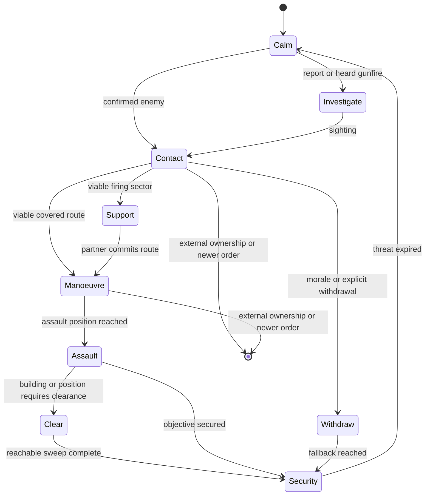

# WAIT Cortex operations

> **Use this page when:** you need to understand or configure WAIT's automatic
> group-level behaviour during contact, movement and recovery.

## Purpose and limits

Cortex is WAIT's optional automatic-tactics layer. It augments native AI only
when an eligible non-player group has a useful combat opportunity. It is not a
replacement for authored mission orders, Zeus commands or another controller
that has claimed the same actors.

CBA is required and provides the configuration authority. ZEN is optional; native
Zeus orders work without it. Configure behaviour from **Options > Addon Options
> Waldos AI Tweaks**, under **General**, **Infantry**, **Coordination**,
**Vehicles**, **Convoys**, **Aircraft**, and **Support and civilians**.

The CBA master setting **Enable Cortex automatic tactics** is on by default.
Each family also has its own gate. A setting marked **Live** is adopted by the
next owner-local update; a setting marked **Next operation** is guaranteed for
a new action without discarding a committed action halfway through.

## Ownership and interruption

One controller owns movement at a time. WAIT creates a finite operation only
when it can own the affected action. The operation records an intent,
generation, owner locality, participants, route, physical progress and a
cancellation reason.

WAIT immediately releases a conflicting operation when any of these occurs:

- a Zeus edit, move, waypoint, remote-control action or explicit native order;
- player control of the actor;
- a newer mission order;
- locality migration or an external controller marker;
- a lost target, impossible route, casualty collapse or safety failure.

Release removes only movement, postures, speed limits and state previously
owned by that operation. It does not restore an older formation, seat
assignment or waypoint over a newer external decision.

## Contact flow

A bounded owner-local engine danger FSM records immediate observations and
wakes the group's single shared decision job. A valid first event can start that
brain immediately instead of waiting for the periodic discovery sweep. The FSM
terminates after draining its short engine queue and does not add a per-unit
permanent movement loop or movement owner.

## Infantry actions

| Action | Expected behaviour | Completion or release |
| --- | --- | --- |
| Investigate | A suitable element checks an approximate reported or heard location while the group retains security. | Sighting, arrival, time limit, new order or loss of route. |
| Advance | Where numbers permit, a moving element makes short covered bounds while a partner covers. Fire remains native and may continue while moving. | Objective progress, contact change, no-progress recovery exhausted or handover. |
| Flank | Selects a distinct left/right corridor that progresses on the threat without crossing a friendly firing lane. | Side approach reached, target change, unsafe route or handover. |
| Assault | A manoeuvre element continues forward from its assault position while support holds only while its firing sector remains safe. A fresh known threat already too close for advance or flank enters this paired-element operation directly. | Position secured, target lost, casualty collapse, blocked route or handover. |
| Withdraw | A broken element selects a screened route away from the threat. Smoke is optional and never blocks movement. | Physical fallback, bounded incomplete result, newer order or handover. |
| Regroup | Separated survivors close only when they remain unreserved and the tactical situation allows it. | Cohesion, time limit, contact or handover. |

A grenade, smoke throw, straggler or individual recovery cannot freeze the rest
of an operation. WAIT makes one local recovery attempt for a stalled actor;
then marks that actor unavailable and lets the capable element continue. It
never teleports, repairs, unflips or grants immunity as a recovery shortcut.

## Coordination and combined arms

Nearby friendly groups coordinate only when they share compatible intent,
threat knowledge and communication eligibility. The coordinator assigns
short-lived support and manoeuvre roles, offset rally areas and distinct
approach corridors. It rejects routes that cross a partner's firing lane.

A support opportunity adds to ordinary combat; it does not require a scheduled
assembly or override a valid authored order. Roles expire after no physical
progress, target change, casualty collapse, lost communication or external
handover. Vehicles and aircraft can support the same opportunity only when
their own capability and ownership checks pass.

## Buildings

Cortex building actions use a finite physical progression:

1. enumerate entrances, exits and reachable interior positions;
2. choose an entry with a viable approach and safe support sectors;
3. assign a limited entry element, interior lanes and exterior security;
4. record a room only after physical arrival in its position radius and floor;
5. retry a blocked position through another entrance, route or actor;
6. report exhausted positions as unreachable and finish `INCOMPLETE`, never as
   fabricated success.

**Clear** sweeps reachable interior positions then establishes security.
**Garrison** occupies defensible interior positions with exterior security. Walking is the default.
Mission scripts can explicitly request instant interior placement with
`[group soldier1, getPosATL house1, 40, createHashMapFromArray [["teleport",true]]] call WAIT_fnc_CortexGarrison;`.
This option runs once on the group owner during a fresh order, using the same interior slot selection;
owner adoption and JIP do not replay it. Surplus actors still approach exterior security normally.
Players, remote-controlled/protected actors, movement reservations and native service tasks are excluded
from instant placement. `inPlace` and `teleport` cannot be combined. Instant placement is not evidence
of accessible interiors or physical CQB entry and must remain excluded from physical routing acceptance.
The executor option has offline checks only; fresh engine placement, repeat, casualty and migration
acceptance remains pending. The Garrison area module labels walking and instant placement distinctly; module controls are described below.
**Traverse** enters through one viable side and leaves through an actual exit
on the onward side. Casualties and stalls can rotate capable reserve actors into
the entry element without forcing a group merge.

## Vehicles and convoys

General driving assistance is separate from registered convoy control. General
driving retains native waypoints and applies sparse speed/terrain observation
plus one bounded physical recovery. Convoys add an ordered vehicle column,
predecessor-trail spacing and contact/passenger policy.

Driving assistance requires a real authored waypoint. The implicit spawn waypoint does not admit it.
The recovery identity uses the shared full waypoint receipt: conditions, timeouts, synchronized
triggers/waypoints, script, attachment, house position, loiter parameters, speed, combat mode and
formation. Attached target motion retains object identity rather than resetting recovery on each
position update. A same-index edit resets recovery observation before another attempt. Every
speed or recovery write rechecks that the waypoint identity is still current. An initial refusal
clears an unapplied speed snapshot. This source guard has no fresh physical acceptance. Retests must
include condition/trigger edits during reverse recovery and a valid new route after the change.
Recovery refresh/reverse is limited to plain MOVE orders with no activation code, waypoint script,
timeout, attached target, waypoint synchronization or inactive trigger. This applies at every
distance, including far outside the native waiting envelope. Safety speed caps and native order
execution remain available; WAIT does not evaluate authored code or bypass synchronization.
Distant scripted/timed/attached orders require physical retesting alongside ordinary recovery.

Only the vehicle currently carrying the group leader may refresh or reverse the shared native
route. Other group vehicles retain native formation movement and can still receive terrain speed
caps. Losing the leader role resets an existing recovery stage and its observation timer before
any reverse-speed cap is selected. Each command also checks current vehicle/group locality and the
actual driver/commander seat identities. This does not cancel an already-issued native movement
command by issuing a competing stop. Physical tests must cover formation waits, leader replacement
while recovering, seat changes during observation and subsequent valid leader recovery.

Ordinary driving now has a route-scoped owner-local operation FSM. Group decisions admit or
reuse it; the existing shared scheduler executes its cruise, deliberate-wait and recovery samples.
Epoch, current-brain identity and the authored route receipt fence callbacks. A newer route retires
old speed leases before fresh admission. Group release, disablement, Zeus/external takeover,
locality loss or loss of eligible vehicles ends the operation. Exhausted recovery retains a terminal
receipt for that exact order so discovery cannot restart the same attempts. A changed order or an
explicit group handback can admit fresh work.

A stationary native-ready vehicle within the completion radius plus 50 metres is treated
conservatively as waiting when its waypoint is HOLD, has an inactive synchronized trigger, a
positive timeout or a nontrivial condition. The condition is read as text and never executed by
WAIT. The guard resets recovery observation while waiting; native waypoint processing still decides
when movement resumes. This envelope is a recovery guard, not proof of arrival, condition truth or
successful navigation. Terrain speed assistance remains separate from route recovery.

No new settings, dependencies or vehicle polling loops are added. The FSM queues one coalesced
sample every four seconds and yields to the existing tactical pause. It reports its semantic state
in `WAIT_Driving_State`; this is observation, not physical acceptance. Predictive traffic, gate
execution, yielding and overtaking remain open work. Required physical retests include trigger,
condition and timeout waits near and far from the waypoint; same-order exhaustion; newer orders;
repeat use; disabled/re-enabled control; and owner migration. Audits are held, so these are unrun.

Ordinary recovery and tracked withdrawal now share a fresh rear-clearance observer. It samples
three positions across the real hull width at two body-relative heights, from the rear body edge.
Nearby actor footprints are projected into that corridor, so a long or angled vehicle can block a
reverse even when its centre sits outside it. More than 64 nearby actors refuses clearance rather
than dropping unexamined candidates. Each call returns the clearance reason, observation time and
ray count; it issues no movement or physics commands and retains no reusable clearance cache.

Ordinary recovery checks its eight-metre leg before the native command. Tracked withdrawal checks
its speed-dependent rear distance at each existing reverse step. The ordinary terrain/water guard
and tracked avenue/facing/deadline gates remain. Six sampled rays are not a complete navigation or
collision guarantee; native movement remains responsible for steering. No new settings or loops
are added. Physical wide-hull, angled-truck, pedestrian, wreck, low barrier, pitch/slope and dense
traffic cases remain unrun while audits are held. Convoy traffic prediction is separate open work.

Finite tactical movement acquisition now retires the ordinary driving FSM and its unchanged
speed leases before publishing the successor owner. Ordinary admission, queued execution and each
command reject an unexpired movement lease or a current tracked reverse. Late cleanup preserves
the successor's speed policy. Expired leases do not permanently exclude ordinary driving. This
handover has no new controls; withdrawal/standoff/jink/orientation and post-expiry resumption need
physical testing, including an acquisition while an ordinary callback is pending.

Convoys measure forward predecessor gaps to remain single-file; they do not use
formation wedge offsets. Target spacing uses a size-aware minimum/maximum band
with damped speed correction. A meaningful stop is classified as ordered,
contact, spacing, obstruction, immobile or external owner and is reported once
to Zeus. Player-made roadblocks remain valid stops.

Operating crews stay aboard. Cargo dismounts and remounts only while their
convoy task generation still owns them; a newer Zeus task wins immediately.

## Diagnostics

The diagnostic view exposes the active intent, owner, generation, phase,
participants, route, physical-progress age, recovery state, external owner,
scheduler latency, skipped work, replans and final cancellation reason. Use it
to diagnose a real action before changing a setting.

Static validation confirms interfaces, bounded contracts and configuration
parity. It does not prove pathfinding, combat, building entry, convoy recovery
or air combat. Those require the packaged, damage-enabled audit batches.

## Related documentation

- [Settings reference](SETTINGS-REFERENCE.md)
- [Capability registry](CAPABILITY-REGISTRY.md)
- [Addon lifecycle](ADDON-LIFECYCLE.md)
- [Modding and operations](MODDING-AND-OPERATIONS.md)

<!-- WAIT-WIKI-NAV -->
---
[Wiki home](https://github.com/AdamWaldie/WaldosAITweaks/wiki/Home) · [Installation and setup](../README.md) · [Capability registry](CAPABILITY-REGISTRY.md)

### Passenger remount cooperation

With `WAIT_AIPass_Vehicles_Enable` and `WAIT_AIPass_VehicleRemount_Enable` enabled,
calm restoration retains an owned passenger boarding episode for up to 60 seconds.
Only passengers dismounted by WAIT are eligible. A new assigned vehicle, Zeus control,
contact or a conflicting operation retires or suspends the old intent rather than
sending passengers back to their original transport.

The passenger group owner requests a stop from the original vehicle owner while an
eligible passenger remains within 100 metres. Each request lasts at most 30 seconds
and never exceeds the boarding deadline. The vehicle owner checks the public boarding
record, group ownership, side, original vehicle, live settings and current assignment.
It considers at most eight passenger records. Crew contact or an active vehicle movement
lease rejects a boarding stop. Actual boarding uses native assignment and get-in orders;
no passenger is moved directly into a seat.

A completed boarding, reassignment or expired request releases the stop. WAIT restores
the prior forced speed only when the current forced speed still equals its own stop.
This uses existing group scheduler callbacks and adds no persistent worker. The record
is public for owner migration; a new owner validates live eligibility before commanding.
Stationary separate-group boarding and replacement-vehicle boarding have physical audit
evidence. Moving-vehicle boarding, interruption and migration of this handshake remain
queued for physical acceptance.

### Interior access recovery priority

A stalled interior access checkpoint uses its existing finite recovery before the controller searches alternate exterior entrances. This prevents entrance cycling from retaining the failed checkpoint while repeatedly resetting its local retry clock. Recovery can retire the checkpoint once and request the assigned room directly. Room retry counts, physical visit requirements, operation ownership and the hard deadline remain intact. No new settings or dependencies are introduced. Static gates passed for this change; fresh packaged normal and headless-client physical acceptance remains outstanding.

A failed partner alternative selection can be reconsidered when another actor physically visits an additional point. The public episode receipt retains the search count and coverage across ownership replay. Each partner receives at most three searches over at most 24 visited points per search, and one successful movement alternative. Unchanged coverage cannot trigger another search. This does not renew progress deadlines or recovery budgets. Fresh physical validation remains required.

### Exterior exit observation

Spare clearance participants receive a finite exit-approach observation assignment. The selector considers at most sixteen real exits and prefers exits with fewer current reserve assignments, then nearer exits. It validates exterior standing space, separation from other actors and destinations, entrance clearance, slope, dry ground and an unobstructed observation line. A supported exposed point is permitted when protective cover is unavailable, and that distinction is retained in the stage receipt. Each actor physically reaches its position before a single watch command is issued. Movement retains existing three-search and sixty-second approach limits, operation authority, native-task yielding and casualty promotion. The published stage journal retains the observation point and selected exit across replay. No new setting is introduced. This provides local exit observation only; complete isolation, changing sectors and larger supporting-squad coordination remain outstanding. Fresh normal/headless physical and runtime-performance validation is required. Audit launches remain paused at the user's request.

The twelve-person clearance audit now independently checks every living exterior participant for stage arrival, actual heading within 75 degrees of its watch point and an unobstructed eye-to-watch line during the original observation window. A rejected hold or assignment receipt cannot pass. These checks are prepared but have not run while audits are paused.

### Driving release and commander takeover

Standalone driving release now checks player, remote-control and specialist ownership of the effective commander as well as the driver. An old WAIT forced-speed lease is discarded without restoring its captured cap when the commander has taken over, including a commander outside the driver's group. Waypoints, native routes and newer speed settings remain unchanged. This closes a source-level cleanup gap. Physical takeover and locality validation remain pending while audits are paused.

When an exterior observer replaces an unavailable clearing worker, promotion retires its matching clearance-generation/owner-epoch exit watch before interior movement. Native tasks and newer authority still gate the command. The historical stage receipt remains diagnostic and no longer reserves a destination once the actor joins the clearing team. Physical casualty-promotion acceptance remains pending.

Locality replay accepts both legacy and extended exterior-stage records. An approaching actor must retain its exact native endpoint; a stopped actor must physically remain at its stage. Exit watching installs once per local owner epoch after physical and authority checks, without a new movement request. Promotion clears that local installation record. Separate headless physical replay remains unvalidated.

### Unconfirmed support reservation

A PENDING/UNCERTAIN shot retains its original mission deadline. At expiry, the scheduling brain ends with UNCERTAINTY_PARKED while the unresolved native-command registry/token remains reserved. No shot is retried and the battery is not declared available. A qualified firing event or owner rejection wakes the exact mission for finite settlement only. A repeat-safe server EntityDeleted handler removes the matching deleted battery record without scanning other missions, and subsystem stop removes the handler. This changes no support settings. Delayed event, deletion, repeated callback and normal/headless physical acceptance remain required; audits are paused. Native-command cancellation is not claimed.

Observer artillery requests preserve the dispatch result: a synchronous server rejection takes the short retry cooldown. A headless owner can confirm forwarding only, not server acceptance or physical firing. This correction still requires live rejection/retry validation.

Clearance cancellation retires the matching exterior observation generation and owner epoch. It clears watching only for a free stopped actor under unchanged WAIT authority; replacement tasks and external control receive no watch command. Live cancellation and handover validation remains pending.

Automatic clearance settlement also retires matching exterior watch metadata, including incomplete outcomes. Historical arrival records remain evidence rather than live assignments; newer generation/epoch watch records survive. Physical repeated-use validation is pending.

Mounted danger responses apply the same captive, surrender and handcuff exclusions as sustained vehicle targeting before requesting targeted suppression, orientation or mortar support. Targetless impact safety remains separate. Physical surrender-transition validation is pending.

Mounted danger suppression aims at the effective commander's native believed contact position rather than reading the enemy's exact aim position after lost sight. Missing estimates reject suppression; existing ownership, protected-target and friendly-fire gates remain. Physical occluded-contact validation is pending.

Fixed-wing ingress pass detection uses ASL displacement with world velocity, preserving a shared vertical origin across terrain cells. This corrects the forward/behind geometry test; physical terrain approach validation remains pending.

Combined-arms reservation expiry preserves a matching terminal manoeuvre/refusal result instead of replacing it with EXPIRED. Active dispatched/applied roles still expire and release their role records. Physical result persistence remains pending.

Combined-arms discovery deduplicates candidate groups through a request-local keyed set while preserving discovery order and dispatch-time admission checks. It removes repeated linear membership scans; total discovery/ranking work still needs budgeting and measured runtime acceptance.

Combined-arms ranking retains the asset found during discovery and uses a unique rank tie-breaker. Dispatch rechecks live asset and commander/driver group ownership instead of repeating the full crew scan. Invalidated assets are refused; candidate population and runtime budget remain unvalidated.

Combined-arms primary server and owner admission both reject captive, surrendering and handcuffed targets before reservation or action. Air fallback expiry preserves matching terminal results while active dispatch/application still expires. Live target-state transition and fallback-result validation remain pending.

CQB casualty replacement selects the nearest currently eligible reserve to the surviving buddy, or to the building when no buddy is available. It preserves original survivor movement, participation evidence and finite deadlines; selection adds no geometry probes. Physical reinforcement flow remains pending.

Garrison arrival and failed-route termination restore the previous approach speed only while WAIT's applied cap remains unchanged and movement authority is retained. Failed destinations no longer retain the approach cap; newer forced-speed values survive. Physical inaccessible-position handback remains pending.

Clearance exterior geometry uses the shared read-only BuildingExteriorCandidate helper. It preserves footprint, exit clearance, standing support, observation and separation thresholds. Operation-owned selection, retries, movement, arrival and watch leases remain separate. Garrison surplus integration and physical validation are pending.

Combined-arms primary server admission, owner application and air fallback reject work while the local Smart AI Pass is inactive or paused. Delayed contact delivery cannot reserve or dispatch new support during pause/stop. Physical pause-transition validation is pending.

Reinforcement discovery and coordinated-assault server admission require the pass to be running as well as enabled and unpaused. Delayed messages after stop cannot create or extend support reservations. Cleanup and acknowledgement handlers remain available to retire existing work. Live stop-transition validation is pending.

Clearance admission orders intact eligible buddy pairs before roster remainder, then applies the existing concurrency capacity. This read-only selection publishes no new pair receipt on refusal. Odd capacity can still leave a singleton; the eight-worker limit remains. Physical pair-continuity validation is pending.

Live air-contact intercept refresh uses a combat-effective local native knower's believed position and successive-sample motion instead of exact unseen target position/velocity. Witness changes reset motion; correction jumps are bounded. Missing estimates end the finite run honestly. Initial plan selection and full sensor/radar freshness remain separate outstanding work; physical crossing/lost-contact validation is pending.

Initial air-contact plan geometry and altitude use a local native knower's believed position. Initial motion is zero until live refresh has successive samples; no exact unseen velocity supplies the startup lead. Missing estimates refuse the plan. Surface plan perception and complete sensor freshness remain outstanding; physical interception is unvalidated.

## Settings and behaviour modules

CBA owns addon settings, feature switches and tuning. Zeus/ZEN modules issue scoped behaviour
orders to explicitly selected groups and destinations or areas. Dialog parameters describe the
requested task, such as its destination or radius; they do not duplicate CBA configuration.
The ordinary-driving enable/release/inspect modules were withdrawn because they crossed this
boundary. Ordinary driving remains automatic under the existing CBA gates and native waypoint
orders. The convoy module remains a convoy task entry point. Future building, support and optional
navigation-corridor modules must use their real production task executor and retain owner authority,
interruption and cleanup. No replacement behaviour module is claimed complete here.

## Garrison behaviour module

Native Zeus lists **Waldos AI Tweaks > Garrison area**. Place it on an AI soldier in the intended
squad; it tasks that squad around the module position. Without ZEN it uses walking and a 50 m
radius. With optional ZEN it opens the same task dialog as the **Garrison area** custom module.
The ZEN dialog explicitly selects a squad, area radius (15–150 m, default 50) and placement
(walk by default or instant interior placement), and **Prefer higher positions** (default on).
Turning height preference off distributes positions randomly while retaining roofed-first priority.
Sorting happens once at admission; published assignments and vacancy refill retain that selection
through owner migration. The script option is `sortByHeight` (Boolean, default true).
Neither mode establishes physical accessibility. Its group list is capped at 128 initial groups;
placing it on a soldier includes that squad even outside the initial list. Dropping the ZEN
module on a building or empty ground uses that position as the area centre, not an automatically
selected squad. The native module requires a soldier attachment and refuses an absent target.

These are per-task parameters, not addon settings. CBA still owns feature enablement. Enabled
Cortex must be ready on the current owner; players, excluded squads and other controllers remain
subject to the existing executor gates. The server authenticates remote requesters as assigned
curators, takes reply identity from the network sender, validates named task parameters and routes
the order to the current owner. Remote requests cannot change addon configuration or artillery
role registrations through this path. At most 64 owner acknowledgements can be pending, each for
12 seconds. Reaching that limit refuses another request rather than queuing unbounded work.

The owner rejects repeated/older task serials and changed native waypoint receipts before
altering the squad's orders. Receipt comparison covers waypoint count/index, position, type,
description, speed, behaviour, combat mode, formation, completion radius, authored conditions/
statements, timeouts and synchronized trigger identities. Conditions/statements are read but never
evaluated or executed by the receipt. A separate Zeus receipt compares the hold token, waypoint
control flag and control kind before the task may clear an older hold. Newer control refuses the
delayed task. Natural trigger activation is not treated as a new authored order. A settings/feature refusal preserves existing order state.
A notification reports owner acceptance or refusal; acceptance is not physical occupation.
Task commands are not replayed to JIP; existing garrison assignments support owner adoption.
Instant placement only occurs on fresh admission. It does not replay on migration or discovery.

The selected task uses the existing interior assignments, exterior security, casualty/morale break,
stuck-route deadlines and transform invalidation. Existing release/new-task/Zeus handover paths
still apply; this module adds no per-frame controller or world scan. Source-level and offline
validation are available; native and ZEN dialog interaction, spoof rejection, duplicate/delayed
requests, terrain/placed/modded buildings, placement, real walking, casualties, repeated tasks,
release, JIP, HC migration and measured performance all remain pending live acceptance.

## Ordinary driving traffic following

The owner-local driving FSM now observes same-direction vehicles ahead before applying its
ordinary speed cap. It projects the other vehicle's eight hull corners into the current vehicle's
body frame, checks lateral and vertical overlap, and uses actual forward velocity and hull-to-hull
gap rather than centre distance alone. The desired gap combines six metres and 1.8 seconds of
predecessor travel; a continuous correction adjusts the cap instead of alternating between fixed
start/stop bands. A second cap estimates available closing distance after allowing four seconds
for cruise sampling. Nominal deceleration is 4 m/s² divided by a mass factor from 1 to 2.5;
heavier vehicles therefore approach a slower predecessor more cautiously. The quadratic distance
model limits speed relative to the predecessor's currently observed forward velocity. It does not
predict a predecessor's future braking. A short closing-distance reaction can request zero speed.
These are provisional policy assumptions, not measured braking guarantees for every vehicle class.
The four-second allowance does not bound actual scheduler latency, particularly under load.

The observer processes at most 64 candidates from a single speed-dependent query capped at
250 m; dense sets request a congestion hold. Engine query cost itself is not bounded by that
processing cap. It installs no handlers, physics helpers or movement controller. Terrain, saved
mission speed and traffic caps combine by taking the minimum. Registered convoys retain their
own controller and do not acquire this ordinary driving lease.

A WAIT-owned traffic zero remains eligible for observation and can resume when the queue clears.
A sampled traffic constraint suppresses route-refresh/reverse recovery and refreshes the stall
observation; clearing traffic therefore starts a fresh progress interval. The FSM's TrafficFollowing
phase requests another coalesced callback in one second; normal cruise remains four seconds.
These are shared scheduler requests, not deadline guarantees under load. A reverse leg uses its
existing rear clearance path rather than a forward following constraint. Cleanup clears observations
and restores an unchanged owned cap using the existing ownership checks. Unmarked external writes
of exactly the same forced-speed value cannot be distinguished by value comparison alone.

Crossing/oncoming priority, overtaking, obstacle/gate geometry, deterministic jam arbitration,
measured vehicle-specific braking and registered-convoy integration remain incomplete. Congestion
never becomes permission to ignore traffic after a timer. Native pathfinding still owns steering.
The straight body corridor can constrain unrelated same-direction vehicles on curved roads; native
routing and future path-aware prediction need physical testing before this is accepted. Offline
checks cannot establish safe headway, smoother motion, recovery, repeat behaviour, HC migration or
the 5% median/10% p95 performance budget. All remain pending live acceptance while audits are held.

## Mixed-convoy low-speed pacing

Follower smoothing no longer switches off when a predecessor drops below 2 km/h. Inside the
spacing tolerance band, spare longitudinal room permits the existing gradual cap reduction even
through a brief tracked-vehicle speed dip. The result remains bounded by the raw predecessor-speed
closing-distance cap on the same callback. At the lower gap boundary a stationary predecessor
still produces zero; reversing predecessors, retained path limits, pedestrian safety and ordered
halts retain immediate priority. No minimum forward speed bypasses these limits and no new
controller, scan, or setting is introduced. This removes a source-level pacing discontinuity;
it does not establish smoother actual movement or safe braking. Mixed tracked/wheeled step-off,
brief/permanent stops, compressed spacing, restart, turns, reversing, convoy authority and measured
performance require fresh live acceptance when audits resume.

The prepared normal-owner vehicles audit includes a stopped tracked predecessor and ordinary truck follower. It requires physical approach, sustained separated hold, absence of queue-induced recovery, actual departure/resume, a repeated stop/resume and disabled observation cleanup. No controller callback, relocation or successful state is injected. This fixture has not been run; collision/damage/gap sampling is not a universal collision guarantee. HC migration, road curves, crossing and dense congestion need separate variants.

## Garrison vacancy refill

After the arrival job settles, the existing group scheduler can refill one vacant interior post.
Living assignments, including unconscious soldiers, retain their reservations. An available new
reinforcement without an assignment is preferred by distance; an exterior defender may move only
when another capable held defender covers the same building exit. Sole exit coverage is preserved.
Player/specialist actors, active movement reservations, native movement/service tasks and failed
routes are excluded. The task roster distinguishes newly joined reinforcements from original
actors released to a newer native task; completion of that task does not permit silently reclaiming
them. Refill also waits for local garrison adoption to complete. Selection processes at most 64 group members and 64 stored interior candidates.
Moved/deleted buildings cannot supply a slot. The casualty break fraction still prevents refill of
a broken group. Vacancy selection does not mean that the selected position is physically reachable.

The replacement walks through the existing garrison approach/arrival path even if the initial
order used instant placement. Reapplication creates a new owner-local generation and a 90-second
approach window only after the previous job settled. Failed actors retain their failures; pending
old routes cannot renew the deadline this way. Adoption marks progression pending before its
job runs. Full release clears refill/pending metadata. Existing held actors are reapplied through
the shared executor; possible movement churn, coverage geometry, actual casualty replacement,
failed/blocked destinations, repeat promotion, late casualties, Zeus handover, owner migration and
performance still require physical acceptance. This source implementation is not an accepted
reinforcement feature and does not claim reserves from other squads.

Garrison refill now requires both the promoted exterior actor and its remaining duplicate observer to be physically at their posts (within 2 m and 0.75 m vertically) with an actual local PATH hold. A published role/hold flag alone is insufficient. Reapplication preserves already arrived, locally held defenders without reenabling PATH or issuing another stop; a new owner still installs its own hold. Dynamic visibility/cover changes, casualty flow and actual movement stability remain unverified.

## Aircraft egress over uneven terrain

Air attack departure now compares world velocity against an ASL displacement from the retained
last target position. The previous comparison subtracted ATL heights from different terrain cells;
that can invert the direction test when a plane climbs over elevated ground. Retaining the target
position in ASL also keeps departure meaningful after its object disappears. The existing physical
travel thresholds, finite egress deadline, native flight controller and forward-weapon alignment
checks remain. No new scan, reveal, sensor capability or scripted turn is added. Surface and air
intercept departure on uneven terrain, target deletion, climbing/descending exits and real weapon
release remain pending physical acceptance. Broader native route receipts, detection reliability,
turning/energy limits and intercept geometry still need further review and live evidence.

## Aircraft authored-route replacement

Air attack admission and active callbacks now use the same authored-route receipt. It includes
position/type/name/description, completion radius, condition/activation text, timeouts, speed,
behaviour/combat/formation, waypoint script, object/vehicle attachment identities, synchronized
triggers/waypoints, house position and loiter parameters. The receipt reads text without executing
it. Natural current-waypoint progression is excluded. WAIT's named temporary attack leg is also
excluded so its own phase changes do not look like an authored replacement. For an attached
waypoint, the object identity replaces its moving world position in the receipt.

A changed receipt uses the existing AUTHORED_ROUTE_CHANGED handback, which removes WAIT's owned
leg without restoring an old route or issuing a competing resume order. This adds fixed metadata
reads per authored waypoint, proportional to route size, at the existing active callback cadence;
there is no new world scan or worker. Long-route cost and same-index/attachment changes need
live validation. This does not yet prove detection of every possible edit to WAIT's own leg.

The existing DESTROY association uses waypointAttachVehicle experimentally. The engine documents
that command for GETIN transport association and cautions that other waypoint types may not work:
[waypointAttachVehicle documentation](https://community.bistudio.com/wiki/waypointAttachVehicle).
Native attack association, detection/radar, roll-in, true weapon release and finite egress remain
unverified across aircraft classes. A registered target or plan cannot pass those physical cases.

## Defend area behaviour module

Native Zeus and optional ZEN expose **Waldos AI Tweaks > Defend area**. The native module requires
an attached AI soldier, identifying its squad and centre; without ZEN it requests a 60 m line facing
that soldier's current direction. With ZEN, or from the custom module, the task dialog explicitly
selects a squad, compass facing (0–360 degrees) and line width (15–150 m, default 60). The same
128-initial-group selector limit as garrison applies; an attached squad is included explicitly.
No nearby group is guessed. These controls issue a defence task, not addon configuration.

The server authenticates the requesting curator, validates/clamps width and normalizes facing,
then uses the existing current-owner preflight and acknowledgement. `width` is the named task key;
older trusted calls using `radius` for defence width retain a legacy named-key fallback.
CBA owns enablement. The existing defence executor allocates cover-aware line posts and a rear
reserve, handles commitment/break conditions, publishes owner-adoptable assignments and releases
on newer orders. Walking is used; this module does not advertise an unimplemented teleport option.
No extra controller or polling loop is introduced. Script equivalent:
`[group soldier1, getMarkerPos "ridge", 90, 60] call WAIT_fnc_CortexDefend;`.

Native/optional dialog selection, actual width/facing, physical occupation and reserve commitment,
replacement of garrison, refusal with preservation of previous state, release, JIP/HC migration,
terrain coverage and measured performance remain pending live acceptance. Registration and owner
acceptance are not proof of a working defensive line. Audits remain held.

Defend now plans its complete line and reserve layout before releasing the prior task. It refuses non-finite inputs, groups over 64 admitted actors, wet/steep slots or positions less than 1 m apart, then rechecks group ownership/eligibility before cleanup and assignment writes. Open dry positions can remain valid when no cover is found; this does not claim ballistic protection or native path accessibility. Cover selection now receives the actual group so per-group feature exclusions apply. Invalid-layout preservation and terrain/cover/path behaviour remain pending physical acceptance.

Garrison admission plans candidates before releasing the previous task. Nonfinite task inputs, an empty valid position list or a planning budget above 64 buildings/512 reported positions/64 admitted actors refuse the replacement. Module radius remains 15–150 m; direct script radii remain positive finite values subject to the same planning budget. Duplicate positions within 1 m in three dimensions and water positions are excluded. The search runs once, with at most 512 roof queries; it does not establish native path accessibility or ballistic protection. Modded inaccessible destinations still require observed movement and bounded route failure, never instant success. Existing runtime cases and performance measurements remain pending.

Garrison casualty refill and initial arrival now share the same read-only occupation predicate. Promoting duplicate exterior observers requires both to be physically at their posts and able to observe the assigned exit through current VIEW geometry and terrain. Nearby soldiers behind obstructions no longer count as retained exit coverage. This retains the existing finite group scheduler and performs geometry only after matching exterior role/building/exit and held-post gates. Runtime casualty, obstruction, ownership and performance acceptance remain pending.

Initial clearance partner recovery no longer commits its provisional lead-room fallback into the shared support-target cache. That previously bypassed the distinct support-point planner later in the same callback. Initial support candidates must be 2.5–8 m from the lead anchor on the nearby floor band with clear geometry (at most 24 candidates checked); where no candidate exists, the existing shared-anchor fallback and finite recovery remain. This fixes an execution-order defect, not proof of coherent physical entry or route accessibility. Pair movement and constrained single-room models remain pending live acceptance.

Clearance entry handoff, initial partner floor selection, exit checkpoint selection and exit-access arrival now compare ASL elevation consistently with the room-visit collector. Heights relative to different terrain cells can disagree on a common floor or accidentally match different floors. Native doMove destinations remain ATL, and the existing 0.75/1.5 m tolerances are retained. Uneven-terrain buildings and paired physical entry/exit still require live verification.

Explicit fragmentation throws now check the selected magazine ammo at admission and again at queued release. Protected soldiers and the thrower must be outside `max(12, 4 * indirectHitRange)` metres of the requested impact point; malformed or negative radius data refuses the attempt. The existing 8–40 m throw envelope remains, so large blast radii may make a carried grenade unsuitable. This follows the engine indirect-damage envelope, not a complete projectile scatter, secondary explosion or scripted fragmentation model. Physical throw and friendly-safety acceptance remain pending. Engine reference: [Arma 3 Damage Description](https://community.bistudio.com/wiki/Arma_3_Damage_Description).

Artillery smoke classification now validates submunition trees before accepting a smoke leaf. Explosive indirect damage, mixed/invalid payload entries and unknown leaf simulations are rejected; an AI smoke-usage flag alone is insufficient. Each uncached profile permits four payload levels, at most 16 children per node and 64 config checks total; actual available rounds remain live queries. Carrier direct-hit damage is rejected while direct smoke leaf collision damage is not treated as HE. This does not prove observed smoke delivery or resolve earlier request-admission failures. Physical ammunition variants and performance remain pending.

Battery-group artillery-smoke enablement is now checked during candidate selection and explicit admission, server mission continuation and the current owner’s final firing boundary. Disabling smoke prevents later queued smoke commands without substituting HE. A native command already issued remains uncertain until its firing evidence resolves; disabling a feature does not cancel a shell in flight or justify retrying it. Live disable-between-dispatch-and-release, battery overrides and HC migration cases remain pending.

Smoke submunition parsing accepts a single class, a bounded class list or the engine’s alternating class/probability array. Weighted arrays require complete pairs, valid class strings, finite nonnegative weights and at least one positive weight. Every branch is classified, including zero-weight branches; a mixed HE tree is never accepted by dropping its entries. The 16-child/64-check/four-level limits remain. Weighted mod ammunition needs in-engine delivery verification. Format reference: [Bohemia weapon config guidelines](https://community.bistudio.com/wiki/Arma_3%3A_Weapon_Config_Guidelines).

Convoy closing-speed caps now use the same provisional mass-adjusted braking model as ordinary driving: 4 s reaction allowance and deceleration `4 / massFactor` m/s², with massFactor clamped to 1–2.5. The relative-speed solution is converted to km/h before applying the convoy cap. Predecessor speed comes from forward model-space velocity, so lateral motion does not count as column progress. Compression/reverse/path limits still override smoothing. These assumptions are not measured braking guarantees; mixed tracked/wheeled step-off, turns, emergency lead braking and performance remain unverified.

Air attack now records the full metadata of its own named waypoint after each authorized leg write and compares it before later writes. An edited or deleted leg ends the lease as `OWNED_ROUTE_CHANGED`; an edited leg retains its native contents and loses only the WAIT name. Cleanup does not recall the previous route. Moving attached targets compare object identity rather than transient position. Actual Zeus edits, deletion, attachments, native engine transitions and HC migration remain pending physical acceptance.

Air cleanup repeats the owned-waypoint receipt check even when early Zeus/external cancellation occurs before normal route comparison. Changed leg contents are preserved regardless of the original cancellation reason, and old target cleanup/resume is suppressed. Deleted legs are not recreated. Live early-cancellation and edited-leg handover remain unverified.

## Clear building behaviour module

Optional ZEN lists **Waldos AI Tweaks > Clear building**. Its dialog selects the exact AI squad and house; it searches up to 128 building candidates within 150 m and 128 initial groups, explicitly including an attached house or soldier’s squad. Labels show name, distance and reported positions. Reported positions are not accessibility or hostile-room safety evidence. Acceptance uses authenticated named CLEAR dispatch, owner preflight and the existing physical CQB executor. At least two capable soldiers must be on foot. No teleport, forced completion or global setting change is exposed. This is a ZEN task; no standalone native module is added without a suitable group/building selector. Dialog selection, owner acknowledgement, pair entry/sweep/exit, replacement/refusal, cleanup and repeat/HC/JIP remain physically unverified.

Clearance admission rejects absent/destroyed targets, malformed target coordinates and models reporting more than 512 positions before replacing existing work. Position geometry queries use finite 3D arrays with duplicate points under 0.5 m excluded; only target-owned roofed points enter clearance. Fresh executor refusal codes now reach the CLEAR owner acknowledgement instead of the generic passenger message. These checks do not infer path access, teleport actors or certify rooms safe. Invalid-target preservation and modded topology still need physical verification.

A new clearance may admit physically arrived, still-owned garrison post holders despite WAIT’s PATH hold. MOVE permission, current owner application, active assignment, WAIT hold marker, physical post validation and existing actor/task/ownership filters remain required. The garrison-to-clear release restores owned state without issuing JOIN; ordinary garrison release still recalls by default. This prevents a predecessor’s recall from being mistaken for a protected foreign task. Actual repeated garrison/clear transitions and HC handover remain unverified.

Building admission duplicate checks now use a shared private 3D spatial index in ASL coordinates. Each candidate checks 27 neighboring cells with exact Euclidean separation, preserving vertical floors and boundary cases; it does not approximate duplicates by cell identity. Each cell allows at most eight admitted points and the grid at most 512 cells. Existing 1 m garrison and 0.5 m clearance separations remain. This replaces growing prior-position scans, without adding world queries or public state. Engine overhead and the full performance budget remain unmeasured.

Convoy lead retries and early-final-waypoint recovery now inspect authored gate semantics. Conditions other than plain true, activation statements, waypoint scripts, timeouts and inactive synchronized triggers prevent recovery replay. No authored code is evaluated. Final-route recovery compares a full metadata receipt; changed same-index lead receipts reset retry progress and are rechecked before doMove. The receipt helper can read one engine waypoint index, avoiding full-route metadata reads for these checks. Gated routes, same-index edits and HC continuation remain physically unverified; per-convoy metadata overhead remains unmeasured.

Convoy recovery, restart and straight-leg follower extension now exclude implicit waypoint zero. Native deletion reindexes remaining waypoints; the aircraft cleanup comment now reflects that documented behaviour rather than claiming persistent index gaps. Lead restart no longer issues doFollow to the leader itself or to the vehicle’s movement operator; only a subordinate sharing the lead vehicle receives that recall. Real HALT/resume, operator/driver arrangements and route deletion remain pending physical verification. Engine reference: [currentWaypoint](https://community.bistudio.com/wiki/currentWaypoint), [deleteWaypoint](https://community.bistudio.com/wiki/deleteWaypoint).

Rear clearance projects all eight corners of each candidate actor hull into the reversing
vehicle frame, checking width, length and vertical overlap with 0.3 m padding. This replaces
the fixed centre-height approximation. Existing 64-candidate and six-ray limits remain;
slopes, stacked roads, tall vehicles and actual reverse execution require physical validation.

Ordinary driving and convoy leads now share a read-only road look-ahead: up to eight road
nodes or 70 m, with at most sixteen connections evaluated at a node and cycle detection.
Turns above 25/45/70 degrees cap speed at 35/25/18 km/h; junctions cap at 30 km/h;
grades above 0.12/0.2 cap at 25/18 km/h. Existing lower mission, terrain and traffic caps
remain authoritative. Dense connection sets cap at 15 km/h. Convoys retain their three-second
cache; ordinary vehicles use their existing sample cadence. No route, waypoint or world
object is changed. Heading-based branch selection does not prove which branch native AI
will take. Junction false constraints, bends, slopes, actual speed and overhead remain unverified.

Clearance resume now validates the episode deadline and unchanged native order before
releasing existing garrison, defence or autonomous tasks. A matching final common-admission
eligibility check also precedes handoff. The new clear records native order state after
its authorized cleanup, so removal of WAIT waypoints is not mistaken for a later mission edit.
Late operation-start refusal retains its existing cancellation handling; this is not a
universal transaction guarantee. Expired/changed resumes and successful handoff need live retesting.

CQB and authenticated Zeus task admission now use the same full current-waypoint metadata
snapshot as driving: scripts, attachment identities, synchronized waypoints, house positions,
loiter settings and existing native fields all participate. The compact count/no-order sentinel
is retained. Attached target motion is not a replacement order; changing the attachment is.
This closes same-index edit gaps in delayed owner dispatch, clearance continuation and held
post-clear state. It reads current-node metadata only, without running authored code or adding
world scans. Same-index edits, moving attachments, JIP/HC and overhead remain physically unverified.

Natural building contact now identifies the house and checks its bounds/roof using the stored
native believed position, rather than reading the hostile's live transform after knowledge was
sampled. It accepts only finite three-coordinate beliefs with nonnegative finite age and keeps
the existing five-second freshness and three-contact geometry limits. This prevents unseen enemy
movement from selecting a different house through live position reads. Belief inside a roofed
house is not proof the enemy remains there. Threat-prioritized interior routing is still missing;
physical contact/entry, lost sight, false beliefs and HC continuity remain unverified.

Natural building contact passes its believed position and original server-clock observation time
into clearance. Finite, building-contained hints no older than five seconds may seed the first
point on the matching floor near that belief. Lower floors still precede upper floors; after the
one-time seed, nearest-neighbour progression continues. All room visits remain physical. The
snapshot/timestamp is retained in the durable order and progress updates; owner adoption cannot
refresh it, and stale hints revert to ordinary routing. No unseen target position is polled.
This is initial route prioritization, not dynamic enemy tracking or proven topology. Threat-floor flow, stale beliefs, inaccessible points, casualties and HC remain unverified.

Door opening retains the three-metre actor interaction range, floor check and live lock guard.
It now checks geometry from the actor's eye to the door trigger, at most four eligible doors
per call. No obstruction is accepted except a hit on that building within the final 0.5 m,
allowing the closed leaf itself to hide its trigger while rejecting earlier walls or objects.
The generation/actor takeover guard is checked again before opening. Modded trigger offsets,
closed leaves, adjacent rooms, locks and actual animation timing require physical retesting;
recognizing a door does not prove access, entry or successful clearance.

Door requests also honour the building-wide bis_disabled_Door flag as well as indexed locks,
rechecking both at the animation boundary. Clearance's initial access check uses the same
combined lock rule; a physically open recognized entry remains passable. No lock flag is
changed. Global/indexed lock combinations and open-but-locked entrances need live validation.

The four-query door-visibility budget rotates through recognized entries on later callbacks.
A local per-building cursor advances past each tested door, preventing earlier obstructed
entries from permanently hiding a usable later entry. It carries no movement authority and
needs no network/JIP replay. Empty door sets refuse before indexing; the 64-definition cap remains.
Dense multi-door approach and multiple-owner fairness remain physically unverified.

Exterior-post validation rejects nonfinite/non-numeric coordinate triples and malformed observer
lanes before geometry queries. Input work is capped at 64 exits, 128 reserved positions and 64
observer lanes, matching the bounded proposal path. Diagnostic refusals report inputs=false.
This protects CQB security, egress and garrison replanning from malformed data; it does not prove
post accessibility, full building isolation or stable physical positioning.

Clearance route setup snapshots absolute node heights once (up to 512 conversions plus one
belief conversion). Remaining-node floor searches reuse that local snapshot instead of repeating
terrain-frame conversions at every route step. Retired-index construction is also performed once.
The nearest-neighbour search itself remains quadratic and bounded by admission; no engine frame
or total addon overhead claim follows from this reduction. Physical profiling remains outstanding.

Ordinary following explicitly includes destroyed LandVehicle entities in its existing nearby
scan using the Arma 2.18 area query, and no longer discards their hulls on alive status. Empty
live vehicles were already included. Existing heading, projected hull/height, 64-candidate and
250 m limits remain. Destruction is not evidence of free space. This does not discover every
static/classless wreck or create a route around a blockage; angled obstacles, jam resolution,
physical braking and dense wreck scenes remain pending. No extra scan or controller is added.

Rear-clearance actor discovery also uses the dead-inclusive area query. Destroyed vehicle
entities participate in full-hull overlap before the independent geometry rays, so sparse
rays are not their only guard. Dead infantry do not count as live actor occupancy; solid
obstruction checks still apply. Both ordinary recovery and tracked withdrawal consume this
shared observer. Classless/static wrecks still depend on geometry; actual wrecked hulls,
slopes and reverse execution require physical validation. Existing 64-candidate limits remain.

Rear discovery splits live infantry from dead-inclusive vehicle entities into two local-envelope
queries, avoiding corpse density in the person occupancy budget. Combined hull processing remains
capped at 64; the extra query occurs at reverse admission, not through another polling loop.

Authenticated task dispatch now stamps a server-clock admission deadline matching its 12-second
acknowledgement window. The owner rejects missing, malformed, nonfinite or expired deadlines
before consuming task serials or changing Zeus/task control. A packet delayed beyond a reported
timeout cannot start the task later. This is admission expiry, not the lifetime of an accepted
operation. The internal door executor also refuses direct non-server network calls while retaining
local/server-dispatched actor, generation and proximity checks. Delayed delivery, HC migration and
real notification/control timing remain physically unverified.

Ordinary route recovery preserves native planning time: a new or newly progressing order gets at least 20 seconds without progress before the first refresh. That refresh gets 30 seconds before admission of the bounded six-second rear leg, and the final authored-route retry gets 60 seconds before exhaustion. Scheduler delay may extend observation; it does not shorten these windows. A full waypoint-identity change, follower-role change or actual route progress resets the relevant observation state. Traffic and intentional waits retain their existing recovery suppression. These are provisional finite windows, not proof that a native route must finish planning within them; long routes and repeated new-order replacement require physical retesting. No waypoint is recreated and no teleport, repair or velocity push is used.

During an actually issued six-second recovery rear leg, the same finite driving operation requests one-second safety samples. It rechecks the rear hull corridor for actors, wrecks and solid geometry, and its pedestrian check uses rear intent even while the vehicle is stationary. A new blockage requests zero through the existing speed lease and does not extend the reverse deadline. At expiry, observation switches to the forward retry corridor before the existing route-recovery admission checks. An initially rejected rear leg is not marked as issued. This adds at most the rear observer's two native queries, 64 hull candidates and six geometry rays per active sample; native braking, stopped reverse restart, new obstacles, deadline return and frame-time cost require live validation.

If combat or recovery enablement prevents the forward retry when an owned rear leg expires, its existing speed lease requests a hold rather than letting the rear command continue indefinitely. A subsequently admissible retry, new authored order or controller handover resolves that hold; it is not reported as completed movement.

CQB casualty promotion protects established exit observers. A reserve whose post is ARRIVED can join an assault pair only when another eligible local reserve holds the same exit, remains within 2 m/0.75 m of its post, has the current generation/owner watch lease, and passes a fresh terrain/VIEW observation check. Approaching observers and role labels do not supply replacement coverage. Uncommitted reserves remain eligible. Each callback examines at most sixteen reserve candidates and spends at most one additional promotion VIEW ray. Candidate order rotates across callbacks so one blocked confirmation cannot permanently starve later candidates. If no safe replacement is confirmed, the casualty slot waits within the existing finite episode deadline. Promoted actors are removed from the live reserve pool, so later slots cannot count them as continuing cover. This preserves existing coverage only; it does not establish isolation of every exit or cross-squad reinforcement. Casualty, occlusion, simultaneous-loss and HC flow remain physically unverified.

Natural building-contact admission retains its four-person strength requirement and now validates that minimum against the clearance executor's actual eligible roster. Unconscious, captive, hidden, simulation-disabled, reserved, externally controlled and native-task actors cannot satisfy it. New tasks exclude hidden or simulation-disabled actors. An existing matching task resume preserves its owned roster during dormancy; runtime command and visitation checks still reject dormant actors. WAIT does not unhide or enable simulation on those actors. The preliminary count uses the common combat-effectiveness predicate, while the executor applies its full movement/task checks before any prior task is released. An insufficient roster reports `INSUFFICIENT_ELIGIBLE_ACTORS`. Failed executor admission uses the existing eight-second natural-contact retry cooldown, avoiding repeated geometry work while actors remain protected. Direct script options may request an integer `minimumActors` from 1 to 16. The default remains 1 for existing explicit calls and resumes, preserving their prior behaviour. This is an admission invariant, not evidence that a four-person group can physically clear every building or provide complete isolation. Casualty-reduced natural contacts, task-protected actors and subsequent valid admission need live testing.

During clearance egress, an individual MOVE whose destination differs from WAIT's recorded request takes precedence even if the group waypoint is unchanged. That actor is excluded from arrival holds and exit retries, and the unfinished exit remains an incomplete result. Terminal cleanup preserves the newer destination. This handover requires physical testing with individual orders during egress.

After shared room coverage, an actor needing further physical interior participation prefers an unoccupied, unreserved visited destination before applying same-floor and distance preferences. A free point on another floor therefore outranks an occupied same-floor point. This reuses the existing eight-actor reservation snapshot and twenty-four-point candidate bound. If every candidate is occupied, the waiter does not issue another movement request or consume a failed-target attempt. One completed WAIT-held worker may yield to a free, previously visited point on the same floor, 2–8 m away, provided no unfinished worker needs that point. Selection inspects at most eight participants and twenty-four points and spends at most one ray from the existing shared geometry budget per callback. Each worker can receive one such yield per original building/transform/deadline episode; a public receipt retains that budget through owner adoption. Actual movement and arrival remain required, exterior security actors are excluded, and no operation deadline is renewed. Cases with no suitable interior space still require staged exterior yielding; this path remains physically unverified.

Individual physical room visits now survive a matching owner resume. Receipts bind the actor to its group, building transform, original hard deadline and fresh-task token; each stored room index must still match the exact native position and shared cleared set. A fresh task resets the token, so earlier clearance cannot supply participation for a repeat. Adoption restores historical entry/visit evidence only, without movement or current-arrival credit. Publications are coalesced to once per changed actor per callback, with eight actors and 512 visited nodes per actor as hard bounds. Network cost and HC migration behaviour remain unmeasured; this does not establish clearance acceptance.

Clearance exit admission also checks individual replacement movement orders before issuing the first exit leg. A diverted soldier is excluded from exit movement and terminal holds; the interrupted consolidation remains a failure, not successful physical egress. This uses the existing bounded worker roster and needs an in-engine transition-boundary retest.

When a clearing lane exhausts its room queue, workers with the required individual physical visits hold their actual position once rather than returning to formation around the leader. Active native movement and unfinished partners remain eligible to progress. The hold participates in the bounded interior-yield mechanism; it is not an exterior security assignment or completed egress. No additional scan or timer is added. Cohesion and doorway flow still require live retesting.

A completed worker blocking the remaining follow-through can now yield outside when no nearby free visited interior point exists. Selection uses the same bounded exterior planner as final egress: up to three proposals at four entrances, preserving live security posts, viewing lanes and earlier exit destinations. One worker is considered per callback; each worker consumes at most one yield attempt in the original episode. This relieves congestion after shared room coverage and supplements doorway observation after arrival; it does not establish complete perimeter isolation.

Early exits retain their native movement request and a fixed 45-second server-clock deadline. The existing building callback observes physical arrival, opens eligible nearby doors and stops an owned failed leg at expiry; it adds no scheduler. Room assignment and final egress do not reissue these legs. Final egress reuses the distinct destinations and real arrival receipts. New individual orders or unavailable actors retire the early exit and retain a failure. A public episode-bound journal supports owner migration only for the matching native destination or a physical stopped arrival; migration does not issue movement or renew the deadline. Full door/stair flow, failed exit recovery, casualty interaction and HC performance require physical validation; no new live audit has run.

Early-exit recovery observes actual displacement, so a moving stair or corridor detour is retained even when straight-line distance increases. Eight seconds without a one-metre displacement permits the shared operation recovery attempt, if still available. Retry consumption is journalled across ownership changes; neither recovery nor renewed local motion observation extends the original 45-second exit deadline. Hidden, unavailable or newly tasked actors receive no recovery command. This remains unverified in-game.

Terminal clearance cleanup releases unchanged speed and stance leases for diverted soldiers while preserving their replacement movement. The post-clear hold records only soldiers this terminal step actually stopped; diverted, unavailable and service actors cannot acquire a later formation recall through that record. Early-exit journal rows are retained in terminal route evidence and removed from active replay state on finish or explicit release. Lifecycle, repeat-task and handover behaviour still need physical validation.

Physically arrived early-exit workers now observe the doorway selected by the exterior planner while teammates finish inside. Existing observers and early-exit assignments contribute to entrance load and reserved viewing lanes, so subsequent selections prefer less-covered exits and avoid obstructing those lines. Early-exit observation adds at most one rotating actual-eye visibility check per building callback, at most once per actor every two seconds, alongside the existing reserve-observer check; it gates watch installation; sustained obstruction retires only the matching watch. Owner adoption retains entry/watch intent but requires a fresh local visibility check. This supports doorway isolation; complete perimeter security and combat effectiveness remain unverified.

Ordinary driving and convoy safety now observe recognised gate/barrier collision geometry across the vehicle body width before applying their existing speed cap. Up to nine forward GEOM rays across lower, middle and upper hull heights inspect at most four hits each over a nominal braking horizon capped at 600 m. The stationary-obstacle envelope retains six metres of room and four seconds of observation reaction, with a provisional mass-adjusted deceleration. A gate constraint uses the existing traffic-wait path, so stopped approach does not trigger a reverse or route refresh into the gate. The normal driving and convoy driving-assist feature gates control this observation; no additional settings, scheduler or speed writer is introduced.

Gate animation, destruction and elapsed time never grant passage: only the current ray result removes this particular constraint. Recognition uses gate/barrier class or model naming, including common legacy conventions. No recognised hit is not proof of a clear road; unknown models, terrain, other objects and curved approaches remain native navigation concerns. This is an approach-safety foundation. Canonical-source opening and lock validation are described below; directional passage arbitration and closure remain unfinished. Nominal braking, long-ray cost, moved/damaged gates and normal/HC physical behaviour remain unverified while audits are held.

Recognised gates with canonical `Door_N_sound_source` definitions (N 1..8) can now receive an opening request when the vehicle is within twelve metres of observed gate geometry and travelling no faster than 8 km/h. The current owner sends a named request bound to its driver and commander, with at most one delivery retry after five seconds. Public pending state retains the original delivery deadline/count through ownership transfer; it grants no movement or opening authority. A context-matching server acknowledgement suppresses further requests. Server authority independently verifies the sender, driver/commander, feature, route or convoy revision, expiry, gate transform, current forward geometry and all recognised lock flags before using the globally effective animation command. Already-open or moving sources are not restarted. No action statements are evaluated.

Requests are finite: the server remembers one gate/transform attempt per vehicle's current route/revision, up to sixteen gates per route. A gate-wide twelve-second receipt coalesces simultaneous openings. The geometry cap remains authoritative throughout; a request, animation phase or timeout never permits driving through an obstruction. Failed or locked openings require a new authored route/explicit intervention before that vehicle retries the same gate. Initial source phases are retained, but there is no automatic closure. Unknown animation conventions, closure policy, shared directional passage arbitration and full physical/network/performance acceptance remain unfinished. The native animation state is visible to JIP; requests themselves are never replayed.

Gate delivery acknowledgements bind the group, authored route, convoy revision, gate and transform. Failed, unsupported and locked outcomes are acknowledged too, so a stopped vehicle cannot generate permanent request traffic. Duplicate delivery returns the recorded result before geometry or configuration scans. A missing acknowledgement ends as a request timeout after two deliveries; an expired opening window remains a diagnostic refusal, never a passability receipt.

Convoy fixed follower paths now carry a revision/owner-epoch/driver/operator/native-command receipt created at the path write. Release retires a matching path with an explicit driver stop before native handback; `unitReady` is not used as proof that a scripted path ended. Retained successor vehicles, service actors and newer native destinations are preserved. Mounted crews are not recalled toward an on-foot leader. A stopped path can resume only a plain current MOVE through its effective commander; scripts, waits, attachments and synchronization remain native. Waypoints and disabled AI features are never reconstructed or enabled. Path receipts record ownership, not physical travel. Release, mounted commander swaps, driver changes, HC transfer and subsequent native route movement remain unverified in-game.
