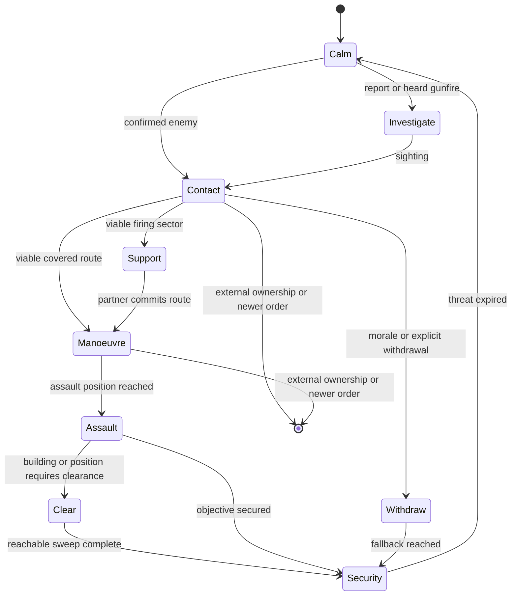

# WAIT Cortex operations

> **Use this page when:** you need to understand or configure WAIT's automatic
> group-level behaviour during contact, movement and recovery.

## Purpose and limits

Cortex is WAIT's optional automatic-tactics layer. It augments native AI only
when an eligible non-player group has a useful combat opportunity. It is not a
replacement for authored mission orders, Zeus commands or another controller
that has claimed the same actors.

CBA is required and provides the configuration authority. ZEN is optional; native
Zeus orders work without it. Configure behaviour from **Options > Addon Options
> Waldos AI Tweaks**, under **General**, **Infantry**, **Coordination**,
**Vehicles**, **Convoys**, **Aircraft**, and **Support and civilians**.

The CBA master setting **Enable Cortex automatic tactics** is on by default.
Each family also has its own gate. A setting marked **Live** is adopted by the
next owner-local update; a setting marked **Next operation** is guaranteed for
a new action without discarding a committed action halfway through.

## Ownership and interruption

One controller owns movement at a time. WAIT creates a finite operation only
when it can own the affected action. The operation records an intent,
generation, owner locality, participants, route, physical progress and a
cancellation reason.

WAIT immediately releases a conflicting operation when any of these occurs:

- a Zeus edit, move, waypoint, remote-control action or explicit native order;
- player control of the actor;
- a newer mission order;
- locality migration or an external controller marker;
- a lost target, impossible route, casualty collapse or safety failure.

Release removes only movement, postures, speed limits and state previously
owned by that operation. It does not restore an older formation, seat
assignment or waypoint over a newer external decision.

## Contact flow

A bounded owner-local engine danger FSM records immediate observations and
wakes the group's single shared decision job. A valid first event can start that
brain immediately instead of waiting for the periodic discovery sweep. The FSM
terminates after draining its short engine queue and does not add a per-unit
permanent movement loop or movement owner.

## Infantry actions

| Action | Expected behaviour | Completion or release |
| --- | --- | --- |
| Investigate | A suitable element checks an approximate reported or heard location while the group retains security. | Sighting, arrival, time limit, new order or loss of route. |
| Advance | Where numbers permit, a moving element makes short covered bounds while a partner covers. Fire remains native and may continue while moving. | Objective progress, contact change, no-progress recovery exhausted or handover. |
| Flank | Selects a distinct left/right corridor that progresses on the threat without crossing a friendly firing lane. | Side approach reached, target change, unsafe route or handover. |
| Assault | A manoeuvre element continues forward from its assault position while support holds only while its firing sector remains safe. A fresh known threat already too close for advance or flank enters this paired-element operation directly. | Position secured, target lost, casualty collapse, blocked route or handover. |
| Withdraw | A broken element selects a screened route away from the threat. Smoke is optional and never blocks movement. | Physical fallback, bounded incomplete result, newer order or handover. |
| Regroup | Separated survivors close only when they remain unreserved and the tactical situation allows it. | Cohesion, time limit, contact or handover. |

A grenade, smoke throw, straggler or individual recovery cannot freeze the rest
of an operation. WAIT makes one local recovery attempt for a stalled actor;
then marks that actor unavailable and lets the capable element continue. It
never teleports, repairs, unflips or grants immunity as a recovery shortcut.

## Coordination and combined arms

Nearby friendly groups coordinate only when they share compatible intent,
threat knowledge and communication eligibility. The coordinator assigns
short-lived support and manoeuvre roles, offset rally areas and distinct
approach corridors. It rejects routes that cross a partner's firing lane.

A support opportunity adds to ordinary combat; it does not require a scheduled
assembly or override a valid authored order. Roles expire after no physical
progress, target change, casualty collapse, lost communication or external
handover. Vehicles and aircraft can support the same opportunity only when
their own capability and ownership checks pass.

## Buildings

Cortex building actions use a finite physical progression:

1. enumerate entrances, exits and reachable interior positions;
2. choose an entry with a viable approach and safe support sectors;
3. assign a limited entry element, interior lanes and exterior security;
4. record a room only after physical arrival in its position radius and floor;
5. retry a blocked position through another entrance, route or actor;
6. report exhausted positions as unreachable and finish `INCOMPLETE`, never as
   fabricated success.

**Clear** sweeps reachable interior positions then establishes security.
**Garrison** occupies defensible interior positions with exterior security.
**Traverse** enters through one viable side and leaves through an actual exit
on the onward side. Casualties and stalls can rotate capable reserve actors into
the entry element without forcing a group merge.

## Vehicles and convoys

General driving assistance is separate from registered convoy control. General
driving retains native waypoints and applies sparse speed/terrain observation
plus one bounded physical recovery. Convoys add an ordered vehicle column,
predecessor-trail spacing and contact/passenger policy.

Driving assistance requires a real authored waypoint. The implicit spawn waypoint does not admit it.
The recovery identity includes waypoint conditions, timeouts, synchronized triggers, speed, combat
mode and formation. A same-index edit resets recovery observation before another attempt. Every
speed or recovery write rechecks that the waypoint identity is still current. An initial refusal
clears an unapplied speed snapshot. This source guard has no fresh physical acceptance. Retests must
include condition/trigger edits during reverse recovery and a valid new route after the change.

Only the vehicle currently carrying the group leader may refresh or reverse the shared native
route. Other group vehicles retain native formation movement and can still receive terrain speed
caps. Losing the leader role resets an existing recovery stage and its observation timer before
any reverse-speed cap is selected. Each command also checks current vehicle/group locality and the
actual driver/commander seat identities. This does not cancel an already-issued native movement
command by issuing a competing stop. Physical tests must cover formation waits, leader replacement
while recovering, seat changes during observation and subsequent valid leader recovery.

Ordinary driving now has a route-scoped owner-local operation FSM. Group decisions admit or
reuse it; the existing shared scheduler executes its cruise, deliberate-wait and recovery samples.
Epoch, current-brain identity and the authored route receipt fence callbacks. A newer route retires
old speed leases before fresh admission. Group release, disablement, Zeus/external takeover,
locality loss or loss of eligible vehicles ends the operation. Exhausted recovery retains a terminal
receipt for that exact order so discovery cannot restart the same attempts. A changed order or an
explicit group handback can admit fresh work.

A stationary native-ready vehicle within the completion radius plus 50 metres is treated
conservatively as waiting when its waypoint is HOLD, has an inactive synchronized trigger, a
positive timeout or a nontrivial condition. The condition is read as text and never executed by
WAIT. The guard resets recovery observation while waiting; native waypoint processing still decides
when movement resumes. This envelope is a recovery guard, not proof of arrival, condition truth or
successful navigation. Terrain speed assistance remains separate from route recovery.

No new settings, dependencies or vehicle polling loops are added. The FSM queues one coalesced
sample every four seconds and yields to the existing tactical pause. It reports its semantic state
in `WAIT_Driving_State`; this is observation, not physical acceptance. Predictive traffic, gate
execution, yielding and overtaking remain open work. Required physical retests include trigger,
condition and timeout waits near and far from the waypoint; same-order exhaustion; newer orders;
repeat use; disabled/re-enabled control; and owner migration. Audits are held, so these are unrun.

Ordinary recovery and tracked withdrawal now share a fresh rear-clearance observer. It samples
three positions across the real hull width at two body-relative heights, from the rear body edge.
Nearby actor footprints are projected into that corridor, so a long or angled vehicle can block a
reverse even when its centre sits outside it. More than 64 nearby actors refuses clearance rather
than dropping unexamined candidates. Each call returns the clearance reason, observation time and
ray count; it issues no movement or physics commands and retains no reusable clearance cache.

Ordinary recovery checks its eight-metre leg before the native command. Tracked withdrawal checks
its speed-dependent rear distance at each existing reverse step. The ordinary terrain/water guard
and tracked avenue/facing/deadline gates remain. Six sampled rays are not a complete navigation or
collision guarantee; native movement remains responsible for steering. No new settings or loops
are added. Physical wide-hull, angled-truck, pedestrian, wreck, low barrier, pitch/slope and dense
traffic cases remain unrun while audits are held. Convoy traffic prediction is separate open work.

Finite tactical movement acquisition now retires the ordinary driving FSM and its unchanged
speed leases before publishing the successor owner. Ordinary admission, queued execution and each
command reject an unexpired movement lease or a current tracked reverse. Late cleanup preserves
the successor's speed policy. Expired leases do not permanently exclude ordinary driving. This
handover has no new controls; withdrawal/standoff/jink/orientation and post-expiry resumption need
physical testing, including an acquisition while an ordinary callback is pending.

Convoys measure forward predecessor gaps to remain single-file; they do not use
formation wedge offsets. Target spacing uses a size-aware minimum/maximum band
with damped speed correction. A meaningful stop is classified as ordered,
contact, spacing, obstruction, immobile or external owner and is reported once
to Zeus. Player-made roadblocks remain valid stops.

Operating crews stay aboard. Cargo dismounts and remounts only while their
convoy task generation still owns them; a newer Zeus task wins immediately.

## Diagnostics

The diagnostic view exposes the active intent, owner, generation, phase,
participants, route, physical-progress age, recovery state, external owner,
scheduler latency, skipped work, replans and final cancellation reason. Use it
to diagnose a real action before changing a setting.

Static validation confirms interfaces, bounded contracts and configuration
parity. It does not prove pathfinding, combat, building entry, convoy recovery
or air combat. Those require the packaged, damage-enabled audit batches.

## Related documentation

- [Settings reference](SETTINGS-REFERENCE.md)
- [Capability registry](CAPABILITY-REGISTRY.md)
- [Addon lifecycle](ADDON-LIFECYCLE.md)
- [Modding and operations](MODDING-AND-OPERATIONS.md)

<!-- WAIT-WIKI-NAV -->
---
[Wiki home](https://github.com/AdamWaldie/WaldosAITweaks/wiki/Home) · [Installation and setup](../README.md) · [Capability registry](CAPABILITY-REGISTRY.md)

### Passenger remount cooperation

With `WAIT_AIPass_Vehicles_Enable` and `WAIT_AIPass_VehicleRemount_Enable` enabled,
calm restoration retains an owned passenger boarding episode for up to 60 seconds.
Only passengers dismounted by WAIT are eligible. A new assigned vehicle, Zeus control,
contact or a conflicting operation retires or suspends the old intent rather than
sending passengers back to their original transport.

The passenger group owner requests a stop from the original vehicle owner while an
eligible passenger remains within 100 metres. Each request lasts at most 30 seconds
and never exceeds the boarding deadline. The vehicle owner checks the public boarding
record, group ownership, side, original vehicle, live settings and current assignment.
It considers at most eight passenger records. Crew contact or an active vehicle movement
lease rejects a boarding stop. Actual boarding uses native assignment and get-in orders;
no passenger is moved directly into a seat.

A completed boarding, reassignment or expired request releases the stop. WAIT restores
the prior forced speed only when the current forced speed still equals its own stop.
This uses existing group scheduler callbacks and adds no persistent worker. The record
is public for owner migration; a new owner validates live eligibility before commanding.
Stationary separate-group boarding and replacement-vehicle boarding have physical audit
evidence. Moving-vehicle boarding, interruption and migration of this handshake remain
queued for physical acceptance.

### Interior access recovery priority

A stalled interior access checkpoint uses its existing finite recovery before the controller searches alternate exterior entrances. This prevents entrance cycling from retaining the failed checkpoint while repeatedly resetting its local retry clock. Recovery can retire the checkpoint once and request the assigned room directly. Room retry counts, physical visit requirements, operation ownership and the hard deadline remain intact. No new settings or dependencies are introduced. Static gates passed for this change; fresh packaged normal and headless-client physical acceptance remains outstanding.

A failed partner alternative selection can be reconsidered when another actor physically visits an additional point. The public episode receipt retains the search count and coverage across ownership replay. Each partner receives at most three searches over at most 24 visited points per search, and one successful movement alternative. Unchanged coverage cannot trigger another search. This does not renew progress deadlines or recovery budgets. Fresh physical validation remains required.

### Exterior exit observation

Spare clearance participants receive a finite exit-approach observation assignment. The selector considers at most sixteen real exits and prefers exits with fewer current reserve assignments, then nearer exits. It validates exterior standing space, separation from other actors and destinations, entrance clearance, slope, dry ground and an unobstructed observation line. A supported exposed point is permitted when protective cover is unavailable, and that distinction is retained in the stage receipt. Each actor physically reaches its position before a single watch command is issued. Movement retains existing three-search and sixty-second approach limits, operation authority, native-task yielding and casualty promotion. The published stage journal retains the observation point and selected exit across replay. No new setting is introduced. This provides local exit observation only; complete isolation, changing sectors and larger supporting-squad coordination remain outstanding. Fresh normal/headless physical and runtime-performance validation is required. Audit launches remain paused at the user's request.

The twelve-person clearance audit now independently checks every living exterior participant for stage arrival, actual heading within 75 degrees of its watch point and an unobstructed eye-to-watch line during the original observation window. A rejected hold or assignment receipt cannot pass. These checks are prepared but have not run while audits are paused.

### Driving release and commander takeover

Standalone driving release now checks player, remote-control and specialist ownership of the effective commander as well as the driver. An old WAIT forced-speed lease is discarded without restoring its captured cap when the commander has taken over, including a commander outside the driver's group. Waypoints, native routes and newer speed settings remain unchanged. This closes a source-level cleanup gap. Physical takeover and locality validation remain pending while audits are paused.

When an exterior observer replaces an unavailable clearing worker, promotion retires its matching clearance-generation/owner-epoch exit watch before interior movement. Native tasks and newer authority still gate the command. The historical stage receipt remains diagnostic and no longer reserves a destination once the actor joins the clearing team. Physical casualty-promotion acceptance remains pending.

Locality replay accepts both legacy and extended exterior-stage records. An approaching actor must retain its exact native endpoint; a stopped actor must physically remain at its stage. Exit watching installs once per local owner epoch after physical and authority checks, without a new movement request. Promotion clears that local installation record. Separate headless physical replay remains unvalidated.

### Unconfirmed support reservation

A PENDING/UNCERTAIN shot retains its original mission deadline. At expiry, the scheduling brain ends with UNCERTAINTY_PARKED while the unresolved native-command registry/token remains reserved. No shot is retried and the battery is not declared available. A qualified firing event or owner rejection wakes the exact mission for finite settlement only. A repeat-safe server EntityDeleted handler removes the matching deleted battery record without scanning other missions, and subsystem stop removes the handler. This changes no support settings. Delayed event, deletion, repeated callback and normal/headless physical acceptance remain required; audits are paused. Native-command cancellation is not claimed.

Observer artillery requests preserve the dispatch result: a synchronous server rejection takes the short retry cooldown. A headless owner can confirm forwarding only, not server acceptance or physical firing. This correction still requires live rejection/retry validation.

Clearance cancellation retires the matching exterior observation generation and owner epoch. It clears watching only for a free stopped actor under unchanged WAIT authority; replacement tasks and external control receive no watch command. Live cancellation and handover validation remains pending.

Automatic clearance settlement also retires matching exterior watch metadata, including incomplete outcomes. Historical arrival records remain evidence rather than live assignments; newer generation/epoch watch records survive. Physical repeated-use validation is pending.

Mounted danger responses apply the same captive, surrender and handcuff exclusions as sustained vehicle targeting before requesting targeted suppression, orientation or mortar support. Targetless impact safety remains separate. Physical surrender-transition validation is pending.

Mounted danger suppression aims at the effective commander's native believed contact position rather than reading the enemy's exact aim position after lost sight. Missing estimates reject suppression; existing ownership, protected-target and friendly-fire gates remain. Physical occluded-contact validation is pending.

Fixed-wing ingress pass detection uses ASL displacement with world velocity, preserving a shared vertical origin across terrain cells. This corrects the forward/behind geometry test; physical terrain approach validation remains pending.

Combined-arms reservation expiry preserves a matching terminal manoeuvre/refusal result instead of replacing it with EXPIRED. Active dispatched/applied roles still expire and release their role records. Physical result persistence remains pending.

Combined-arms discovery deduplicates candidate groups through a request-local keyed set while preserving discovery order and dispatch-time admission checks. It removes repeated linear membership scans; total discovery/ranking work still needs budgeting and measured runtime acceptance.

Combined-arms ranking retains the asset found during discovery and uses a unique rank tie-breaker. Dispatch rechecks live asset and commander/driver group ownership instead of repeating the full crew scan. Invalidated assets are refused; candidate population and runtime budget remain unvalidated.

Combined-arms primary server and owner admission both reject captive, surrendering and handcuffed targets before reservation or action. Air fallback expiry preserves matching terminal results while active dispatch/application still expires. Live target-state transition and fallback-result validation remain pending.

CQB casualty replacement selects the nearest currently eligible reserve to the surviving buddy, or to the building when no buddy is available. It preserves original survivor movement, participation evidence and finite deadlines; selection adds no geometry probes. Physical reinforcement flow remains pending.

Garrison arrival and failed-route termination restore the previous approach speed only while WAIT's applied cap remains unchanged and movement authority is retained. Failed destinations no longer retain the approach cap; newer forced-speed values survive. Physical inaccessible-position handback remains pending.

Clearance exterior geometry uses the shared read-only BuildingExteriorCandidate helper. It preserves footprint, exit clearance, standing support, observation and separation thresholds. Operation-owned selection, retries, movement, arrival and watch leases remain separate. Garrison surplus integration and physical validation are pending.

Combined-arms primary server admission, owner application and air fallback reject work while the local Smart AI Pass is inactive or paused. Delayed contact delivery cannot reserve or dispatch new support during pause/stop. Physical pause-transition validation is pending.

Reinforcement discovery and coordinated-assault server admission require the pass to be running as well as enabled and unpaused. Delayed messages after stop cannot create or extend support reservations. Cleanup and acknowledgement handlers remain available to retire existing work. Live stop-transition validation is pending.

Clearance admission orders intact eligible buddy pairs before roster remainder, then applies the existing concurrency capacity. This read-only selection publishes no new pair receipt on refusal. Odd capacity can still leave a singleton; the eight-worker limit remains. Physical pair-continuity validation is pending.

Live air-contact intercept refresh uses a combat-effective local native knower's believed position and successive-sample motion instead of exact unseen target position/velocity. Witness changes reset motion; correction jumps are bounded. Missing estimates end the finite run honestly. Initial plan selection and full sensor/radar freshness remain separate outstanding work; physical crossing/lost-contact validation is pending.

Initial air-contact plan geometry and altitude use a local native knower's believed position. Initial motion is zero until live refresh has successive samples; no exact unseen velocity supplies the startup lead. Missing estimates refuse the plan. Surface plan perception and complete sensor freshness remain outstanding; physical interception is unvalidated.

## Settings and behaviour modules

CBA owns addon settings, feature switches and tuning. Zeus/ZEN modules issue scoped behaviour
orders to explicitly selected groups and destinations or areas. Dialog parameters describe the
requested task, such as its destination or radius; they do not duplicate CBA configuration.
The ordinary-driving enable/release/inspect modules were withdrawn because they crossed this
boundary. Ordinary driving remains automatic under the existing CBA gates and native waypoint
orders. The convoy module remains a convoy task entry point. Future building, support and optional
navigation-corridor modules must use their real production task executor and retain owner authority,
interruption and cleanup. No replacement behaviour module is claimed complete here.
